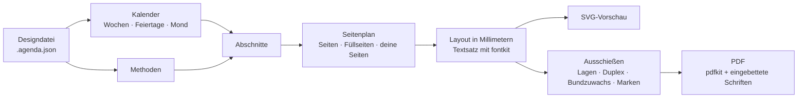

<div align="center">

# Heritage Studio

**Gestalte, prüfe und drucke handgemachte Planer: für jedes Jahr, jede Sprache und jedes Land,
in Lagen gefalzt und von Hand genäht.**

[](README.md)
[](README.es.md)
[](README.pt.md)
[](README.it.md)
[](README.de.md)
[](README.fr.md)


</div>

**Online ausprobieren:** [jonidimo.github.io/agenda-heritage-generator](https://jonidimo.github.io/agenda-heritage-generator/) (immer die neueste Version, ohne Installation).

Heritage Studio begann als ein einzelner handgemachter Planer für 2026. Heute ist es eine App,
die das ganze Buch für jedes beliebige Jahr erstellt: Kalender, Feiertage, Habit-Tracker und
Planungsseiten auf Grundlage der Verhaltenswissenschaft. Sie ordnet die Seiten auf Bögen an,
die für einen Duplexdrucker bereit sind, sodass du sie falzen, nähen und binden kannst.

Sie läuft vollständig in deinem Browser, auch offline, unter Linux, Windows, macOS und Android,
und als Desktop-App für Windows, macOS und Linux. Nichts wird irgendwohin hochgeladen.


## Herunterladen

**[Lade die neueste Version herunter](https://github.com/jonidimo/agenda-heritage-generator/releases/latest)** und wähle unter
*Assets* die Datei für dein System:

| System | Datei |
| --- | --- |
| Windows 10 und 11 | `…-win-x64-setup.exe` (Installationsprogramm) oder `…-win-x64-portable.exe` (ohne Installation) |
| macOS 13 oder neuer | `…-mac-arm64.dmg` (Apple Silicon) oder `…-mac-x64.dmg` (Intel) |
| Linux | `…-linux-x86_64.AppImage` (jede Distribution) oder `…-linux-amd64.deb` (Debian, Ubuntu, Mint) |

Die Installationsprogramme sind nicht mit einem kostenpflichtigen Zertifikat signiert, daher
warnen Windows und macOS dich beim ersten Öffnen. Die [Anleitung zur Desktop-App](docs/desktop.md)
(auf Englisch) zeigt, wie du sie öffnest, wo deine Planer gespeichert werden und wie du die App
selbst baust. Wenn du sie lieber im Browser nutzen willst, siehe [Lokal ausführen](#lokal-ausführen).

## Funktionen

### Sieh alles genau so, wie es gedruckt wird

- Vier Ansichten, die sich beim Bearbeiten aktualisieren: **Seite**, **Doppelseite**,
  **gedruckter Bogen** (so, wie er aus dem Drucker kommt, Vorder- und Rückseite) und das
  **ganze Buch**.
- Die Vorschau zeichnet dieselben Glyphenumrisse, die auch ins PDF gehen, und hängt daher
  nicht von den auf deinem Computer installierten Schriften ab.
- Der **Preflight** findet Text, der nicht passt, überlappende Texte, alles, was über die
  Seite hinausragt oder im nicht bedruckbaren Rand des Druckers liegt, fehlende Zeichen in
  einer Schrift und Bilder mit zu geringer Auflösung.
- **Modi Entwurf und Druck**: *Entwurf* ist für Seite, Doppelseite und ganzes Buch gedacht; *Druck* fügt die Ansicht des gedruckten Bogens und das Druckpanel hinzu und zeichnet auf jeder Seite den Bereich, den der Drucker nicht bedruckt, sowie den Bindungsrand ein.
- **Verwendungszweck**: Ein Planer, der **am Bildschirm gelesen** werden soll, verzichtet auf Bindungsrand, Beschnitt, Marken und Füllseiten der Lagen; seine Seiten behalten ihre Größe, und er wird Seite für Seite mit Links exportiert. Du kannst jederzeit zurück zu *Drucken und binden* wechseln.

### Mit der Maus bearbeiten

- Ziehe, verschiebe in kleinen Schritten, skaliere, drehe, mache transparent oder blende
  jedes Element aus. Wende die Änderung auf jede Seite dieses Typs an, auf linken Seiten gespiegelt,
  oder nur auf eine Seite. Einrasten, Randhilfslinien, Rückgängig und Wiederholen.
- **Wasserzeichen pro Person**: der Kolibri, ein Symbol oder dein eigenes SVG oder PNG, am
  äußeren oder inneren Rand verankert, mit Größe und Deckkraft; auf jeder Seite oder nur auf
  rechten oder linken Seiten, mit dem Papier verschmolzen (*Multiplizieren* lässt den weißen
  Hintergrund eines Logos verschwinden), in Grau oder eingefärbt, und mit Position und Bild
  auf linken Seiten getrennt gespiegelt.
- **Eigene Seiten an beliebiger Stelle**: ein Bild, ein Vektor-SVG oder eine Seite aus einem
  PDF (im fertigen PDF als Vektoren erhalten) oder eine Seite mit Linien, Punkten oder
  Kästchen. Der Rest des Buchs ordnet sich um sie herum neu an.
- Eigene Texte, Bilder, Linien und Rahmen auf jedem Seitentyp.
- Ändere die Größe deiner Elemente an jeder Kante oder Ecke; halte Umschalt gedrückt, um die
  Proportionen beizubehalten.
- **Auch die Elemente des Planers selbst** (ein Monatsname, ein Rahmen, eine Tabelle, ein
  Schreibbereich) lassen sich an jeder Kante oder Ecke in der Größe ändern: Ihr Inhalt wird
  im neuen Kasten neu angeordnet statt gestreckt, und das Panel hat Felder für Breite und Höhe.
- **Doppelklicke auf einen beliebigen Text**, um ihn direkt an Ort und Stelle zu bearbeiten:
  deine eigenen oder die des Planers (Name und Titel auf dem Umschlag, Widmung, der Spruch
  jedes Monats, Seitentitel). Enter oder Strg+Enter bestätigt, Esc verwirft, und die Seite
  wird beim Tippen neu gezeichnet. Ein Textelement kann seinen Zeilen folgen (automatische
  Höhe).
- **Stil pro Element**: gestrichelte, gepunktete oder doppelte Linien, Farbe und Stärke jeder
  Linienart, Füll- und Textfarbe, für ein Element auf jeder Seite seines Typs oder nur auf
  einer Seite.
- **Kopiere, schneide aus, füge ein und dupliziere** deine Elemente (Strg+C, X, V und D)
  innerhalb einer Seite oder zwischen Seiten.
- Das Ziehen eines Schiebereglers oder Farbwählers läuft flüssig: Die Seite folgt live, die
  Miniaturansichten warten, und der ganze Ziehvorgang ist ein einziger Rückgängig-Schritt.
- Ein Bildelement nimmt jedes Bild auf: Wähle eins aus dem Planer oder lade ein PNG, JPG
  oder SVG hoch.
- Jedes Textelement kann eine eigene Schrift und Farbe haben oder seinem Texttyp folgen.
- **Zoome** die Seite mit Strg und + / − / 0 oder mit Strg und dem Mausrad (oder mit zwei
  Fingern auf dem Touchpad): Der Punkt unter dem Mauszeiger bleibt, wo er ist. **Einstellungen →
  Größe der Oberfläche** (ein Schieberegler mit Zahl) skaliert die gesamte Oberfläche, und die Seitenpanels und die
  Seitenleiste lassen sich durch Ziehen ihrer Ränder in der Größe ändern; die App merkt sich beides.
- **Rechtsklick** (oder langes Drücken auf dem Smartphone) auf ein Element, eine Seite oder
  eine Miniaturansicht zeigt seine Optionen: das Wasserzeichenbild ändern, etwas auf einer
  Seite oder auf allen Seiten dieses Typs ausblenden, ähnliche Elemente auswählen, Text oder
  Bilder dort hinzufügen, wo du geklickt hast.
- **Wähle mehrere Elemente aus** mit Strg oder Umschalt oder indem du von einer leeren Stelle
  aus einen Rahmen aufziehst. Verschiebe sie gemeinsam, richte sie aus, verteile sie mit
  gleichen Abständen oder ordne sie in einem Raster an, das ihre Zeilen und Spalten erkennt.
- **Linien, Punkte oder Kästchen pro Seitentyp oder pro Seite**: Zeilenabstand, horizontaler
  und vertikaler Punktabstand, Punktgröße und Linienstärke.
- **Skalieren und verformen**: Jedes Element hat acht Anfasser, die seinen Inhalt im neuen Kasten neu anordnen; die Skalierung ist ein eigener Schieberegler, und **Verformen erlauben** streckt die Zeichnung stattdessen in jede Richtung.
- **Kopiere die Elemente des Planers selbst** (Strg+C auf einem Monatsnamen, einem Rahmen, einer Tabelle …) und füge ein eigenes, bearbeitbares Element ein: Text bleibt bearbeitbarer Text; der Rest wird zu einer Zeichnung, die ihre Linienstärken behält.
- **Zehn weitere Elementarten**: Tabelle, Checkliste, Habit-Tracker, Finanzzeilen, Minikalender (seine Tage verlinken auf ihre Seiten), Quadranten, Notizen, Tagesplan, Bewertung und **QR-Code** (jede Webadresse, E-Mail, Telefonnummer oder jeder Text; im PDF antippbar), jede mit eigenen Feldern.
- **Symbole und Formen**: eine Bibliothek mit 96 Symbolen (Lucide), in jeder Sprache durchsuchbar und in jeder Farbe einfärbbar, und fünfzehn Formen: Rechteck, Ellipse, Linie mit Pfeilen oder Punkten, Pfeil, Dreieck, Raute, Polygon (3 bis 24 Seiten), Stern (3 bis 24 Zacken), Herz, Ring, Bogen oder Kreissektor, Sprechblase, Banner, Kreuz und ein freier SVG-Pfad. Die Kontur bleibt innerhalb des Kastens, und es werden nur die Einstellungen der jeweiligen Form angezeigt.
- **Ein Bild auf jedem Monatsdeckblatt** statt des Stickers, für einen Monat oder für alle.
- **Ebenen**: Ein Panel listet die Elemente der Seite von oben nach unten auf; nach oben, nach unten, ganz nach hinten, umbenennen, ausblenden und mit dem Darunterliegenden verschmelzen (Multiplizieren, Negativ multiplizieren, Abdunkeln, Aufhellen). Strg+↑ und Strg+↓ verschieben das gewählte Element.
- **Ebenenmenü und Sperren**: Rechtsklick auf eine Zeile in Ebenen zum Duplizieren, Sperren oder Entsperren, Umbenennen, In den Vordergrund, In den Hintergrund oder Löschen. Ein gesperrtes Element lässt sich auswählen, aber nicht ziehen, skalieren, mit den Pfeilen verschieben oder löschen (Strg+Umschalt+Alt+L). Unter der Liste Deckkraft, Füllmethode und Sperre des gewählten Elements.
- **Formen**: Füllung als Farbfeld mit einer Schaltfläche *Keine Füllung*, Deckkraft von 5 bis 100 %, und jedes eigene Element dreht sich von 0 bis 360°.
- **Ressourcen / Vektoren**: Jedes Bild, SVG oder Symbol mit einem Klick auf die Seite legen oder als **Stempel- und Strichpinsel** nutzen: ein Klick setzt eine Kopie; Ziehen setzt Kopien entlang des Strichs (Größe, Abstand, gerade / folgt dem Strich / zufällig, Variation, Farbe). Jeder Strich ist ein Element und ein Rückgängig-Schritt.
- **Vollbild (F11)**: nur die Seite, ohne Seitenleisten, Miniaturleiste und Fußzeile; F11 oder Esc bringen sie wie zuvor zurück.
- **Ziehen zum Verschieben**: Mit der mittleren Maustaste oder mit gedrückter Leertaste und der Haupttaste folgt die Arbeitsfläche dem Zeiger, ohne nach den Bildlaufleisten zu suchen.
- **Aufgeräumte Menüs**: Datei (der Planer und seine Dateien, mit *Meine Planer*), Bearbeiten, Ansicht, Einstellungen (Sprache der Oberfläche, jede in ihrer eigenen Sprache; Größe der Oberfläche; Vorlieben; KI-Assistent) und Hilfe (Tastenkürzel, Leitfaden für KI-Modelle, Problem melden, Über). *Neuer Planer* passt in jedes Fenster: zwei Spalten, und *Planer erstellen* ist immer sichtbar.
- **Ausgeblendete Elemente gehen nie verloren**: Bearbeiten → *Ausgeblendete Elemente anzeigen* listet sie auf und holt jedes einzeln zurück. **Auf die Auswahl zoomen** mit Strg+Umschalt+2; die Fußzeile zählt die Warnungen der aktuellen Seite, und Miniaturansichten zeigen einen Punkt.
- **Tastenkürzel** für alles, in der App aufgelistet (F1) und neben jedem Menüeintrag.

### Abschnitte und Seitenvorlagen

- **Bei null anfangen**: Die Vorlage *Leer* hat überhaupt keine Seiten und zeigt, was du
  zuerst tun kannst; die Vorlage *Notizbuch* besteht aus einer Titelseite und so vielen
  gepunkteten, linierten, karierten oder leeren Seiten, wie du willst, ohne Kalender. Füge
  beliebige Abschnitte hinzu (auch mehrere Notizabschnitte), füge jedem Monat Seiten hinzu
  oder entferne einen Abschnitt über sein Menü.

- Klicke im Panel **Abschnitte** auf einen Abschnitt, um zu seiner Seite zu springen. Mit
  einem Rechtsklick verschiebst du ihn, schaltest ihn aus oder änderst, wie oft er sich wiederholt.
- Jeder Abschnitt kann einmal vorkommen oder sich **jeden Monat, jede Woche oder jeden Tag
  wiederholen**.
- **Seitenvorlagen**: Gestalte eine Seite einmal (ein Hintergrund aus Linien, Punkten oder
  Kästchen, Texte, Bilder, Rahmen) und wiederhole sie, wo du willst. Texte wie `{date}`,
  `{weekday}` oder `{month}` ändern sich auf jeder Kopie.
- **Rechtsklicke auf einen Monat** in der Seitenleiste, um zu seinem Deckblatt, seiner Monatsübersicht oder seiner ersten Woche zu springen, eine Seite für jeden Monat zu wiederholen, den Monat auszublenden, nur diesen Monat als PDF zu exportieren oder nur diesen Monat in der Leiste anzuzeigen. Ausgeblendete Monate verlassen das Buch; der Jahreskalender behält sie, ohne Links. Eine **Jahr**-Marke springt zur Jahresübersicht, und die Leiste scrollt mit dem Mausrad.

### Alles finden

- Die **obere Leiste** hat drei Bereiche (Datei und Verlauf, Modus und Ansicht, Suche und
  Zoom) und klappt in schmalen Fenstern alles, was nicht passt, in ein „⋯“-Menü ein.
- Die **Suche** (Strg+K, `/` oder das Suchfeld in der oberen Leiste) findet Einstellungen, Abschnitte, Seiten und Elemente,
  auch mit Tippfehlern, ohne Akzente oder in beliebiger Groß- und Kleinschreibung, und
  bringt dich mit einer Hervorhebung dorthin.
- Die Schaltflächen **Zurück und Vorwärts** in der oberen Leiste gehen durch die Seiten, die
  du besucht hast, wie in einem Browser.

### Jedes Jahr, jede Sprache, jedes Land

- Gedruckter Text auf Spanisch, Englisch, Portugiesisch, Italienisch, Deutsch und
  Französisch; die Oberfläche spricht dieselben sechs Sprachen und folgt der Sprache, die
  beim Anlegen des Planers gewählt wurde.
- Das Land bestimmt die regionalen Konventionen (Datumsreihenfolge, Währung, erster Tag der
  Woche) anhand der im Browser eingebauten Unicode-CLDR-Daten, sodass Englisch in Argentinien
  als Tag/Monat geschrieben wird. Datumsreihenfolge und erster Wochentag lassen sich auch von
  Hand einstellen; Daten werden immer im Format ISO 8601 gespeichert.
- Gesetzliche Feiertage für **207 Länder** und ihre Regionen, von 2016 bis 2061. Füge
  Brückentage hinzu, entferne Feiertage oder gib einem mit dem Stift unter *Kalender →
  Feiertage* einen anderen Namen (zum Beispiel einen kürzeren, wenn er nicht ins Feld passt).
- Geburtstage und wichtige Termine, Mondphasen sowie Tagundnachtgleichen und Sonnenwenden,
  berechnet für deine Zeitzone und Hemisphäre.
- ISO-Kalenderwochen, Wochen, die am Montag, Sonntag oder Samstag beginnen, 1 bis 24 Monate,
  ab jedem beliebigen Monat.

### Für Papier gemacht

- 6 Themes (Heritage, Klar, Klassisch, Minimal, Notizbuch, Filigran) und 4 Vorlagen. Ein
  Theme legt alles auf einmal fest: Schrift und Farbe jeder Textart und den Stil von
  Schreiblinien, Trennern, Tabellen und Rahmen.
- **Linien und Zierelemente**: durchgezogene, gestrichelte, gepunktete oder doppelte Linien,
  Ornamente, die entlang einer Linie wiederholt oder in ihre Mitte gesetzt werden, und Ecken
  für Rahmen. Zehn Ornamente sind eingebaut, und du kannst eigene als SVG oder PNG importieren.
- **Eine Palette aus einer Farbe**: Wähle eine Farbe und eine Harmonie (monochrom, analog,
  komplementär, geteilt komplementär oder triadisch). Die App leitet jede Farbe im
  Farbraum OKLCH ab und hält Text dunkel genug, um auf Papier lesbar zu sein.
- **Eigene Themes**: Speichere den gesamten Stil unter einem Namen, verwende ihn in anderen
  Planern und teile ihn als `.tema.json`-Datei mit den enthaltenen Ornamenten.
- Ändere Schriften, Größen, Linienstärke und Zeilenabstand, Linien, Punkte oder Kästchen,
  die Schattierung der Wochenenden und eine Komfortstufe für ältere Augen. Alles wird live
  aktualisiert.
- 5 mitgelieferte Open-Source-Schriftfamilien, als Teilmengen ins PDF eingebettet. Lade
  eigene TTF-, OTF-, WOFF- oder WOFF2-Schriften hoch; die App prüft, ob sie alle Zeichen
  enthalten, die deine Sprache braucht. Fehlt einer Schrift ein Zeichen (eine Trikotschrift
  ohne Komma oder Klammern), kommt es aus einer Ersatzschrift, am Bildschirm und im PDF, wie
  in einem Browser; Stil weist darauf hin, wenn Satzzeichen fehlen, und wofür die Schrift
  sich eignet.

### Evidenzbasierte Methoden

- **30 Methoden**: Alastair-Woche, Wenn-dann-Pläne, WOOP, Fortschrittsmonitoring, ein
  Habit-Tracker, der erledigte Tage statt Serien zählt, Wochenrückblick, drei gute Dinge,
  Schlaftagebuch, externes Gedächtnis und mehr.
- Jede Methode verändert die Seiten, die sie betrifft, und wird in einem **gedruckten
  Leitfaden** mit ihrem Evidenzgrad (stark, mäßig, begrenzt, Praxis ohne direkte Studien oder
  umstritten) und ihren Quellen erklärt. Siehe [den Evidenzbericht](docs/evidencia-metodos.md)
  (auf Spanisch).
- Füge eigene Methoden über die Oberfläche hinzu, ohne Code.

### Hefte, die gelingen

- **Genähte Lagen** mit der Anzahl Bögen pro Lage, die du wählst (alle gleich, ausgeglichen
  oder eine eigene Liste), eine einzige Lage, Schneiden und Stapeln für Spiral- oder
  Ringbindung oder eine Seite pro Bogen.
- A4 → A5, Legal / Oficio → 177,8 × 215,9 mm (das größte Format, das der HP LaserJet 4350
  druckt), Letter, Folio, Oficio 340, A3, A5 oder benutzerdefiniert.
- Duplex über die kurze oder lange Kante oder manueller Duplex; Korrektur der Rückseite;
  Bundzuwachs; Falz-, Schneide- und Kollationiermarken; Lagennummern.
- Kalibrierungsbogen, Lochschablone für die Nähstationen und ein Umschlag, dessen
  Rückenbreite aus der Anzahl der Bögen berechnet wird.

### Auf dem Tablet oder E-Reader lesen

- Das **Seiten-PDF** enthält antippbare Links wie ein digitaler Planer: Jeder Tag in den
  Kalendern, der Monatsübersicht und der Monatsansicht führt zu seiner Woche (oder seiner
  Tagesseite), jeder Monatsname zu seinem Monat, Titel gehen eine Ebene nach oben (Woche →
  Monat → Jahreskalender → Inhaltsverzeichnis), und das Inhaltsverzeichnis führt zu seinen
  Seiten. In einem Reader, der PDF-Links folgt, etwa einem Onyx Boox oder einem Tablet,
  genügt ein Tippen.
- **Lesezeichen im Reader**: Das seitliche Inhaltsverzeichnis des Readers listet die
  Abschnitte, jeden Monat und seine Wochen auf.
- **Register für jeden Monat** am Rand jeder Seite (optional), die jeweils zu ihrem Monat
  führen.
- Links entstehen aus dem, was gedruckt wird, daher folgen sie jeder Änderung von Jahr,
  Papier oder Abschnitten. Die Link-Schaltfläche in der oberen Leiste zeigt sie auf der Seite
  an, und ein Klick folgt ihnen; das Panel jedes Elements zeigt, wohin es führt, und lässt
  dich seine Links entfernen oder es auf eine andere Seite oder eine Webadresse leiten. Das
  PDF zum Drucken enthält sie nicht.
- Jede antippbare Stelle lässt sich einzeln ändern: Klicke auf der Seite auf eine Tageszahl
  oder einen Monatsnamen oder rechtsklicke darauf, um nur diese eine woandershin zu leiten
  oder sie zu entfernen.

### Deine Dateien und Vorlagen

- **Datei → Speichern** (Strg+S) schreibt eine `.agenda.json`-Datei mit den enthaltenen
  Bildern und Schriften. In Chrome, Edge und der Desktop-App überschreiben die folgenden
  Speichervorgänge dieselbe Datei.
- **Als Vorlage speichern** bewahrt ein ganzes Design auf, um neue Planer daraus zu
  beginnen, für ein anderes Jahr, eine andere Person oder Sprache. Vorlagen lassen sich als
  Dateien exportieren und teilen.
- **Alles sichern** speichert alle Planer und Vorlagen sowie die hochgeladenen Schriften in einer
  Datei; wenn du sie öffnest, werden sie wiederhergestellt. Eine Schrift aus einer geöffneten Datei
  ersetzt nicht die gleichnamige, die dieses Gerät schon hat: Die hiesige bleibt, mit einem Hinweis.
- Planer werden auch im Browser aufbewahrt, aber nur in diesem Browser und unter dieser
  App-Adresse, daher sind Dateien die sichere Kopie.
- Die Panels **Bilder** und **Schriften** zeigen, wo jedes Bild verwendet wird (Wasserzeichen, Umschlag, Elemente, Seiten, Ornamente), und entfernen es zusammen mit allem, was es verwendet hat; bei Schriften siehst du, welche Zeichen fehlen und wo jede Familie verwendet wird, und deine eigenen lassen sich entfernen.
- **Bilder neben der Datei**: Ein Planer kann über einen Pfad auf seine Bilder verweisen
  (`"path": "bilder/logo.png"`), statt sie in sich zu tragen; die Kommandozeile, der
  MCP-Server und die Desktop-App (wenn das System die Datei öffnet oder mit *Datei → Datei öffnen…*)
  lesen sie nur aus diesem Ordner. In der Web-App bietet der Hinweis **Bilderordner suchen …**: Du
  wählst den Ordner, und die Bilder werden in den Planer eingebettet (der Pfad entfällt). Wie bei
  jeder Datei, die das System in der Desktop-App öffnet, fragt das erste *Speichern* einer Sitzung,
  wohin.
- **Schlanke PDFs**: *Drucken → Bilder in der PDF* (300 ppi zum Drucken, 150 für Bildschirme oder
  Originale) verkleinert nur Bilder, die mehr Auflösung haben, als ihre gedruckte Größe braucht, ohne
  sichtbaren Qualitätsverlust; ein Bild auf jeder Seite (ein Wasserzeichen) wird nur einmal in der
  PDF gespeichert. Das Panel *Bilder* zeigt das Gewicht jedes Bildes und seine ppi in der Größe, in
  der es wirklich gedruckt wird; über 600 ppi weist es darauf hin (`overDpi`). Auch beim Hochladen:
  Fotos als WebP/HEIC/AVIF werden zu JPEG (nicht PNG), was über 4000 px an der längsten Seite liegt,
  wird verkleinert, und dieselbe Datei wird nie zweimal gespeichert.
- Desktop-App: Nach dem Export eines PDFs zeigt sie, **wo es gespeichert wurde**, mit *Ordner öffnen*; Planer öffnen sich per Doppelklick auf eine `.agenda.json` oder indem du sie auf das Fenster ziehst, und beim Schließen geht nie die letzte Änderung verloren.
- **Die Blattgröße von Anfang an**: Der Bildschirm für einen neuen Planer zeigt das Papier (oder den Tablet-Bildschirm), die Bindung und die daraus folgende Seitengröße. *Datei/Bearbeiten → Blattgröße…* ändert sie später und kann eigene Elemente in einem Rückgängig-Schritt an die neue Seite anpassen.

### Ein KI-Assistent in der App

- Eine runde Schaltfläche unten rechts (**Strg+J**): Bitte mit deinen eigenen Worten
  um eine Änderung („mach die Notizen auf dieser Seite größer“, „jeden Monat einen
  Habit-Tracker“). Der Assistent liest den Planer, schlägt **eine** Änderung vor, und du
  siehst sie auf der Seite, bevor du sie **übernimmst** oder **verwirfst**; eine übernommene
  Änderung ist ein einziger Rückgängig-Schritt. Sobald du ihn schließt, bleibt nichts gespeichert.
- Funktioniert mit **Anthropic (Claude), Google Gemini, OpenAI und kompatiblen Diensten**
  (OpenRouter, Groq, Mistral) sowie **lokalen Modellen** (Ollama, LM Studio), mit deinem
  eigenen Schlüssel. Auf Wunsch kann er sich auch die Seiten ansehen (Vision).
- Dein Schlüssel wird nie im Klartext gespeichert: In der Desktop-App verschlüsselt ihn das
  Betriebssystem (Schlüsselbund, DPAPI, libsecret), und Anfragen laufen über die App; auf der
  Website bleibt er im Arbeitsspeicher oder verschlüsselt im Browser, wenn du ihn dir merken
  lässt. Einstellungen unter *Einstellungen → KI-Assistent…* oder über das Zahnrad an der Pille.
- **Version 2.4.1**: Der Assistent sitzt als runde Schaltfläche unten rechts. Bei einem lokalen Server wird die Modellliste selbst geholt (eine Auswahlliste, kein filterndes Feld), und eine Adresse ohne `/v1` wird korrigiert angeboten. Wer etwas anderes verlangt, während ein Vorschlag sichtbar ist, **verfeinert** ihn (der nächste Vorschlag kommt hinzu, Übernehmen bestätigt alles in einem Schritt), und die Karte zeigt jede Änderung mit altem und neuem Wert.
- **Version 2.5.0**: Das Modell hat 10 Schritte pro Anfrage und wird vor dem letzten gebeten, mit dem Vorhandenen etwas vorzuschlagen; es weiß, dass eine andere Sprache des Planers alles in einem Vorgang übersetzt. Die Adresse `http://0.0.0.0:8080`, die llama.cpp anzeigt, funktioniert so, wie sie ist. Lädt ein Teil des Programms nicht (weil es bei geöffnetem Fenster aktualisiert wurde), erklärt die Karte das und bietet an, das Fenster neu zu laden, ohne Arbeit zu verlieren.

### Mit einem KI-Modell gestalten

- Ein **MCP-Server** lässt Claude oder jedes Modell, das MCP spricht, einen Planer erstellen,
  ändern, prüfen, sich seine Seiten ansehen und das PDF oder ein Theme exportieren. Die
  Desktop-App enthält ihn: Starte ihn mit `--mcp` ([wie](docs/desktop.md#6-use-it-with-an-ai-model-from-outside-mcp), auf Englisch). Bitte ihn um
  „einen Lehrerplaner von März bis Dezember“ oder „ein Theme mit Jugendstil-Zierelementen“.
- Das Dateiformat kommt mit einem **JSON Schema** und einem aus dem Code erzeugten Katalog,
  und `npm run agenda -- check` sagt genau, was ignoriert oder korrigiert würde. Lies den
  [Leitfaden](docs/llm-templates.md) (auf Englisch; [en español](docs/plantillas-llm.md)).
- Jede Änderung des Modells kommt mit den Layout-Warnungen zurück, die sie verursacht hat
  (Text, der nicht passt, Elemente außerhalb der Seite oder überlappend), sodass es sie
  beheben kann, ohne dass jemand hinsehen muss.
- Modelle können `icon:<name>` für jedes Symbol verwenden, ohne es zu deklarieren, mit Formen
  zeichnen und Bilder per Pfad neben der Datei ablegen. In allen Werkzeugen ist `path` immer
  die Datei, die gelesen wird, und `out` die, die geschrieben wird.
- **Eigene Schriften und ein Leitfaden für Modelle (2.5.0)**: Eigene Schriften reisen in der Datei mit (`userFonts`), und der Server zeichnet mit ihnen; `add_font` bettet eine ein und sagt, welche Satzzeichen ihr fehlen. `get_guide` liefert den Leitfaden abschnittsweise für Clients, die keine Ressourcen lesen, es gibt Rezepte (`nueva-agenda`, `revisar-avisos`, `traducir`), und jeder Hinweis von `check_design` sagt, wie er zu beheben ist.
- **Bilder und Schriften aus dem Internet (2.5.1)**: Der MCP-Server sucht Bilder (`search_images`, mit Vorschaubildern zur Auswahl; Openverse und Wikimedia Commons ohne Schlüssel; Pexels, Pixabay, Unsplash und DeviantArt mit einem) und importiert sie (`import_image`: bereinigt sie, schneidet sie auf eine Seite oder den ganzen Umschlag mit Beschnitt und Rücken zu, verkleinert sie auf ~300 dpi, behält Urheber, Lizenz und Adresse, importiert nie dasselbe Bild zweimal und ändert ohne `confirm: true` nichts); `build_credits_page` erstellt die Nachweisseite; `search_fonts` und `import_font` holen Google Fonts, prüfen ñ, Akzente, ¿ und ¡ und betten die Schrift vollständig ein, damit der Text frei änderbar bleibt. Er besucht nur die Domains dieser APIs (nie lokale oder private Adressen), mit Zeit- und Größenlimit pro Download; Schlüssel stehen in Umgebungsvariablen (`PIXABAY_API_KEY`, `UNSPLASH_ACCESS_KEY`, `GOOGLE_FONTS_API_KEY`) und werden nie im Kalender gespeichert.
- **Eigene Bilder, Links und lokales Netzwerk (2.5.1)**: `import_image` nimmt auch eine Datei aus dem Arbeitsordner (`image`, z. B. KI-generierte Bilder) oder einen direkten Link (`url`) an, und `browse_page` listet die Bilder und Links einer Webseite, damit ein Modell auswählt. Seiten und Links werden nur für Domains geöffnet, die **Sie** in `AGENDA_TRUSTED_HOSTS` angeben (auch aus Ihrem lokalen Netz, per `http`); alles andere bleibt gesperrt. **Haftungshinweis:** Eine Domain anzugeben ist Ihre Entscheidung: Das Programm prüft weder, was dort liegt, noch wem die Bilder gehören (Urheberrecht des Importierten und die Nutzung Ihres Netzes liegen bei Ihnen), und wird ohne Gewähr bereitgestellt. Ohne Ihre Zustimmung (`confirm`) wird nichts hinzugefügt.
- **Der Assistent (der Stern) im Internet und in deinen Ordnern (2.6.0, Desktop-App)**: der Assistent der App sucht jetzt Bilder und Schriften im Internet (`search_images`, `browse_page`, `search_fonts`), liest Bilder aus deinen Ordnern (`list_local_images`; jeder Planer bekommt seinen eigenen Ordner, automatisch in `Dokumente/Heritage Studio` angelegt, sofern du unter **Einstellungen → Internet und Ordner** keinen anderen wählst) und importiert sie (`import_image`, `import_font`) mit Autor und Lizenz; sie auf eine Seite zu setzen ist ein Vorschlag, den du bestätigst wie jede Änderung. **Einstellungen → Internet und Ordner** enthält die API-Schlüssel (vom System verschlüsselt, nie wieder angezeigt) mit einer **Testen**-Schaltfläche je Dienst, deine vertrauenswürdigen Seiten, den Basisordner und die zusätzlichen Ordner, die der Assistent lesen darf. Verschiebst oder benennst du den Ordner eines Planers im Basisordner um, findet die App ihn wieder; die Gruppe **Ordner** im Bilderbereich zeigt eine Vorschau und fügt per Klick hinzu. Für externe Clients geben `list_images` und `AGENDA_MCP_READ_DIRS` dem MCP-Server Lesezugriff auf die genannten Ordner (nur Bilder).
- **Live-Verbindung (Desktop-App)**: Bei geöffneter App arbeitet derselbe Server mit **dem Planer, den du geöffnet hast**. Das Modell liest ihn, ändert ihn in einem Schritt, den du rückgängig machen kannst (abgelehnt, wenn du ihn inzwischen bearbeitet hast), zeigt dir eine Seite oder öffnet einen anderen Planer. Schalte das unter *Einstellungen → Einem KI-Modell erlauben, den geöffneten Planer zu bearbeiten* aus. Nichts lauscht im Netzwerk: Es ist ein lokaler Socket, geschützt durch ein Token, das bei jedem Start neu erzeugt wird.

### Für die Dauer gemacht

- *Für 2028 duplizieren* überträgt ein Design ins nächste Jahr, mit seinen Seiten und
  Anpassungen an Ort und Stelle.
- Dateien werden beim Öffnen validiert: Farben, Zahlen und Theme-Einstellungen werden
  geprüft, sodass eine beschädigte oder manipulierte Datei weder die App kaputt machen noch
  Code darin ausführen kann.
- Dieselbe Engine läuft im Browser, in einem Hintergrund-Worker und auf der Kommandozeile.

## Screenshots

| | |
| --- | --- |
|  |  |
| Der gedruckte Bogen mit Falz- und Lagenmarken neben den Druckeinstellungen. | Stil: Schriften, Größen, Linien und Komfort aktualisieren die Seiten live. |
|  |  |
| Methoden und der Leitfaden, der sie erklärt, mit Evidenz und Quellen. | Das ganze Buch und die Feiertage des gewählten Landes. |

Die Screenshots zeigen die Oberfläche auf Englisch; die Sprache änderst du im Menü
**Datei**.

<p align="center"></p>

Echte PDF-Seiten: Titelseite (Spanisch), Leitfaden (Englisch), Monatsdeckblatt
(Portugiesisch), Habit-Tracker (Italienisch) und Passwörter (Spanisch).


Eine Wochen-Doppelseite aus dem Planer 2027: links die Tage, rechts das Alastair-Aufgabenraster.


## So funktioniert es



1. **Ein Planer ist eine Designdatei, kein Code.** Es ist JSON, beim Laden validiert, mit
   Jahr, Sprache, Land, Abschnitten und ihren Optionen, Theme, Person, Wasserzeichen, deinen
   eigenen Seiten und Bildern und deinen Bearbeitungen. Bearbeitungen werden als Versätze
   gespeichert, die an stabile Namen wie `week:2027-W12:left` gebunden sind, sodass sie einen
   Wechsel von Jahr oder Papier überstehen.
2. **Der Kalender** erstellt Monate und ISO-Wochen mit Feiertagen, persönlichen Terminen und
   Mondphasen.
3. **Abschnitte** (Titelseite, Wochen-Doppelseite, Habit-Tracker, Passwörter …) planen ihre
   Seiten und setzen sie mit Layout-Hilfsfunktionen in Millimetern. Seiten werden gemessen,
   nicht deklariert: Der Planer fügt Füllseiten hinzu, damit Doppelseiten einander
   gegenüberliegen, Monatsdeckblätter auf eine rechte Seite fallen und jede Lage voll ist.
4. **Text** wird einmal mit fontkit gesetzt. Die Vorschau zeichnet diese Glyphen, und das PDF
   schreibt dieselben Glyphen mit eingebetteter Schrift, sodass der Bildschirm dem Papier
   entspricht.
5. **Das Ausschießen** platziert die Seiten auf Bögen. In einer Lage aus *n* Bögen trägt
   Bogen *i* die Seiten 4n−2i und 2i+1 auf der Vorderseite und 2i+2 und 4n−2i−1 auf der Rückseite.
6. **Das PDF** wird von pdfkit in einem Hintergrund-Worker geschrieben, sodass der Editor nie
   einfriert. Importierte PDF-Seiten werden mit pdf-lib als Vektoren eingebettet.

## Lokal ausführen

Du brauchst [Node.js](https://nodejs.org/) 22.12 oder neuer.

```bash
git clone https://github.com/jonidimo/agenda-heritage-generator.git
```

```bash
cd agenda-heritage-generator && npm ci
```

```bash
npm run dev
```

Öffne <http://localhost:5173>. Beim ersten Start werden die Feiertagsdaten erzeugt, was etwa
eine Minute dauert.

**Als App installieren.** Wähle in Chrome, Edge oder Chromium, auf einem Computer oder einem
Android-Smartphone, *Installieren* oder *Zum Startbildschirm hinzufügen*. Danach funktioniert
sie offline.

**Desktop-App.** Siehe [Herunterladen](#herunterladen). Die [Anleitung zur Desktop-App](docs/desktop.md)
(auf Englisch) erklärt, wie du sie installierst und wie du die Installationsprogramme baust.

**Eigene Kopie veröffentlichen.** `npm run build` schreibt eine statische Website nach `dist/`.
Der mitgelieferte GitHub-Pages-Workflow veröffentlicht sie: Aktiviere ihn unter
*Settings → Pages → Source: GitHub Actions*.

**Kommandozeile.** Jeder Export ist auch über ein Terminal verfügbar:

```bash
npm run agenda -- new --template heritage --year 2028 --locale de-DE --country DE --out designs/mein-2028.agenda.json
```

```bash
npm run agenda -- info designs/mein-2028.agenda.json
```

```bash
npm run agenda -- check designs/mein-2028.agenda.json
```

```bash
npm run pdf -- designs/mein-2028.agenda.json --kind imposed --out output/mein-2028-druck.pdf
```

`check` listet auf, was in einer Datei ignoriert oder korrigiert würde, sowie die Warnungen des
erstellten Planers. `npm run -s agenda -- schema` und `npm run -s agenda -- catalog` geben das
Dateiformat und alles aus, was darin benannt werden kann. `npm run -s mcp` startet den MCP-Server
für KI-Modelle (siehe [den Leitfaden](docs/llm-templates.md)).

## Drucken und Binden

Drucke einmal den Kalibrierungsbogen, dann das doppelseitige PDF; falze, loche, nähe und füge
den Umschlag hinzu. Die [Anleitung zum Drucken und Binden](docs/printing.md) (auf Englisch)
erklärt jeden Schritt, mit Einstellungen für Linux (CUPS), Windows und Android
([en español](docs/impresion.md)).

## Projektstruktur

| Ordner | Inhalt |
| --- | --- |
| `src/core` | Die Engine, ohne Browser-Abhängigkeiten: Kalender, Feiertage, Text, Layout, Abschnitte, Ausschießen, SVG- und PDF-Renderer. |
| `src/app` | Der Editor (React). |
| `src/workers` | PDF-Erzeugung in einem Hintergrund-Worker. |
| `src/cli` | Kommandozeile. |
| `src/node` | Gemeinsam genutzt von Kommandozeile, MCP-Server und Tests: liest Schriften, Feiertage und Bilder von der Festplatte und prüft Designdateien. |
| `src/mcp` | Der MCP-Server für KI-Modelle. |
| `electron` | Die Desktop-App (Electron). |
| `designs` | Beispielplaner für 2027 auf Spanisch, Englisch, Portugiesisch und Italienisch. |
| `tests`, `e2e` | Unit-Tests (Vitest) und Browser-Tests (Playwright). |
| `docs` | Anleitungen und der Evidenzbericht. |
| `legacy` | Die Python-Version von 2026 und ihre PDFs, als Designreferenz aufbewahrt. |

## Entwicklung

```bash
npm test
```

```bash
npm run test:e2e
```

```bash
npm run typecheck && npm run lint
```

Die Tests setzen jede Vorlage in mehreren Sprachen, Papierformaten und Komfortstufen und
schlagen fehl, wenn ein Text überläuft, sich überlappt oder den bedruckbaren Bereich verlässt.
Um eine Methode oder einen Abschnitt hinzuzufügen, lies [Adding methods and sections](docs/adding-methods.md)
(auf Englisch).

## Danksagungen

- Gemacht von **Jonatan Damián Dimotta Bré** ([Instagram](https://www.instagram.com/dimottajonatan/),
  [Quellcode](https://github.com/jonidimo/agenda-heritage-generator),
  [online](https://jonidimo.github.io/agenda-heritage-generator/)). Der Leitfaden jedes Planers
  endet mit diesen Danksagungen und einem QR-Code zum Quellcode; sie lassen sich unter
  *Methoden* ausschalten.
- Symbole von [Lucide](https://lucide.dev) (ISC-Lizenz).

- Schriften unter der SIL Open Font License: Cormorant Garamond, Manrope, Atkinson
  Hyperlegible Next, EB Garamond und Caveat (Lizenzen in `public/fonts`).
- Feiertagsdaten aus [date-holidays](https://github.com/commenthol/date-holidays) von
  commenthol, basierend auf Wikipedia, unter
  [CC BY-SA 3.0](https://creativecommons.org/licenses/by-sa/3.0/). Prüfe Brückentage im
  offiziellen Kalender deiner Regierung.
- [Astronomy Engine](https://github.com/cosinekitty/astronomy) (MIT) für Mondphasen und
  Jahreszeiten.
- [PDFKit](https://pdfkit.org/) und [fontkit](https://github.com/foliojs/fontkit) (MIT),
  [pdf-lib](https://github.com/cantoo-scribe/pdf-lib) (MIT), [PDF.js](https://mozilla.github.io/pdf.js/)
  (Apache 2.0), React, Vite, Tailwind CSS, Zustand, Immer, Zod und Lucide.
