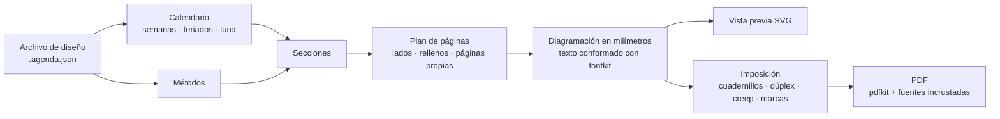

<div align="center">

# Heritage Studio

**Diseñá, previsualizá e imprimí agendas artesanales: cualquier año, idioma y país,
en cuadernillos plegados y cosidos a mano.**

[](README.md)
[](README.es.md)
[](README.pt.md)
[](README.it.md)
[](README.de.md)
[](README.fr.md)


</div>

**Probala en línea:** [jonidimo.github.io/agenda-heritage-generator](https://jonidimo.github.io/agenda-heritage-generator/) (siempre la última versión, sin instalar nada).

Heritage Studio empezó como una sola agenda artesanal para 2026. Hoy es una aplicación
que arma el libro completo para cualquier año: calendario, feriados, registros de hábitos
y páginas de planificación basadas en la ciencia del comportamiento. Ubica las páginas en
hojas listas para una impresora dúplex, listas para plegar, coser y encuadernar.

Funciona entera en el navegador, también sin conexión, en Linux, Windows, macOS y
Android, y como aplicación de escritorio para Windows, macOS y Linux. No se sube nada a
ningún lado.


## Descargar

**[Descargá la última versión](https://github.com/jonidimo/agenda-heritage-generator/releases/latest)** y elegí el archivo de tu sistema en *Assets*:

| Sistema | Archivo |
| --- | --- |
| Windows 10 y 11 | `…-win-x64-setup.exe` (instalador) o `…-win-x64-portable.exe` (sin instalar) |
| macOS 13 o posterior | `…-mac-arm64.dmg` (Apple silicon) o `…-mac-x64.dmg` (Intel) |
| Linux | `…-linux-x86_64.AppImage` (cualquier distribución) o `…-linux-amd64.deb` (Debian, Ubuntu, Mint) |

Los instaladores no están firmados con un certificado pago, así que Windows y macOS avisan
la primera vez que se abren. La [guía de la aplicación de escritorio](docs/desktop.md) (en
inglés) explica cómo abrirlos, dónde se guardan tus agendas y cómo compilar la aplicación.
Para usarla en el navegador, mirá [Cómo usarla](#cómo-usarla).

## Qué hace

### Se ve exactamente como se va a imprimir

- Cuatro vistas que se actualizan mientras editás: **página**, **pliego**, **hoja
  impresa** (como sale de la impresora, frente y dorso) y el **libro entero**.
- La vista previa dibuja los mismos contornos de letras que van al PDF, así que no
  depende de las fuentes instaladas en tu computadora.
- La **verificación previa** encuentra textos que no entran, textos que se pisan, lo que
  sale de la página o cae en el margen que la impresora no imprime, caracteres que le
  faltan a una fuente e imágenes con poca resolución.
- **Modos Diseño e Impresión**: *Diseño* es para la página, el pliego y el libro entero; *Impresión* suma la hoja impresa y el panel de impresión, y dibuja en cada página la zona que la impresora no imprime y el margen de costura.
- **Destino**: una agenda hecha para **leer en pantalla** deja de lado el margen de costura, los recortes, las marcas y las páginas de relleno de los cuadernillos; sus páginas conservan el tamaño y se exporta de a una página, con enlaces. Podés volver a *Imprimir y encuadernar* cuando quieras.

### Se edita con el mouse

- Arrastrá, mové de a poco, escalá, rotá, atenuá u ocultá cualquier elemento. El cambio
  se aplica a todas las páginas de ese tipo, espejado en las páginas izquierdas, o a una
  sola página. Imán, guías de márgenes, deshacer y rehacer.
- **Marcas de agua por persona**: el colibrí, un ícono o tu propio SVG o PNG, anclados al
  borde exterior o interior, con tamaño y opacidad; en todas las páginas o solo en las
  derechas o las izquierdas, fundidas con el papel (*Multiplicar* hace desaparecer el fondo
  blanco de un logo), en grises o teñidas, y con la posición y la imagen espejadas por
  separado en las páginas izquierdas.
- **Páginas propias donde quieras**: una imagen, un SVG vectorial o una página de un PDF
  (que sigue siendo vectorial en el PDF final), o una página de renglones, puntos o
  cuadrícula. El resto del libro se reacomoda solo.
- Textos, imágenes, renglones y marcos propios en cualquier tipo de página.
- Cambiá el tamaño de tus elementos desde cualquier borde o esquina; con Mayús se
  mantienen las proporciones.
- **También los elementos propios de la agenda** (el nombre de un mes, un marco, una tabla,
  un área de escritura) se agrandan o achican desde cualquier borde o esquina: su contenido
  se vuelve a acomodar dentro de la caja nueva en lugar de estirarse, y el panel tiene
  campos de ancho y alto.
- **Doble clic en cualquier texto** para editarlo ahí mismo: los tuyos y los de la agenda
  (nombre y título de la portada, dedicatoria, la frase de cada mes, títulos de página).
  Enter o Ctrl+Enter confirma, Esc descarta, y la página se redibuja mientras escribís. Un
  texto propio puede seguir a sus renglones (alto automático).
- **Estilo por elemento**: líneas a guiones, de puntos o dobles, color y grosor de cada
  clase de línea, relleno y color del texto, para un elemento en todas las páginas de su
  tipo o solo en una.
- **Copiar, cortar, pegar y duplicar** tus elementos (Ctrl+C, X, V y D) dentro de una página
  o entre páginas.
- Arrastrar un deslizador o un selector de color es fluido: la página acompaña en vivo, las
  miniaturas esperan y todo el arrastre es un solo paso de deshacer.
- Un elemento de imagen acepta cualquier imagen: elegí una de la agenda o subí un PNG, JPG
  o SVG.
- Cada texto puede tener su propia letra y su propio color, o seguir los de su tipo de
  texto.
- **Zoom** de la página con Ctrl y + / − / 0, o con Ctrl y la rueda del mouse (o pellizcando
  el panel táctil): el punto bajo el cursor queda quieto. **Ajustes →
  Tamaño de la interfaz** (un deslizador con su número) agranda o achica toda la interfaz, y los paneles laterales y la tira
  de miniaturas se redimensionan arrastrando sus bordes; la aplicación recuerda ambas cosas.
- **Clic derecho** (o pulsación larga en el teléfono) sobre cualquier elemento, página o
  miniatura: cambiar la imagen de la marca de agua, ocultar algo en una página o en todas
  las de ese tipo, seleccionar elementos similares, agregar textos o imágenes donde
  hiciste clic.
- **Varios elementos a la vez** con Ctrl o Mayús, o arrastrando un recuadro desde un
  lugar vacío: moverlos juntos, alinearlos, repartirlos con espacios iguales u ordenarlos
  en una cuadrícula que encuentra sus filas y columnas.
- **Renglones, puntos o cuadrícula por tipo de página o por página**: separación de
  renglones, separación horizontal y vertical de puntos, tamaño de punto y grosor.
- **Escalar y deformar**: cada elemento tiene ocho tiradores que reacomodan su contenido en la caja nueva; la escala es un deslizador aparte, y **Permitir deformar** estira el dibujo en cualquier dirección en su lugar.
- **Copiá los elementos del programa** (Ctrl+C sobre el nombre de un mes, un marco, una tabla…) y pegá un elemento propio editable: el texto sigue siendo texto editable; lo demás pasa a ser un dibujo que conserva el grosor de sus líneas.
- **Diez tipos más de elemento**: tabla, lista de pendientes, seguimiento de hábitos, renglones de finanzas, minicalendario (sus días llevan a su página), cuadrantes, notas, horario del día, valoración y **código QR** (cualquier dirección web, correo, teléfono o texto; tocable en el PDF), cada uno con sus propios campos.
- **Íconos y formas**: una biblioteca de 96 íconos (Lucide), que se buscan en cualquier idioma y se tiñen de cualquier color, y quince formas: rectángulo, elipse, línea con flechas o puntos, flecha, triángulo, rombo, polígono (de 3 a 24 lados), estrella (de 3 a 24 puntas), corazón, aro, arco o sector, globo de diálogo, cinta, cruz y trazado libre SVG. El trazo queda dentro de la caja y cada forma muestra solo sus ajustes.
- **Una imagen en cada portada de mes** en lugar del sticker, para un mes o para todos.
- **Capas**: un panel lista los elementos de la página de arriba hacia abajo; subir, bajar, llevar al fondo, renombrar, ocultar y fusionar con lo de abajo (multiplicar, trama, oscurecer, aclarar). Ctrl+↑ y Ctrl+↓ mueven el elemento elegido.
- **Menú de capas y bloqueo**: clic derecho en una fila de Capas para duplicar, bloquear o desbloquear, renombrar, traer al frente, enviar al fondo o borrar. Un elemento bloqueado se elige pero no se arrastra, no cambia de tamaño, no se mueve con las flechas ni se borra (Ctrl+Shift+Alt+L). Debajo de la lista, la opacidad, la fusión y el bloqueo del elegido.
- **Formas**: relleno como una muestra de color con un botón *Sin relleno*, opacidad de 5 a 100 %, y todo elemento propio gira de 0 a 360°.
- **Recursos / Vectores**: cualquier imagen, SVG o ícono se coloca en la página con un clic, o se usa como **pincel de sello y trazo**: un clic deja una copia; arrastrar deja copias a lo largo del trazo (tamaño, espaciado, derecho / sigue el trazo / al azar, variación, color). Cada trazo es un elemento y un paso de Deshacer.
- **Pantalla completa (F11)**: solo la página, sin los paneles laterales, la tira de miniaturas ni el pie; F11 o Esc los devuelven como estaban.
- **Desplazar arrastrando**: con el botón del medio del mouse, o con la barra espaciadora apretada y el botón principal, el área de trabajo se mueve con el puntero, sin buscar las barras.
- **Menús ordenados**: Archivo (la agenda y sus archivos, con *Mis agendas*), Edición, Ver, Ajustes (idioma de la interfaz, cada uno en su idioma; tamaño de la interfaz; preferencias; asistente de IA) y Ayuda (atajos, guía para modelos de IA, avisar de un problema, Acerca de). *Nueva agenda* entra en cualquier ventana: dos columnas, y *Crear agenda* siempre a la vista.
- **Lo oculto no se pierde**: Edición → *Mostrar elementos ocultos* los lista y devuelve cada uno. **Acercar a la selección** con Ctrl+Mayús+2; el pie de la página cuenta los avisos de la página actual y las miniaturas muestran un punto.
- **Atajos de teclado** para todo, listados en la aplicación (F1) y junto a cada ítem de menú.

### Secciones y plantillas de página

- **Empezar de cero**: la plantilla *En blanco* no tiene ninguna página y muestra qué hacer
  primero; la plantilla *Cuaderno* es una portada y todas las páginas de puntos, renglones,
  cuadrícula o lisas que quieras, sin calendario. Agregá cualquier sección (y varias de
  notas), agregá páginas a cada mes o quitá una sección desde su menú.

- Hacé clic en una sección del panel **Secciones** para ir a su página. Con clic derecho
  la movés, la apagás o cambiás cada cuánto se repite.
- Cualquier sección puede aparecer una vez o **repetirse cada mes, semana o día**.
- **Plantillas de página**: diseñás una página una vez (fondo de renglones, puntos o
  cuadrícula, textos, imágenes, marcos) y la repetís donde quieras. Textos como `{date}`,
  `{weekday}` o `{month}` cambian en cada copia.
- **Clic derecho en un mes** de la tira de páginas para ir a su portada, su registro o su primera semana, repetir una página en cada mes, ocultar el mes, exportar solo ese mes a PDF o ver solo ese mes en la tira. Los meses ocultos salen del libro; el calendario anual los conserva, sin enlaces. Un marcador **Año** salta a la vista anual y la tira se desplaza con la rueda del mouse.

### Encontrar cualquier cosa

- La **barra superior** tiene tres zonas (archivo e historial, modo y vista, búsqueda y zoom) y
  en ventanas angostas guarda lo que no entra en un menú «⋯».
- **Buscador** (Ctrl+K, `/` o el campo de búsqueda de la barra): encuentra ajustes, secciones, páginas y elementos
  aunque escribas con errores, sin tildes o con otras mayúsculas, y te lleva ahí
  resaltándolo.
- Botones **Atrás y Adelante** en la barra superior para volver a las páginas que
  visitaste, como en el navegador.

### Cualquier año, idioma y país

- Textos impresos en español, inglés, portugués, italiano, alemán y francés; la interfaz
  habla los mismos seis idiomas y sigue al que se elige al crear la agenda.
- El país fija las convenciones regionales (orden de las fechas, moneda, día en que
  empieza la semana) con los datos de Unicode CLDR que trae el navegador: el inglés en
  Argentina se escribe día/mes. El orden de las fechas y el comienzo de la semana también
  se eligen a mano; las fechas se guardan siempre en ISO 8601.
- Feriados de **207 países** y sus regiones, de 2016 a 2061. Podés agregar feriados
  puente, quitar feriados o darles otro nombre con el lápiz de *Calendario → Feriados* (por
  ejemplo, uno más corto para un nombre que no entra en su casilla).
- Cumpleaños y fechas importantes, fases lunares, y los equinoccios y solsticios
  calculados para tu zona horaria y hemisferio.
- Semanas ISO, semanas que empiezan el lunes, el domingo o el sábado, de 1 a 24 meses,
  empezando en cualquier mes.

### Pensada para el papel

- 6 temas (Heritage, Clara, Clásica, Mínima, Cuaderno, Filigrana) y 4 plantillas. Un
  tema define todo junto: la letra y el color de cada tipo de texto y el estilo de los
  renglones, separadores, tablas y marcos.
- **Líneas y firuletes**: líneas lisas, de guiones, de puntos o dobles, ornamentos
  repetidos a lo largo de una línea o en su centro, y esquinas para los marcos. Trae diez
  ornamentos y podés importar los tuyos en SVG o PNG.
- **Una paleta a partir de un color**: elegís un color y una armonía (monocromática,
  análoga, complementaria, complementaria dividida o triádica). La aplicación deriva todos
  los colores en el espacio de color OKLCH y mantiene el texto oscuro para que se lea bien
  en papel.
- **Temas propios**: guardás todo el estilo con un nombre, lo usás en otras agendas y lo
  compartís como archivo `.tema.json`, con sus ornamentos adentro.
- Cambiá fuentes, tamaños, grosor y separación de renglones, renglones, puntos o
  cuadrícula, sombreado de fin de semana y un nivel de comodidad para leer sin anteojos.
  Todo se actualiza en vivo.
- 5 familias tipográficas libres incluidas, incrustadas en el PDF como subconjuntos.
  Podés subir tus propias fuentes TTF, OTF, WOFF o WOFF2: la aplicación verifica que
  tengan todos los caracteres que necesita tu idioma. Si a una le falta un carácter (una
  fuente de camiseta sin coma ni paréntesis), ese carácter sale de una fuente de reserva, en
  pantalla y en el PDF, como en un navegador; Estilo avisa si le falta la puntuación y para
  qué conviene usarla.

### Métodos basados en evidencia

- **30 métodos**: semana Alastair, planes «si pasa X, hago Y», WOOP, registro del
  avance, un registro de hábitos que cuenta días hechos en lugar de rachas, revisión
  semanal, tres cosas buenas, diario de sueño, memoria externa y más.
- Cada método cambia las páginas que corresponden y se explica en una **guía impresa**
  con su nivel de evidencia (sólida, moderada, limitada, práctica sin estudios directos o
  discutida) y sus referencias. Ver [el informe de evidencia](docs/evidencia-metodos.md).
- Podés agregar tus propios métodos desde la interfaz, sin programar.

### Cuadernillos que salen bien

- **Cuadernillos cosidos** con la cantidad de hojas por cuadernillo que elijas (todos
  iguales, equilibrados o una lista a medida), un solo cuadernillo, cortar y apilar para
  espiral o discos, o una página por hoja.
- A4 → A5, Legal / Oficio → 177,8 × 215,9 mm (el tamaño más grande que imprime la HP
  LaserJet 4350), Carta, Folio, Oficio 340, A3, A5 o a medida.
- Dúplex por el borde corto o largo, o dúplex manual; corrección del dorso; creep;
  marcas de plegado, corte y colación; número de cuadernillo.
- Hoja de calibración, plantilla de perforado para las estaciones de costura y una tapa
  con el ancho del lomo calculado según la cantidad de hojas.

### Para leer en tableta o lector

- El **PDF de páginas** viene con enlaces tocables, como una agenda digital: cada día de
  los calendarios, del registro del mes y de la vista mensual lleva a su semana (o a su
  página del día), cada mes a su mes, los títulos suben un nivel (semana → mes →
  calendario anual → índice) y el índice lleva a sus páginas. En un lector que siga los
  enlaces del PDF, como un Onyx Boox o una tableta, alcanza con tocar.
- **Marcadores del lector**: el índice lateral del lector tiene las secciones, cada mes y
  sus semanas.
- **Pestañas de todos los meses** en el borde de cada página (opcional): cada una lleva a
  su mes.
- Los enlaces salen de lo que está impreso, así que acompañan cualquier cambio de año,
  papel o secciones. El botón de enlaces de la barra de arriba los muestra sobre la página
  y un clic los sigue; el panel de cada elemento muestra adónde lleva y permite quitarle
  los enlaces o mandarlo a otra página o a una dirección web. El PDF para imprimir no los
  lleva.
- Cada zona tocable se puede cambiar por separado: tocá un número de día o un nombre de mes
  en la página, o hacé clic derecho, para mandar solo ese a otro lado o quitarlo.

### Tus archivos y plantillas

- **Archivo → Guardar** (Ctrl+S) escribe un archivo `.agenda.json` con sus imágenes y
  fuentes adentro. En Chrome, Edge y la aplicación de escritorio, las veces siguientes se
  reescribe el mismo archivo.
- **Guardar como plantilla** conserva el diseño completo para empezar otras agendas: otro
  año, otra persona u otro idioma. Las plantillas se pueden exportar y compartir como
  archivos.
- **Copia de seguridad de todo** guarda todas las agendas y plantillas, y las fuentes subidas, en
  un solo archivo; al abrirlo se restauran. Una fuente de un archivo que se abre no reemplaza a la
  que este equipo ya tenga con el mismo nombre: queda la de acá, y se avisa.
- Las agendas también quedan en el navegador, pero solo en ese navegador y en esa
  dirección de la aplicación: los archivos son la copia segura.
- Los paneles **Imágenes** y **Fuentes** dicen dónde se usa cada imagen (marca de agua, tapa, elementos, páginas, ornamentos) y la quitan junto con todo lo que la usaba; las fuentes muestran qué caracteres faltan y dónde se usa cada familia, y las tuyas se pueden quitar.
- **Imágenes junto al archivo**: una agenda puede apuntar a sus imágenes por ruta (`"path":
  "imagenes/logo.png"`) en lugar de llevarlas adentro; la línea de comandos, el servidor MCP y
  la aplicación de escritorio (cuando el sistema le abre el archivo, o con *Archivo → Abrir archivo…*)
  las leen solo de esa carpeta. En la aplicación web, el aviso ofrece **Buscar la carpeta de las
  imágenes…**: elegís la carpeta y las imágenes quedan incrustadas en la agenda (y se borra la ruta).
  Como con cualquier archivo que abre el sistema en el escritorio, el primer *Guardar* de una sesión
  pregunta dónde.
- **PDF livianos**: *Impresión → Imágenes en el PDF* (300 ppp para imprimir, 150 para pantalla u
  originales) achica solo las imágenes que tienen más resolución de la que hace falta al tamaño en que
  se imprimen, sin perder calidad que se note, y una imagen que va en todas las páginas (una marca de
  agua) se guarda una sola vez en el PDF. El panel *Imágenes* muestra el peso de cada una y sus ppp al
  tamaño en que se imprime de verdad; por encima de 600 ppp lo avisa (`overDpi`). Al subir imágenes
  pasa lo mismo: las fotos en WebP/HEIC/AVIF quedan en JPEG (no en PNG), lo que pasa de 4000 px de lado
  se achica y el mismo archivo no se guarda dos veces.
- Aplicación de escritorio: al exportar un PDF muestra **dónde quedó guardado**, con *Abrir carpeta*; las agendas se abren con doble clic en un `.agenda.json` o soltándolas sobre la ventana, y cerrar nunca pierde el último cambio.
- **El tamaño de la hoja desde el principio**: la pantalla de agenda nueva muestra el papel (o la pantalla de la tableta), cómo se encuaderna y el tamaño que queda cada página. *Archivo/Edición → Tamaño de la hoja…* lo cambia después y puede llevar tus elementos a la página nueva en un solo paso de Deshacer.

### Un asistente de IA dentro de la aplicación

- Un botón redondo en la esquina de abajo a la derecha (**Ctrl+J**): pedí un cambio con tus palabras
  («agrandá las notas de esta página», «un registro de hábitos cada mes»). El asistente lee
  la agenda, propone **un** cambio y lo ves en la página antes de **Aplicarlo** o
  **Descartarlo**; un cambio aplicado es un solo paso de deshacer. No queda nada guardado al cerrar.
- Funciona con **Anthropic (Claude), Google Gemini, OpenAI y servicios compatibles**
  (OpenRouter, Groq, Mistral) y **modelos locales** (Ollama, LM Studio), con tu propia clave.
  Si querés, también puede mirar las páginas (visión).
- Tu clave nunca se guarda en texto plano: en la aplicación de escritorio la cifra el sistema
  operativo (Llavero, DPAPI, libsecret) y los pedidos salen por la aplicación; en la web vive
  en memoria, o cifrada en el navegador si elegís recordarla. Los ajustes están en
  *Ajustes → Asistente de IA…* o en el engranaje de la píldora.
- **Versión 2.4.1**: el asistente queda como un botón redondo en la esquina de abajo a la derecha. Con un servidor local la lista de modelos se busca sola (una lista para elegir, no un campo que filtra), y una dirección sin `/v1` se ofrece corregida. Pedir otra cosa con una propuesta a la vista la **ajusta** (la próxima propuesta se suma y Aplicar confirma todo en un paso), y la tarjeta muestra cada cambio con su valor de antes y el nuevo.
- **Versión 2.5.0**: el modelo tiene 10 pasos por pedido y antes del último se le pide que proponga con lo que ya sabe; sabe que cambiar el idioma de la agenda traduce todo en una sola operación. La dirección `http://0.0.0.0:8080` que muestra llama.cpp sirve tal cual. Si una parte del programa no carga (porque se actualizó con la ventana abierta), la tarjeta lo explica y ofrece recargar la ventana sin perder lo hecho.

### Diseñar con un modelo de inteligencia artificial

- Un **servidor MCP** permite que Claude, o cualquier modelo compatible con MCP, cree una
  agenda, la cambie, la revise, mire sus páginas y exporte el PDF o un tema. La aplicación de
  escritorio lo incluye: se inicia con `--mcp` ([cómo](docs/desktop.md#6-use-it-with-an-ai-model-from-outside-mcp), en inglés). Pedile "una
  agenda docente de marzo a diciembre" o "un tema con firuletes art nouveau".
- El formato del archivo tiene un **esquema JSON** y un catálogo que salen del código, y
  `npm run agenda -- check` dice exactamente qué se ignoraría o corregiría. Leé la
  [guía](docs/plantillas-llm.md) ([in English](docs/llm-templates.md)).
- Cada cambio del modelo vuelve con los avisos de maquetación que produjo (textos que no
  entran, elementos fuera de la página o superpuestos), así puede corregirlos sin que nadie mire.
- Los modelos pueden usar `icon:<nombre>` para cualquier ícono sin declararlo, dibujar con
  formas y dejar las imágenes junto al archivo por ruta. En todas las herramientas, `path` es
  siempre el archivo que se lee y `out` el que se escribe.
- **Fuentes propias y guía para modelos (2.5.0)**: las fuentes propias viajan dentro del archivo (`userFonts`) y el servidor las usa al dibujar; `add_font` incrusta una y dice qué puntuación le falta. `get_guide` da la guía por secciones a los clientes que no leen recursos, hay recetas (`nueva-agenda`, `revisar-avisos`, `traducir`), y cada aviso de `check_design` dice cómo corregirlo.
- **Imágenes y fuentes de internet (2.5.1)**: el servidor MCP busca imágenes (`search_images`, con miniaturas para elegir; Openverse y Wikimedia Commons sin clave; Pexels, Pixabay, Unsplash y DeviantArt con una) y las importa (`import_image`: las limpia, las recorta a una página o a la tapa entera con sangrado y lomo, las achica a ~300 ppp, guarda autor, licencia y dirección, no importa dos veces la misma y no cambia nada sin `confirm: true`); `build_credits_page` arma la página de créditos; `search_fonts` e `import_font` traen fuentes de Google Fonts, revisando ñ, tildes, ¿ y ¡ e incrustando la fuente entera para que puedas cambiar el texto sin límites. Solo visita los dominios de esas APIs (nunca direcciones locales ni privadas), con tiempo y tamaño máximos por descarga; las claves van en variables de entorno (`PIXABAY_API_KEY`, `UNSPLASH_ACCESS_KEY`, `GOOGLE_FONTS_API_KEY`) y nunca se guardan en la agenda.
- **Imágenes propias, enlaces y red local (2.5.1)**: `import_image` también acepta un archivo de la carpeta de trabajo (`image`, p. ej. arte hecho con IA) o un enlace directo (`url`), y `browse_page` lista las imágenes y los enlaces de una página web para que un modelo elija. Solo se abren páginas y enlaces de dominios que **vos declarás** en `AGENDA_TRUSTED_HOSTS` (pueden ser de tu red local, por `http`); lo demás sigue cerrado. **Aviso de responsabilidad:** declarar un dominio es una decisión tuya: el programa no revisa qué hay ahí ni de quién son las imágenes (los derechos de autor de lo que importes y el uso de tu red son tuyos) y se ofrece sin garantías. Nada se agrega sin tu aprobación (`confirm`).
- **Enlace en vivo (aplicación de escritorio)**: con la aplicación abierta, el mismo servidor trabaja sobre **la agenda que tenés abierta**. El modelo la lee, la cambia en un solo paso que se puede deshacer (se rechaza si la editaste mientras tanto), te muestra una página o abre otra agenda. Se apaga en *Ajustes → Permitir que un modelo de IA edite la agenda abierta*. Nada escucha en la red: es un socket local protegido por un token que se genera en cada arranque.

### Hecha para durar

- *Duplicar para 2028* lleva un diseño al año siguiente, con sus páginas y ajustes en su
  lugar.
- Los archivos se validan al abrirlos: colores, números y ajustes del tema se revisan,
  así un archivo dañado o manipulado no rompe la aplicación ni ejecuta código.
- El mismo motor funciona en el navegador, en un proceso en segundo plano y en la línea de
  comandos.

## Capturas

| | |
| --- | --- |
|  |  |
| La hoja impresa, con marcas de plegado y de cuadernillo, junto a los ajustes de impresión. | Estilo: fuentes, tamaños, renglones y comodidad se actualizan en vivo. |
|  |  |
| Los métodos y la guía que los explica, con evidencia y referencias. | El libro entero y los feriados del país elegido. |

Las capturas muestran la interfaz en inglés; el idioma se cambia en el menú
**Archivo**.

<p align="center"></p>

Páginas reales del PDF: portada (español), guía (inglés), portada de mes (portugués),
registro de hábitos (italiano) y contraseñas (español).


Un pliego semanal de la agenda 2027: los días a la izquierda y la grilla de tareas
Alastair a la derecha.


## Cómo funciona



1. **Una agenda es un archivo de diseño, no código.** Es un JSON que se valida al abrirlo,
   con el año, el idioma, el país, las secciones y sus opciones, el tema, la persona, las
   marcas de agua, tus páginas e imágenes, y tus ajustes. Los ajustes se guardan como
   desplazamientos asociados a nombres estables como `week:2027-W12:left`, así sobreviven
   a un cambio de año o de papel.
2. **El calendario** arma los meses y las semanas ISO con feriados, fechas personales y
   fases lunares.
3. **Las secciones** (portada, pliego semanal, registro de hábitos, contraseñas…)
   planifican sus páginas y las diagraman en milímetros con funciones de diagramación.
   Las páginas se miden, no se declaran: la agenda agrega páginas de relleno para que los
   pliegos queden enfrentados, las portadas de mes caigan en página derecha y cada
   cuadernillo quede completo.
4. **El texto** se conforma una sola vez con fontkit. La vista previa dibuja esos glifos y
   el PDF escribe los mismos glifos con la fuente incrustada: la pantalla coincide con el
   papel.
5. **La imposición** ubica las páginas en las hojas. En un cuadernillo de *n* hojas, la
   hoja *i* lleva las páginas 4n−2i y 2i+1 al frente y 2i+2 y 4n−2i−1 al dorso.
6. **El PDF** lo escribe pdfkit en segundo plano, así el editor nunca se congela. Las
   páginas de PDF importadas se incrustan como vectores con pdf-lib.

## Cómo usarla

Necesitás [Node.js](https://nodejs.org/) 22.12 o más nuevo.

```bash
git clone https://github.com/jonidimo/agenda-heritage-generator.git
```

```bash
cd agenda-heritage-generator && npm ci
```

```bash
npm run dev
```

Abrí <http://localhost:5173>. La primera vez se generan los datos de feriados, que tarda
alrededor de un minuto.

**Instalarla como aplicación.** En Chrome, Edge o Chromium, en una computadora o en un
teléfono Android, elegí *Instalar* o *Agregar a la pantalla principal*. Desde ahí funciona
sin conexión.

**Aplicación de escritorio.** Mirá [Descargar](#descargar). La
[guía de la aplicación de escritorio](docs/desktop.md) (en inglés) explica cómo instalarla y
cómo compilar los instaladores.

**Publicar tu propia copia.** `npm run build` genera un sitio estático en `dist/`. El flujo
de GitHub Pages incluido lo publica: activalo en *Settings → Pages → Source: GitHub
Actions*.

**Línea de comandos.** Todo lo que se exporta también se puede generar desde una terminal:

```bash
npm run agenda -- new --template heritage --year 2028 --locale es-AR --country AR --out designs/mi-2028.agenda.json
```

```bash
npm run agenda -- info designs/mi-2028.agenda.json
```

```bash
npm run agenda -- check designs/mi-2028.agenda.json
```

```bash
npm run pdf -- designs/mi-2028.agenda.json --kind imposed --out output/mi-2028-imprimir.pdf
```

`check` lista lo que se ignoraría o corregiría en un archivo y los avisos de la agenda
armada. `npm run -s agenda -- schema` y `npm run -s agenda -- catalog` muestran el formato del
archivo y todo lo que puede nombrar. `npm run -s mcp` inicia el servidor MCP para modelos
de inteligencia artificial (ver [la guía](docs/plantillas-llm.md)).

## Impresión y encuadernación

Imprimí una vez la hoja de calibración y después el PDF a doble faz; plegá, perforá, cosé
y poné la tapa. La [guía de impresión y encuadernación](docs/impresion.md) explica cada
paso, con los ajustes para Linux (CUPS), Windows y Android ([in English](docs/printing.md)).

## Estructura del proyecto

| Carpeta | Contenido |
| --- | --- |
| `src/core` | El motor, sin dependencias del navegador: calendario, feriados, texto, diagramación, secciones, imposición y salidas SVG y PDF. |
| `src/app` | El editor (React). |
| `src/workers` | La generación del PDF en segundo plano. |
| `src/cli` | La línea de comandos. |
| `src/node` | Lo comparten la línea de comandos, el servidor MCP y las pruebas: lee fuentes, feriados e imágenes del disco y revisa archivos de agenda. |
| `src/mcp` | El servidor MCP para modelos de inteligencia artificial. |
| `electron` | La aplicación de escritorio (Electron). |
| `designs` | Agendas de ejemplo para 2027 en español, inglés, portugués e italiano. |
| `tests`, `e2e` | Pruebas unitarias (Vitest) y del navegador (Playwright). |
| `docs` | Guías y el informe de evidencia. |
| `legacy` | La versión 2026 en Python y sus PDF, como referencia de diseño. |

## Desarrollo

```bash
npm test
```

```bash
npm run test:e2e
```

```bash
npm run typecheck && npm run lint
```

Las pruebas diagraman cada plantilla en varios idiomas, papeles y niveles de comodidad, y
fallan si algún texto no entra, se pisa con otro o sale del área imprimible. Para agregar
un método o una sección, leé [Adding methods and sections](docs/adding-methods.md).

## Créditos

- Hecho por **Jonatan Damián Dimotta Bré** ([Instagram](https://www.instagram.com/dimottajonatan/),
  [código fuente](https://github.com/jonidimo/agenda-heritage-generator),
  [en línea](https://jonidimo.github.io/agenda-heritage-generator/)). La guía de cada agenda
  termina con estos créditos y un código QR al código fuente; se pueden apagar en *Métodos*.
- Íconos de [Lucide](https://lucide.dev) (licencia ISC).

- Fuentes con licencia SIL Open Font License: Cormorant Garamond, Manrope, Atkinson
  Hyperlegible Next, EB Garamond y Caveat (licencias en `public/fonts`).
- Datos de feriados de [date-holidays](https://github.com/commenthol/date-holidays), de
  commenthol, basados en Wikipedia, con licencia
  [CC BY-SA 3.0](https://creativecommons.org/licenses/by-sa/3.0/). Revisá el calendario
  oficial de tu país por los feriados puente.
- [Astronomy Engine](https://github.com/cosinekitty/astronomy) (MIT) para las fases
  lunares y las estaciones.
- [PDFKit](https://pdfkit.org/) y [fontkit](https://github.com/foliojs/fontkit) (MIT),
  [pdf-lib](https://github.com/cantoo-scribe/pdf-lib) (MIT), [PDF.js](https://mozilla.github.io/pdf.js/)
  (Apache 2.0), React, Vite, Tailwind CSS, Zustand, Immer, Zod y Lucide.
