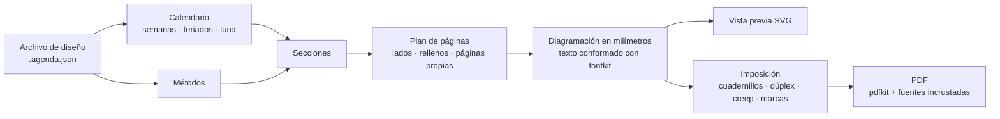

<div align="center">

# Heritage Studio

**Diseñá, previsualizá e imprimí agendas artesanales: cualquier año, idioma y país,
en cuadernillos plegados y cosidos a mano.**

[](README.md)
[](README.es.md)
[](README.pt.md)
[](README.it.md)


</div>

Heritage Studio empezó como una sola agenda artesanal para 2026. Hoy es una aplicación
que arma el libro completo para cualquier año: calendario, feriados, registros de hábitos
y páginas de planificación basadas en la ciencia del comportamiento. Ubica las páginas en
hojas listas para una impresora dúplex, listas para plegar, coser y encuadernar.

Funciona entera en el navegador, también sin conexión, en Linux, Windows, macOS y
Android, y como aplicación de escritorio para Windows, macOS y Linux. No se sube nada a
ningún lado.


## Qué hace

### Se ve exactamente como se va a imprimir

- Cuatro vistas que se actualizan mientras editás: **página**, **pliego**, **hoja
  impresa** (como sale de la impresora, frente y dorso) y el **libro entero**.
- La vista previa dibuja los mismos contornos de letras que van al PDF, así que no
  depende de las fuentes instaladas en tu computadora.
- La **verificación previa** encuentra textos que no entran, textos que se pisan, lo que
  sale de la página o cae en el margen que la impresora no imprime, caracteres que le
  faltan a una fuente e imágenes con poca resolución.

### Se edita con el mouse

- Arrastrá, mové de a poco, escalá, rotá, atenuá u ocultá cualquier elemento. El cambio
  se aplica a todas las páginas de ese tipo, espejado en las páginas izquierdas, o a una
  sola página. Imán, guías de márgenes, deshacer y rehacer.
- **Marcas de agua por persona**: el colibrí o tu propio SVG o PNG, anclados al borde
  exterior o interior, con tamaño y opacidad.
- **Páginas propias donde quieras**: una imagen, un SVG vectorial o una página de un PDF
  (que sigue siendo vectorial en el PDF final), o una página de renglones, puntos o
  cuadrícula. El resto del libro se reacomoda solo.
- Textos, imágenes, renglones y marcos propios en cualquier tipo de página.
- **Clic derecho** (o pulsación larga en el teléfono) sobre cualquier elemento, página o
  miniatura: cambiar la imagen de la marca de agua, ocultar algo en una página o en todas
  las de ese tipo, seleccionar elementos similares, agregar textos o imágenes donde
  hiciste clic.
- **Varios elementos a la vez** con Ctrl o Mayús, o arrastrando un recuadro desde un
  lugar vacío: moverlos juntos, alinearlos, repartirlos con espacios iguales u ordenarlos
  en una cuadrícula que encuentra sus filas y columnas.
- **Renglones, puntos o cuadrícula por tipo de página o por página**: separación de
  renglones, separación horizontal y vertical de puntos, tamaño de punto y grosor.

### Cualquier año, idioma y país

- Textos impresos en español (Argentina, Uruguay, Chile, México, Colombia, Perú,
  España), inglés (EE. UU., Reino Unido), portugués (Brasil, Portugal) e italiano. La
  interfaz habla los mismos cuatro idiomas.
- Feriados de **207 países** y sus regiones, de 2016 a 2061. Podés agregar feriados
  puente, renombrar o quitar feriados.
- Cumpleaños y fechas importantes, fases lunares, y los equinoccios y solsticios
  calculados para tu zona horaria y hemisferio.
- Semanas ISO, semanas que empiezan el lunes, el domingo o el sábado, de 1 a 24 meses,
  empezando en cualquier mes.

### Pensada para el papel

- 5 temas (Heritage, Clara, Clásica, Mínima, Cuaderno) y 4 plantillas.
- Cambiá fuentes, tamaños, grosor y separación de renglones, renglones, puntos o
  cuadrícula, sombreado de fin de semana y un nivel de comodidad para leer sin anteojos.
  Todo se actualiza en vivo.
- 5 familias tipográficas libres incluidas, incrustadas en el PDF como subconjuntos.
  Podés subir tus propias fuentes TTF, OTF, WOFF o WOFF2: la aplicación verifica que
  tengan todos los caracteres que necesita tu idioma.

### Métodos basados en evidencia

- **30 métodos**: semana Alastair, planes «si pasa X, hago Y», WOOP, registro del
  avance, un registro de hábitos que cuenta días hechos en lugar de rachas, revisión
  semanal, tres cosas buenas, diario de sueño, memoria externa y más.
- Cada método cambia las páginas que corresponden y se explica en una **guía impresa**
  con su nivel de evidencia (sólida, moderada, limitada, práctica sin estudios directos o
  discutida) y sus referencias. Ver [el informe de evidencia](docs/evidencia-metodos.md).
- Podés agregar tus propios métodos desde la interfaz, sin programar.

### Cuadernillos que salen bien

- **Cuadernillos cosidos** con la cantidad de hojas por cuadernillo que elijas (todos
  iguales, equilibrados o una lista a medida), un solo cuadernillo, cortar y apilar para
  espiral o discos, o una página por hoja.
- A4 → A5, Legal / Oficio → 177,8 × 215,9 mm (el tamaño más grande que imprime la HP
  LaserJet 4350), Carta, Folio, Oficio 340, A3, A5 o a medida.
- Dúplex por el borde corto o largo, o dúplex manual; corrección del dorso; creep;
  marcas de plegado, corte y colación; número de cuadernillo.
- Hoja de calibración, plantilla de perforado para las estaciones de costura y una tapa
  con el ancho del lomo calculado según la cantidad de hojas.

### Tus archivos y plantillas

- **Archivo → Guardar** (Ctrl+S) escribe un archivo `.agenda.json` con sus imágenes y
  fuentes adentro. En Chrome, Edge y la aplicación de escritorio, las veces siguientes se
  reescribe el mismo archivo.
- **Guardar como plantilla** conserva el diseño completo para empezar otras agendas: otro
  año, otra persona u otro idioma. Las plantillas se pueden exportar y compartir como
  archivos.
- **Copia de seguridad de todo** guarda todas las agendas y plantillas en un solo
  archivo; al abrirlo se restauran.
- Las agendas también quedan en el navegador, pero solo en ese navegador y en esa
  dirección de la aplicación: los archivos son la copia segura.

### Hecha para durar

- *Duplicar para 2028* lleva un diseño al año siguiente, con sus páginas y ajustes en su
  lugar.
- Los archivos se validan al abrirlos: colores, números y ajustes del tema se revisan,
  así un archivo dañado o manipulado no rompe la aplicación ni ejecuta código.
- El mismo motor funciona en el navegador, en un proceso en segundo plano y en la línea de
  comandos.

## Capturas

| | |
| --- | --- |
|  |  |
| La hoja impresa, con marcas de plegado y de cuadernillo, junto a los ajustes de impresión. | Estilo: fuentes, tamaños, renglones y comodidad se actualizan en vivo. |
|  |  |
| Los métodos y la guía que los explica, con evidencia y referencias. | El libro entero y los feriados del país elegido. |

Las capturas muestran la interfaz en inglés; se cambia de idioma con el selector de
arriba a la derecha.

<p align="center"></p>

Páginas reales del PDF: portada (español), guía (inglés), portada de mes (portugués),
registro de hábitos (italiano) y contraseñas (español).


Un pliego semanal de la agenda 2027: los días a la izquierda y la grilla de tareas
Alastair a la derecha.


## Cómo funciona



1. **Una agenda es un archivo de diseño, no código.** Es un JSON que se valida al abrirlo,
   con el año, el idioma, el país, las secciones y sus opciones, el tema, la persona, las
   marcas de agua, tus páginas e imágenes, y tus ajustes. Los ajustes se guardan como
   desplazamientos asociados a nombres estables como `week:2027-W12:left`, así sobreviven
   a un cambio de año o de papel.
2. **El calendario** arma los meses y las semanas ISO con feriados, fechas personales y
   fases lunares.
3. **Las secciones** (portada, pliego semanal, registro de hábitos, contraseñas…)
   planifican sus páginas y las diagraman en milímetros con funciones de diagramación.
   Las páginas se miden, no se declaran: la agenda agrega páginas de relleno para que los
   pliegos queden enfrentados, las portadas de mes caigan en página derecha y cada
   cuadernillo quede completo.
4. **El texto** se conforma una sola vez con fontkit. La vista previa dibuja esos glifos y
   el PDF escribe los mismos glifos con la fuente incrustada: la pantalla coincide con el
   papel.
5. **La imposición** ubica las páginas en las hojas. En un cuadernillo de *n* hojas, la
   hoja *i* lleva las páginas 4n−2i y 2i+1 al frente y 2i+2 y 4n−2i−1 al dorso.
6. **El PDF** lo escribe pdfkit en segundo plano, así el editor nunca se congela. Las
   páginas de PDF importadas se incrustan como vectores con pdf-lib.

## Cómo usarla

Necesitás [Node.js](https://nodejs.org/) 22.12 o más nuevo.

```bash
git clone https://github.com/jonidimo/agenda-heritage-generator.git
```

```bash
cd agenda-heritage-generator && npm ci
```

```bash
npm run dev
```

Abrí <http://localhost:5173>. La primera vez se generan los datos de feriados, que tarda
alrededor de un minuto.

**Instalarla como aplicación.** En Chrome, Edge o Chromium, en una computadora o en un
teléfono Android, elegí *Instalar* o *Agregar a la pantalla principal*. Desde ahí funciona
sin conexión.

**Aplicación de escritorio.** Los instaladores para Windows, macOS y Linux se compilan en
GitHub. La [guía de la aplicación de escritorio](docs/desktop.md) (en inglés) explica cómo
descargarlos, instalarlos y compilarlos.

**Publicar tu propia copia.** `npm run build` genera un sitio estático en `dist/`. El flujo
de GitHub Pages incluido lo publica: activalo en *Settings → Pages → Source: GitHub
Actions*.

**Línea de comandos.** Todo lo que se exporta también se puede generar desde una terminal:

```bash
npm run agenda -- new --template heritage --year 2028 --locale es-AR --country AR --out designs/mi-2028.agenda.json
```

```bash
npm run agenda -- info designs/mi-2028.agenda.json
```

```bash
npm run pdf -- designs/mi-2028.agenda.json --mode imposed --out output/mi-2028-imprimir.pdf
```

## Impresión y encuadernación

Imprimí una vez la hoja de calibración y después el PDF a doble faz; plegá, perforá, cosé
y poné la tapa. La [guía de impresión y encuadernación](docs/impresion.md) explica cada
paso, con los ajustes para Linux (CUPS), Windows y Android ([in English](docs/printing.md)).

## Estructura del proyecto

| Carpeta | Contenido |
| --- | --- |
| `src/core` | El motor, sin dependencias del navegador: calendario, feriados, texto, diagramación, secciones, imposición y salidas SVG y PDF. |
| `src/app` | El editor (React). |
| `src/workers` | La generación del PDF en segundo plano. |
| `src/cli` | La línea de comandos. |
| `electron` | La aplicación de escritorio (Electron). |
| `designs` | Agendas de ejemplo para 2027 en español, inglés, portugués e italiano. |
| `tests`, `e2e` | Pruebas unitarias (Vitest) y del navegador (Playwright). |
| `docs` | Guías y el informe de evidencia. |
| `legacy` | La versión 2026 en Python y sus PDF, como referencia de diseño. |

## Desarrollo

```bash
npm test
```

```bash
npm run test:e2e
```

```bash
npm run typecheck && npm run lint
```

Las pruebas diagraman cada plantilla en varios idiomas, papeles y niveles de comodidad, y
fallan si algún texto no entra, se pisa con otro o sale del área imprimible. Para agregar
un método o una sección, leé [Adding methods and sections](docs/adding-methods.md).

## Créditos

- Fuentes con licencia SIL Open Font License: Cormorant Garamond, Manrope, Atkinson
  Hyperlegible Next, EB Garamond y Caveat (licencias en `public/fonts`).
- Datos de feriados de [date-holidays](https://github.com/commenthol/date-holidays), de
  commenthol, basados en Wikipedia, con licencia
  [CC BY-SA 3.0](https://creativecommons.org/licenses/by-sa/3.0/). Revisá el calendario
  oficial de tu país por los feriados puente.
- [Astronomy Engine](https://github.com/cosinekitty/astronomy) (MIT) para las fases
  lunares y las estaciones.
- [PDFKit](https://pdfkit.org/) y [fontkit](https://github.com/foliojs/fontkit) (MIT),
  [pdf-lib](https://github.com/cantoo-scribe/pdf-lib) (MIT), [PDF.js](https://mozilla.github.io/pdf.js/)
  (Apache 2.0), React, Vite, Tailwind CSS, Zustand, Immer, Zod y Lucide.
