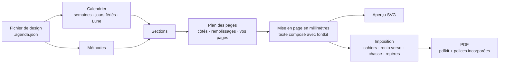

<div align="center">

# Heritage Studio

**Concevez, prévisualisez et imprimez des agendas faits main : pour n’importe quelle année, langue et pays,
pliés en cahiers et cousus à la main.**

[](README.md)
[](README.es.md)
[](README.pt.md)
[](README.it.md)
[](README.de.md)
[](README.fr.md)


</div>

**Essayez-le en ligne :** [jonidimo.github.io/agenda-heritage-generator](https://jonidimo.github.io/agenda-heritage-generator/) (toujours la dernière version, rien à installer).

Heritage Studio est né d’un seul agenda fait main pour 2026. C’est aujourd’hui une application
qui construit le livre entier pour n’importe quelle année : calendrier, jours fériés, suivis
d’habitudes et pages de planification fondées sur les sciences du comportement. Elle dispose
les pages sur des feuilles prêtes pour une imprimante recto verso, afin que vous puissiez les
plier, les coudre et les relier.

Elle fonctionne entièrement dans votre navigateur, y compris hors ligne, sous Linux, Windows,
macOS et Android, ainsi qu’en application de bureau pour Windows, macOS et Linux. Rien n’est
envoyé nulle part.


## Télécharger

**[Téléchargez la dernière version](https://github.com/jonidimo/agenda-heritage-generator/releases/latest)** et choisissez le fichier correspondant à votre système sous
*Assets* :

| Système | Fichier |
| --- | --- |
| Windows 10 et 11 | `…-win-x64-setup.exe` (installateur) ou `…-win-x64-portable.exe` (sans installation) |
| macOS 13 ou plus récent | `…-mac-arm64.dmg` (Apple silicon) ou `…-mac-x64.dmg` (Intel) |
| Linux | `…-linux-x86_64.AppImage` (toute distribution) ou `…-linux-amd64.deb` (Debian, Ubuntu, Mint) |

Les installateurs ne sont pas signés avec un certificat payant, c’est pourquoi Windows et macOS
affichent un avertissement la première fois que vous les ouvrez. Le [guide de l’application de bureau](docs/desktop.md)
(en anglais) explique comment les ouvrir, où sont conservés vos agendas et comment compiler
l’application vous-même. Pour l’utiliser plutôt dans le navigateur, voir [Lancer en local](#lancer-en-local).

## Fonctionnalités

### Voyez-le exactement tel qu’il sera imprimé

- Quatre vues, mises à jour pendant que vous modifiez : **page**, **double page**,
  **feuille imprimée** (telle qu’elle sort de l’imprimante, recto et verso) et le **livre entier**.
- L’aperçu dessine les mêmes contours de glyphes que ceux qui vont dans le PDF ; il ne dépend
  donc pas des polices installées sur votre ordinateur.
- Le **contrôle en amont** repère le texte qui ne tient pas, les textes qui se chevauchent, tout
  ce qui sort de la page ou tombe dans la marge non imprimable de l’imprimante, les caractères
  manquants dans une police et les images dont la résolution est insuffisante.
- **Modes Conception et Impression** : *Conception* sert pour la page, la double page et le livre entier ; *Impression* ajoute la vue de la feuille imprimée et le panneau d’impression, et dessine sur chaque page la zone que l’imprimante n’imprime pas ainsi que la marge de reliure.
- **Destination** : un agenda conçu pour être **lu à l’écran** supprime la marge de reliure, les coupes, les repères et les pages de remplissage des cahiers ; ses pages gardent leur format et il s’exporte page par page, avec des liens. Vous pouvez revenir à tout moment à *Imprimer et relier*.

### Modifiez à la souris

- Faites glisser, déplacez pas à pas, redimensionnez, faites pivoter, estompez ou masquez
  n’importe quel élément. Appliquez la modification à toutes les pages de ce type, en miroir
  sur les pages de gauche, ou à une seule page. Magnétisme, repères de marges, annuler et rétablir.
- **Filigranes par personne** : le colibri, une icône ou votre propre SVG ou PNG, ancrés au bord
  extérieur ou intérieur, avec taille et opacité ; sur toutes les pages ou seulement sur les pages
  de droite ou de gauche, fondus avec le papier (*Produit* fait disparaître le fond blanc d’un
  logo), en gris ou teintés, avec la position et l’image mises en miroir séparément sur les
  pages de gauche.
- **Vos propres pages où vous voulez** : une image, un SVG vectoriel ou une page d’un PDF
  (conservée en vectoriel dans le PDF final), ou une page lignée, à points ou quadrillée. Le
  reste du livre se réorganise autour.
- Vos propres textes, images, lignes et cadres sur n’importe quel type de page.
- Redimensionnez vos éléments depuis n’importe quel bord ou coin ; maintenez Maj pour conserver
  leurs proportions.
- **Redimensionnez aussi les éléments propres à l’agenda** (un nom de mois, un cadre, un tableau,
  une zone d’écriture) depuis n’importe quel bord ou coin : leur contenu est remis en page dans
  le nouveau cadre au lieu d’être étiré, et le panneau comporte des champs de largeur et de hauteur.
- **Double-cliquez sur n’importe quel texte** pour le modifier sur place : les vôtres ou ceux de
  l’agenda (nom et titre de la couverture, dédicace, la phrase de chaque mois, titres des pages).
  Entrée ou Ctrl+Entrée valide, Échap annule, et la page se redessine pendant la saisie. Un
  élément de texte peut suivre ses lignes (hauteur automatique).
- **Style par élément** : lignes en tirets, pointillées ou doubles, couleur et épaisseur de chaque
  type de ligne, couleur de remplissage et de texte, pour un élément sur toutes les pages de son
  type ou sur une seule page.
- **Copiez, coupez, collez et dupliquez** vos éléments (Ctrl+C, X, V et D) dans une page ou
  d’une page à l’autre.
- Faire glisser un curseur ou un sélecteur de couleur est fluide : la page suit en direct, les
  miniatures attendent, et tout le glissement correspond à une seule étape d’annulation.
- Un élément image accepte n’importe quelle image : choisissez-en une dans l’agenda ou importez
  un PNG, un JPG ou un SVG.
- Chaque élément de texte peut avoir sa propre police et sa propre couleur, ou suivre son type
  de texte.
- **Zoomez** sur la page avec Ctrl et + / − / 0, ou avec Ctrl et la molette de la souris (ou en
  pinçant sur le pavé tactile) : le point sous le curseur reste en place. **Réglages →
  Taille de l’interface** (un curseur avec sa valeur) met à l’échelle toute l’interface, et les panneaux latéraux et la bande
  de pages se redimensionnent en faisant glisser leurs bords ; l’application mémorise les deux.
- **Clic droit** (ou appui long sur un téléphone) sur n’importe quel élément, page ou miniature
  pour afficher ses options : changer l’image du filigrane, masquer quelque chose sur une page ou
  sur toutes les pages de ce type, sélectionner des éléments similaires, ajouter du texte ou des
  images là où vous avez cliqué.
- **Sélectionnez plusieurs éléments** avec Ctrl ou Maj, ou en traçant un rectangle depuis un
  endroit vide. Déplacez-les ensemble, alignez-les, répartissez-les avec des espacements égaux,
  ou rangez-les dans une grille qui retrouve leurs lignes et leurs colonnes.
- **Lignes, points ou quadrillage par type de page ou par page** : interligne, espacement
  horizontal et vertical des points, taille des points et épaisseur des lignes.
- **Mettre à l’échelle et déformer** : chaque élément possède huit poignées qui remettent son contenu en page dans le nouveau cadre ; l’échelle est un curseur à part, et **Autoriser la déformation** étire plutôt le dessin dans n’importe quelle direction.
- **Copiez les éléments propres à l’agenda** (Ctrl+C sur un nom de mois, un cadre, un tableau…) et collez un élément modifiable bien à vous : le texte reste du texte modifiable ; le reste devient un dessin qui conserve ses épaisseurs de trait.
- **Dix types d’éléments supplémentaires** : tableau, liste de contrôle, suivi d’habitudes, lignes de finances, mini-calendrier (ses jours renvoient à leurs pages), quadrants, notes, emploi du temps de la journée, évaluation et **code QR** (n’importe quelle adresse web, e-mail, numéro de téléphone ou texte ; cliquable dans le PDF), chacun avec ses propres champs.
- **Icônes et formes** : une bibliothèque de 96 icônes (Lucide), consultable dans toutes les langues et teintée de n’importe quelle couleur, et quinze formes : rectangle, ellipse, ligne avec flèches ou points, flèche, triangle, losange, polygone (3 à 24 côtés), étoile (3 à 24 branches), cœur, anneau, arc ou secteur, bulle de dialogue, bannière, croix et un tracé SVG libre. Le trait reste à l’intérieur du cadre et seuls les réglages de chaque forme sont affichés.
- **Une image sur chaque couverture de mois** à la place de l’autocollant, pour un mois ou pour tous.
- **Calques** : un panneau liste les éléments de la page de haut en bas ; monter, descendre, envoyer à l’arrière-plan, renommer, masquer et fondre avec ce qui se trouve dessous (produit, superposition claire, obscurcir, éclaircir). Ctrl+↑ et Ctrl+↓ déplacent l’élément choisi.
- **Menu des calques et verrouillage** : clic droit sur une ligne de Calques pour dupliquer, verrouiller ou déverrouiller, renommer, mettre au premier plan, envoyer à l’arrière-plan ou supprimer. Un élément verrouillé se sélectionne mais ne se fait pas glisser, ne se redimensionne pas, ne bouge pas avec les flèches et ne se supprime pas (Ctrl+Shift+Alt+L). Sous la liste, l’opacité, la fusion et le verrouillage de l’élément choisi.
- **Formes** : remplissage en pastille de couleur avec un bouton *Sans remplissage*, opacité de 5 à 100 %, et tout élément personnel tourne de 0 à 360°.
- **Ressources / Vecteurs** : toute image, tout SVG ou toute icône se pose sur la page d’un clic, ou devient un **pinceau tampon et tracé** : un clic laisse une copie ; glisser laisse des copies le long du tracé (taille, espacement, droit / suit le tracé / aléatoire, variation, couleur). Chaque tracé est un élément et une étape d’annulation.
- **Plein écran (F11)** : la page seule, sans les panneaux latéraux, la bande des miniatures ni le pied de page ; F11 ou Échap les remettent comme avant.
- **Glisser pour défiler** : avec le bouton du milieu de la souris, ou en maintenant la barre d’espace avec le bouton principal, la zone de travail suit le pointeur, sans chercher les barres de défilement.
- **Menus en ordre** : Fichier (l’agenda et ses fichiers, avec *Mes agendas*), Édition, Affichage, Réglages (langue de l’interface, chacune dans sa langue ; taille de l’interface ; préférences ; assistant IA) et Aide (raccourcis, guide pour les modèles d’IA, signaler un problème, À propos). *Nouvel agenda* tient dans n’importe quelle fenêtre : deux colonnes, et *Créer l’agenda* toujours visible.
- **Les éléments masqués ne sont jamais perdus** : Édition → *Afficher les éléments masqués* les liste et les rétablit un par un. **Zoom sur la sélection** avec Ctrl+Maj+2 ; le pied de page compte les avertissements de la page en cours, et les miniatures affichent un point.
- **Raccourcis clavier** pour tout, listés dans l’application (F1) et à côté de chaque élément de menu.

### Sections et modèles de page

- **Partir de zéro** : le modèle *Vierge* n’a aucune page et indique quoi faire en premier ;
  le modèle *Carnet* se compose d’une page de titre et d’autant de pages à points, lignées,
  quadrillées ou blanches que vous le souhaitez, sans calendrier. Ajoutez n’importe quelle
  section (y compris plusieurs sections de notes), ajoutez des pages à chaque mois ou retirez
  une section depuis son menu.

- Cliquez sur une section dans le panneau **Sections** pour aller à sa page. Un clic droit
  permet de la déplacer, de la désactiver ou de changer sa fréquence de répétition.
- Toute section peut apparaître une seule fois ou **se répéter chaque mois, chaque semaine ou
  chaque jour**.
- **Modèles de page** : concevez une page une fois (un fond ligné, à points ou quadrillé, des
  textes, des images, des cadres) et répétez-la où vous voulez. Des textes comme `{date}`,
  `{weekday}` ou `{month}` changent sur chaque copie.
- **Clic droit sur un mois** dans la bande de pages pour aller à sa couverture, à son journal mensuel ou à sa première semaine, répéter une page pour chaque mois, masquer le mois, exporter seulement ce mois en PDF, ou n’afficher que ce mois dans la bande. Les mois masqués sortent du livre ; le calendrier annuel les conserve, sans liens. Un repère **Année** mène à la vue d’ensemble annuelle, et la bande défile avec la molette de la souris.

### Trouvez tout

- La **barre supérieure** comporte trois zones (fichier et historique, mode et vue, recherche
  et zoom) et, dans les fenêtres étroites, replie ce qui ne tient pas dans un menu « ⋯ ».
- La **recherche** (Ctrl+K, `/` ou le champ de recherche de la barre supérieure) trouve réglages, sections, pages et éléments,
  même avec des fautes de frappe, sans accents ou sans tenir compte de la casse, et vous y
  emmène en les mettant en évidence.
- Les boutons **Précédent et Suivant** de la barre supérieure parcourent les pages que vous
  avez consultées, comme dans un navigateur.

### Toute année, toute langue, tout pays

- Texte imprimé en espagnol, anglais, portugais, italien, allemand et français ; l’interface
  parle les mêmes six langues et suit la langue choisie lors de la création de l’agenda.
- Le pays fixe les conventions régionales (ordre des dates, monnaie, premier jour de la
  semaine) à partir des données Unicode CLDR intégrées au navigateur : l’anglais en Argentine
  s’écrit ainsi jour/mois. L’ordre des dates et le premier jour de la semaine peuvent aussi
  être réglés à la main ; les dates sont toujours enregistrées au format ISO 8601.
- Jours fériés de **207 pays** et de leurs régions, de 2016 à 2061. Ajoutez des ponts,
  supprimez des jours fériés ou donnez-en un autre nom avec le crayon de *Calendrier → Jours
  fériés* (par exemple un plus court pour un nom qui ne tient pas dans sa case).
- Anniversaires et dates importantes, phases de la Lune, ainsi qu’équinoxes et solstices
  calculés pour votre fuseau horaire et votre hémisphère.
- Numéros de semaine ISO, semaines commençant le lundi, le dimanche ou le samedi, de 1 à
  24 mois, à partir de n’importe quel mois.

### Pensé pour le papier

- 6 thèmes (Heritage, Claire, Classique, Minimale, Carnet, Arabesques) et 4 modèles. Un
  thème règle tout d’un coup : la police et la couleur de chaque type de texte ainsi que le
  style des lignes d’écriture, des séparateurs, des tableaux et des cadres.
- **Lignes et fioritures** : lignes pleines, en tirets, pointillées ou doubles, ornements
  répétés le long d’une ligne ou placés en son centre, et coins pour les cadres. Dix ornements
  sont fournis, et vous pouvez importer les vôtres en SVG ou PNG.
- **Une palette à partir d’une couleur** : choisissez une couleur et une harmonie (monochrome,
  analogue, complémentaire, complémentaire divisée ou triadique). L’application en déduit
  chaque couleur dans l’espace colorimétrique OKLCH et garde le texte assez foncé pour être
  lisible sur papier.
- **Vos propres thèmes** : enregistrez tout le style sous un nom, utilisez-le dans d’autres
  agendas et partagez-le sous forme de fichier `.tema.json` contenant ses ornements.
- Modifiez polices, tailles, épaisseur et espacement des lignes, lignes, points ou
  quadrillage, ombrage des week-ends et un niveau de confort pour les yeux fatigués. Tout se
  met à jour en direct.
- 5 familles de polices libres fournies, incorporées au PDF sous forme de sous-ensembles.
  Importez vos propres polices TTF, OTF, WOFF ou WOFF2 ; l’application vérifie qu’elles
  contiennent tous les caractères dont votre langue a besoin. S’il manque un caractère à
  l’une d’elles (une police de maillot sans virgule ni parenthèses), ce caractère vient
  d’une police de secours, à l’écran et dans le PDF, comme dans un navigateur ; Style
  signale s’il manque la ponctuation et à quoi la police convient le mieux.

### Des méthodes fondées sur les preuves

- **30 méthodes** : semaine Alastair, plans si-alors, WOOP, suivi des progrès, un suivi
  d’habitudes qui compte les jours accomplis plutôt que les séries, bilan hebdomadaire, trois
  bonnes choses, journal du sommeil, mémoire externe et bien d’autres.
- Chaque méthode modifie les pages qu’elle concerne et est expliquée dans un **guide imprimé**
  avec son niveau de preuve (solide, modéré, limité, pratique sans études directes ou
  controversé) et ses références. Voir [le rapport sur les preuves](docs/evidencia-metodos.md)
  (en espagnol).
- Ajoutez vos propres méthodes depuis l’interface, sans code.

### Des cahiers qui tombent juste

- **Cahiers cousus** avec le nombre de feuilles par cahier de votre choix (tous égaux,
  équilibrés ou une liste personnalisée), un seul cahier, couper-empiler pour une reliure à
  spirale ou à disques, ou une page par feuille.
- A4 → A5, Legal / Oficio → 177,8 × 215,9 mm (le plus grand format qu’imprime la HP LaserJet
  4350), Letter, Folio, Oficio 340, A3, A5 ou personnalisé.
- Recto verso sur le bord court ou long, ou recto verso manuel ; correction du verso ;
  compensation de la chasse (creep) ; repères de pliage, de coupe et d’assemblage ; numéros de
  cahier.
- Feuille d’étalonnage, gabarit de perçage pour les points de couture, et une couverture dont
  la largeur du dos est calculée à partir du nombre de feuilles.

### Lisez-le sur une tablette ou une liseuse

- Le **PDF des pages** est doté de liens cliquables, comme un agenda numérique : chaque jour des
  calendriers, du journal mensuel et de la vue du mois mène à sa semaine (ou à sa page du jour),
  chaque nom de mois à son mois, les titres remontent d’un niveau (semaine → mois → calendrier
  annuel → sommaire) et le sommaire mène à ses pages. Sur une liseuse qui suit les liens PDF,
  comme une Onyx Boox ou une tablette, il suffit d’un toucher.
- **Signets de la liseuse** : l’index latéral de la liseuse liste les sections, chaque mois et
  ses semaines.
- **Onglets pour chaque mois** sur le bord de chaque page (en option), chacun menant à son mois.
- Les liens découlent de ce qui est imprimé, ils suivent donc tout changement d’année, de papier
  ou de sections. Le bouton des liens de la barre supérieure les affiche sur la page, et un clic
  les suit ; le panneau de chaque élément indique où il mène et vous permet de supprimer ses
  liens ou de l’envoyer vers une autre page ou une adresse web. Le PDF destiné à l’impression ne
  les contient pas.
- Chaque zone cliquable peut être modifiée à part : cliquez sur un numéro de jour ou un nom de
  mois sur la page, ou faites un clic droit dessus, pour envoyer seulement celui-ci ailleurs ou
  le supprimer.

### Vos fichiers et modèles

- **Fichier → Enregistrer** (Ctrl+S) écrit un fichier `.agenda.json` contenant ses images et ses
  polices. Dans Chrome, Edge et l’application de bureau, les enregistrements suivants réécrivent
  le même fichier.
- **Enregistrer comme modèle** conserve tout un design pour démarrer de nouveaux agendas à partir
  de celui-ci, pour une autre année, une autre personne ou une autre langue. Les modèles peuvent
  être exportés et partagés sous forme de fichiers.
- **Tout sauvegarder** enregistre tous les agendas et modèles, ainsi que les polices importées, dans
  un seul fichier ; l’ouvrir les restaure. Une police d’un fichier ouvert ne remplace pas celle du
  même nom que cet appareil a déjà : celle d’ici reste, avec un avis.
- Les agendas sont aussi conservés dans le navigateur, mais seulement dans ce navigateur et à
  cette adresse de l’application : les fichiers sont donc la copie sûre.
- Les panneaux **Images** et **Polices** indiquent où chaque image est utilisée (filigrane, couverture, éléments, pages, ornements) et la suppriment avec tout ce qui l’utilisait ; les polices montrent les caractères manquants et où chaque famille est utilisée, et les vôtres peuvent être supprimées.
- **Images à côté du fichier** : un agenda peut désigner ses images par un chemin (`"path":
  "images/logo.png"`) au lieu de les contenir ; la ligne de commande, le serveur MCP et
  l’application de bureau (quand le système ouvre le fichier) les lisent uniquement depuis ce
  dossier.
- Application de bureau : après l’export d’un PDF, elle indique **où il a été enregistré**, avec *Ouvrir le dossier* ; les agendas s’ouvrent par un double-clic sur un `.agenda.json` ou en le déposant sur la fenêtre, et la fermeture ne perd jamais la dernière modification.
- **Le format de la feuille dès le départ** : l’écran de nouvel agenda montre le papier (ou l’écran de la tablette), la reliure et la taille de chaque page. *Fichier/Édition → Format de la feuille…* le change ensuite et peut adapter vos éléments à la nouvelle page en une seule étape d’annulation.

### Un assistant IA dans l’application

- Un bouton rond en bas à droite (**Ctrl+J**) : demandez une modification avec vos
  propres mots (« agrandis les notes de cette page », « un suivi d’habitudes chaque mois »).
  L’assistant lit l’agenda, propose **une** modification, et vous la voyez sur la page avant de
  l’**Appliquer** ou de l’**Ignorer** ; une modification appliquée correspond à une seule étape
  d’annulation. Rien n’est conservé une fois que vous le fermez.
- Fonctionne avec **Anthropic (Claude), Google Gemini, OpenAI et les services compatibles**
  (OpenRouter, Groq, Mistral) ainsi qu’avec des **modèles locaux** (Ollama, LM Studio), avec
  votre propre clé. Il peut aussi, si vous le souhaitez, regarder les pages (vision).
- Votre clé n’est jamais stockée en clair : dans l’application de bureau, le système
  d’exploitation la chiffre (Trousseau, DPAPI, libsecret) et les requêtes passent par
  l’application ; sur le site web, elle reste en mémoire, ou chiffrée dans le navigateur si vous
  choisissez de la mémoriser. Réglages dans *Réglages → Assistant IA…* ou via l’engrenage de la
  pastille.
- **Version 2.4.1** : l’assistant tient dans un bouton rond en bas à droite. Avec un serveur local, la liste des modèles se récupère toute seule (une liste à choisir, pas un champ qui filtre), et une adresse sans `/v1` est proposée corrigée. Demander autre chose pendant qu’une proposition est affichée l’**ajuste** (la proposition suivante s’ajoute et Appliquer confirme tout en une étape), et la carte montre chaque changement avec l’ancienne et la nouvelle valeur.
- **Version 2.5.0** : le modèle dispose de 10 étapes par demande et, avant la dernière, on lui demande de proposer avec ce qu’il sait déjà ; il sait que changer la langue de l’agenda traduit tout en une seule opération. L’adresse `http://0.0.0.0:8080` qu’affiche llama.cpp fonctionne telle quelle. Si une partie du programme ne se charge pas (parce qu’il a été mis à jour fenêtre ouverte), la carte l’explique et propose de recharger la fenêtre sans perdre votre travail.

### Concevez avec un modèle d’IA

- Un **serveur MCP** permet à Claude, ou à tout modèle qui parle MCP, de créer un agenda, de le
  modifier, de le vérifier, d’en regarder les pages et d’exporter le PDF ou un thème.
  L’application de bureau l’intègre : lancez-le avec `--mcp` ([comment](docs/desktop.md#6-use-it-with-an-ai-model-from-outside-mcp), en anglais). Demandez-lui
  « un agenda d’enseignant de mars à décembre » ou « un thème avec des fioritures Art nouveau ».
- Le format de fichier est accompagné d’un **JSON Schema** et d’un catalogue générés à partir
  du code, et `npm run agenda -- check` indique exactement ce qui serait ignoré ou corrigé.
  Lisez le [guide](docs/llm-templates.md) (en anglais ; [en español](docs/plantillas-llm.md)).
- Chaque modification apportée par le modèle revient avec les avertissements de mise en page
  qu’elle a causés (texte qui ne tient pas, éléments hors de la page ou qui se chevauchent),
  afin qu’il puisse les corriger sans que personne n’ait à regarder.
- Les modèles peuvent utiliser `icon:<name>` pour n’importe quelle icône sans la déclarer,
  dessiner avec des formes et garder les images à côté du fichier via un chemin. Dans tous les
  outils, `path` est toujours le fichier lu et `out` celui qui est écrit.
- **Polices propres et guide pour les modèles (2.5.0)** : vos polices voyagent dans le fichier (`userFonts`) et le serveur les utilise pour dessiner ; `add_font` en incorpore une et indique la ponctuation qui lui manque. `get_guide` donne le guide par sections aux clients qui ne lisent pas les ressources, il y a des recettes (`nueva-agenda`, `revisar-avisos`, `traducir`), et chaque avertissement de `check_design` dit comment le corriger.
- **Liaison en direct (application de bureau)** : quand l’application est ouverte, le même serveur travaille sur **l’agenda que vous avez ouvert**. Le modèle le lit, le modifie en une seule étape que vous pouvez annuler (refusée si vous l’avez modifié entre-temps), vous montre une page ou ouvre un autre agenda. Désactivez-la dans *Réglages → Autoriser un modèle d’IA à modifier l’agenda ouvert*. Rien n’écoute sur le réseau : il s’agit d’un socket local protégé par un jeton créé à chaque démarrage.

### Fait pour durer

- *Dupliquer pour 2028* reporte un design sur l’année suivante, avec ses pages et ses
  ajustements en place.
- Les fichiers sont validés à l’ouverture : couleurs, nombres et réglages du thème sont
  vérifiés, de sorte qu’un fichier endommagé ou falsifié ne peut ni casser l’application ni y
  exécuter du code.
- Le même moteur tourne dans le navigateur, dans un worker en arrière-plan et en ligne de
  commande.

## Captures d’écran

| | |
| --- | --- |
|  |  |
| La feuille imprimée, avec les repères de pliage et de cahier, à côté des réglages d’impression. | Style : polices, tailles, lignes et confort mettent à jour les pages en direct. |
|  |  |
| Les méthodes et le guide qui les explique, avec preuves et références. | Le livre entier et les jours fériés du pays choisi. |

Les captures montrent l’interface en anglais ; pour changer de langue, utilisez le menu
**Fichier**.

<p align="center"></p>

Vraies pages PDF : page de titre (espagnol), guide (anglais), couverture de mois (portugais),
suivi d’habitudes (italien) et mots de passe (espagnol).


Une double page hebdomadaire de l’agenda 2027 : les jours à gauche, la grille de tâches
Alastair à droite.


## Comment ça marche



1. **Un agenda est un fichier de design, pas du code.** C’est du JSON, validé au chargement,
   avec l’année, la langue, le pays, les sections et leurs options, le thème, la personne, les
   filigranes, vos propres pages et images, et vos modifications. Les modifications sont
   enregistrées sous forme de décalages associés à des noms stables comme `week:2027-W12:left`,
   si bien qu’elles survivent à un changement d’année ou de papier.
2. **Le calendrier** construit les mois et les semaines ISO avec les jours fériés, les dates
   personnelles et les phases de la Lune.
3. **Les sections** (page de titre, double page hebdomadaire, suivi d’habitudes, mots de passe…)
   planifient leurs pages et les mettent en page en millimètres à l’aide de fonctions de mise en
   page. Les pages sont mesurées, pas déclarées : l’agenda ajoute des pages de remplissage pour
   que les doubles pages se fassent face, que les couvertures de mois tombent sur une page de
   droite et que chaque cahier soit complet.
4. **Le texte** est composé une seule fois avec fontkit. L’aperçu dessine ces glyphes et le PDF
   écrit les mêmes glyphes avec la police incorporée : l’écran correspond donc au papier.
5. **L’imposition** place les pages sur les feuilles. Dans un cahier de *n* feuilles, la feuille
   *i* porte les pages 4n−2i et 2i+1 au recto et 2i+2 et 4n−2i−1 au verso.
6. **Le PDF** est écrit par pdfkit dans un worker en arrière-plan, de sorte que l’éditeur ne se
   fige jamais. Les pages PDF importées sont incorporées en vectoriel avec pdf-lib.

## Lancer en local

Il vous faut [Node.js](https://nodejs.org/) 22.12 ou plus récent.

```bash
git clone https://github.com/jonidimo/agenda-heritage-generator.git
```

```bash
cd agenda-heritage-generator && npm ci
```

```bash
npm run dev
```

Ouvrez <http://localhost:5173>. Le premier démarrage génère les données des jours fériés, ce qui
prend environ une minute.

**Installez-le comme une application.** Dans Chrome, Edge ou Chromium, sur un ordinateur ou un
téléphone Android, choisissez *Installer* ou *Ajouter à l’écran d’accueil*. Il fonctionne
ensuite hors ligne.

**Application de bureau.** Voir [Télécharger](#télécharger). Le [guide de l’application de bureau](docs/desktop.md)
(en anglais) explique comment l’installer et comment compiler les installateurs.

**Publiez votre propre copie.** `npm run build` écrit un site statique dans `dist/`. Le workflow
GitHub Pages inclus le publie : activez-le dans *Settings → Pages → Source: GitHub
Actions*.

**Ligne de commande.** Chaque export est aussi disponible depuis un terminal :

```bash
npm run agenda -- new --template heritage --year 2028 --locale fr-FR --country FR --out designs/mon-2028.agenda.json
```

```bash
npm run agenda -- info designs/mon-2028.agenda.json
```

```bash
npm run agenda -- check designs/mon-2028.agenda.json
```

```bash
npm run pdf -- designs/mon-2028.agenda.json --kind imposed --out output/mon-2028-impression.pdf
```

`check` liste ce qui serait ignoré ou corrigé dans un fichier ainsi que les avertissements de
l’agenda construit. `npm run -s agenda -- schema` et `npm run -s agenda -- catalog` affichent le
format de fichier et tout ce qu’il permet de nommer. `npm run -s mcp` lance le serveur MCP pour
les modèles d’IA (voir [le guide](docs/llm-templates.md)).

## Impression et reliure

Imprimez une fois la feuille d’étalonnage, puis le PDF recto verso ; pliez, percez, cousez et
ajoutez la couverture. Le [guide d’impression et de reliure](docs/printing.md) (en anglais)
explique chaque étape, avec les réglages pour Linux (CUPS), Windows et Android
([en español](docs/impresion.md)).

## Structure du projet

| Dossier | Contenu |
| --- | --- |
| `src/core` | Le moteur, sans dépendance au navigateur : calendrier, jours fériés, texte, mise en page, sections, imposition, moteurs de rendu SVG et PDF. |
| `src/app` | L’éditeur (React). |
| `src/workers` | La génération du PDF dans un worker en arrière-plan. |
| `src/cli` | La ligne de commande. |
| `src/node` | Partagé par la ligne de commande, le serveur MCP et les tests : lit les polices, les jours fériés et les images sur le disque, et vérifie les fichiers de design. |
| `src/mcp` | Le serveur MCP pour les modèles d’IA. |
| `electron` | L’application de bureau (Electron). |
| `designs` | Agendas d’exemple pour 2027 en espagnol, anglais, portugais et italien. |
| `tests`, `e2e` | Tests unitaires (Vitest) et tests dans le navigateur (Playwright). |
| `docs` | Les guides et le rapport sur les preuves. |
| `legacy` | La version Python de 2026 et ses PDF, conservés comme référence de design. |

## Développement

```bash
npm test
```

```bash
npm run test:e2e
```

```bash
npm run typecheck && npm run lint
```

Les tests mettent en page chaque modèle dans plusieurs langues, formats de papier et niveaux de
confort, et échouent si un texte déborde, en chevauche un autre ou sort de la zone imprimable.
Pour ajouter une méthode ou une section, lisez [Adding methods and sections](docs/adding-methods.md)
(en anglais).

## Crédits

- Réalisé par **Jonatan Damián Dimotta Bré** ([Instagram](https://www.instagram.com/dimottajonatan/),
  [code source](https://github.com/jonidimo/agenda-heritage-generator),
  [en ligne](https://jonidimo.github.io/agenda-heritage-generator/)). Le guide de chaque agenda se
  termine par ces crédits et un code QR vers le code source ; ils peuvent être désactivés dans
  *Méthodes*.
- Icônes de [Lucide](https://lucide.dev) (licence ISC).

- Polices sous licence SIL Open Font License : Cormorant Garamond, Manrope, Atkinson
  Hyperlegible Next, EB Garamond et Caveat (licences dans `public/fonts`).
- Données des jours fériés issues de [date-holidays](https://github.com/commenthol/date-holidays)
  de commenthol, fondées sur Wikipédia, sous licence
  [CC BY-SA 3.0](https://creativecommons.org/licenses/by-sa/3.0/). Pour les ponts, consultez le
  calendrier officiel de votre gouvernement.
- [Astronomy Engine](https://github.com/cosinekitty/astronomy) (MIT) pour les phases de la Lune
  et les saisons.
- [PDFKit](https://pdfkit.org/) et [fontkit](https://github.com/foliojs/fontkit) (MIT),
  [pdf-lib](https://github.com/cantoo-scribe/pdf-lib) (MIT), [PDF.js](https://mozilla.github.io/pdf.js/)
  (Apache 2.0), React, Vite, Tailwind CSS, Zustand, Immer, Zod et Lucide.
