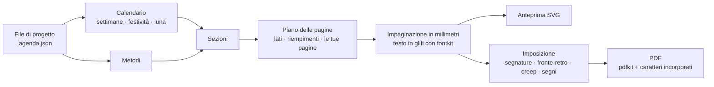

<div align="center">

# Heritage Studio

**Progetta, visualizza e stampa agende artigianali: qualsiasi anno, lingua e Paese,
in segnature piegate e cucite a mano.**

[](README.md)
[](README.es.md)
[](README.pt.md)
[](README.it.md)


</div>

Heritage Studio è nato come un’unica agenda artigianale per il 2026. Oggi è un’app che
costruisce il libro completo per qualsiasi anno: calendario, festività, registri delle
abitudini e pagine di pianificazione basate sulle scienze comportamentali. Dispone le
pagine su fogli pronti per una stampante fronte-retro, così puoi piegarli, cucirli e
rilegarli.

Funziona interamente nel browser, anche offline, su Linux, Windows, macOS e Android, e
come app desktop per Windows, macOS e Linux. Non viene caricato nulla da nessuna parte.


## Scarica

**[Scarica l’ultima versione](https://github.com/jonidimo/agenda-heritage-generator/releases/latest)** e scegli il file per il tuo sistema in *Assets*:

| Sistema | File |
| --- | --- |
| Windows 10 e 11 | `…-win-x64-setup.exe` (installer) o `…-win-x64-portable.exe` (senza installazione) |
| macOS 13 o successivo | `…-mac-arm64.dmg` (Apple silicon) o `…-mac-x64.dmg` (Intel) |
| Linux | `…-linux-x86_64.AppImage` (qualsiasi distribuzione) o `…-linux-amd64.deb` (Debian, Ubuntu, Mint) |

Gli installer non sono firmati con un certificato a pagamento, quindi Windows e macOS
mostrano un avviso la prima volta che li apri. La [guida all’app desktop](docs/desktop.md)
(in inglese) spiega come aprirli, dove vengono salvate le tue agende e come compilare l’app.
Per usarla nel browser, vedi [Come usarla](#come-usarla).

## Cosa fa

### Vedi tutto esattamente come verrà stampato

- Quattro viste, aggiornate mentre modifichi: **pagina**, **doppia pagina**,
  **foglio stampato** (come esce dalla stampante, fronte e retro) e il **libro intero**.
- L’anteprima disegna gli stessi contorni delle lettere che finiscono nel PDF, quindi non
  dipende dai caratteri installati sul tuo computer.
- La **verifica preliminare** trova testi che non entrano, testi sovrapposti, ciò che esce
  dalla pagina o finisce nel margine che la stampante non stampa, segni mancanti in un
  carattere e immagini con poca risoluzione.

### Modifica con il mouse

- Trascina, sposta a piccoli passi, ridimensiona, ruota, attenua o nascondi qualsiasi
  elemento. Applica la modifica a tutte le pagine di quel tipo, riflessa nelle pagine di
  sinistra, o a una sola pagina. Calamita, guide dei margini, annulla e ripeti.
- **Filigrane per persona**: il colibrì o un tuo SVG o PNG, ancorati al bordo esterno o
  interno, con dimensioni e opacità.
- **Pagine personalizzate dove vuoi**: un’immagine, un SVG vettoriale o una pagina di un
  PDF (che resta vettoriale nel PDF finale), oppure una pagina a righe, a puntini o a
  quadretti. Il resto del libro si riorganizza da solo.
- Aggiungi testi, immagini, righe e cornici a qualsiasi tipo di pagina.
- Ridimensiona i tuoi elementi da qualsiasi bordo o angolo; con Maiusc mantengono le
  proporzioni.
- Un elemento immagine accetta qualsiasi immagine: scegline una dall’agenda o carica un PNG,
  JPG o SVG.
- Ogni testo può avere il suo carattere e il suo colore, oppure seguire quelli del suo tipo
  di testo.
- **Zoom** della pagina con Ctrl e + / − / 0 (o la rotellina del mouse con Ctrl). **File →
  Dimensione dell'interfaccia** ingrandisce o riduce tutta l'interfaccia, e i pannelli laterali
  e la striscia di miniature si ridimensionano trascinandone i bordi; l'app ricorda entrambe le cose.
- **Clic destro** (o pressione prolungata sul telefono) su qualsiasi elemento, pagina o
  miniatura: cambiare l’immagine della filigrana, nascondere qualcosa in una pagina o in
  tutte quelle di quel tipo, selezionare elementi simili, aggiungere testi o immagini dove
  hai cliccato.
- **Più elementi insieme** con Ctrl o Maiusc, o trascinando un riquadro da un punto vuoto:
  spostarli insieme, allinearli, distribuirli con spazi uguali o ordinarli in una griglia
  che ne trova righe e colonne.
- **Righe, puntini o quadretti per tipo di pagina o per pagina**: interlinea, passo
  orizzontale e verticale dei puntini, dimensione del puntino e spessore.

### Sezioni e modelli di pagina

- Clicca una sezione nel pannello **Sezioni** per andare alla sua pagina. Con il clic
  destro la sposti, la disattivi o cambi ogni quanto si ripete.
- Qualsiasi sezione può comparire una volta o **ripetersi ogni mese, settimana o giorno**.
- **Modelli di pagina**: disegni una pagina una volta (sfondo a righe, puntini o quadretti,
  testi, immagini, cornici) e la ripeti dove vuoi. Testi come `{date}`, `{weekday}` o
  `{month}` cambiano in ogni copia.

### Trova qualsiasi cosa

- **Ricerca** (Ctrl+K, `/` o la lente): trova impostazioni, sezioni, pagine ed elementi
  anche con errori di battitura, senza accenti o con maiuscole diverse, e ti porta lì
  evidenziandoli.
- I pulsanti **Indietro e Avanti** nella barra superiore ripercorrono le pagine visitate,
  come nel browser.

### Qualsiasi anno, lingua e Paese

- Testi stampati in spagnolo, inglese, portoghese e italiano; l’interfaccia parla le
  stesse quattro lingue e segue quella scelta quando si crea l’agenda.
- Il Paese fissa le convenzioni regionali (ordine delle date, valuta, giorno in cui
  inizia la settimana) con i dati Unicode CLDR del browser: l’inglese in Argentina si
  scrive giorno/mese. L’ordine delle date e l’inizio della settimana si possono anche
  scegliere a mano; le date sono sempre salvate in ISO 8601.
- Festività di **207 Paesi** e delle loro regioni, dal 2016 al 2061. Aggiungi ponti,
  rinomina o rimuovi festività.
- Compleanni e date importanti, fasi lunari, ed equinozi e solstizi calcolati per il tuo
  fuso orario e il tuo emisfero.
- Numerazione ISO delle settimane, settimane che iniziano di lunedì, di domenica o di
  sabato, da 1 a 24 mesi, a partire da qualsiasi mese.

### Pensata per la carta

- 6 temi (Heritage, Chiara, Classica, Minimale, Quaderno, Filigrana) e 4 modelli. Un
  tema definisce tutto insieme: il carattere e il colore di ogni tipo di testo e lo stile
  delle righe di scrittura, dei separatori, delle tabelle e delle cornici.
- **Linee e ghirigori**: linee continue, tratteggiate, punteggiate o doppie, ornamenti
  ripetuti lungo una linea o al suo centro, e angoli per le cornici. Ci sono dieci
  ornamenti inclusi e puoi importare i tuoi in SVG o PNG.
- **Una palette da un colore**: scegli un colore e un’armonia (monocromatica, analoga,
  complementare, complementare divisa o triadica). L’app ricava tutti i colori nello
  spazio colore OKLCH e mantiene il testo abbastanza scuro da leggersi bene sulla carta.
- **Temi personali**: salva tutto lo stile con un nome, usalo in altre agende e
  condividilo come file `.tema.json`, con i suoi ornamenti dentro.
- Cambia caratteri, dimensioni, spessore e interlinea delle righe; scegli righe, puntini o
  quadretti; regola l’ombreggiatura del fine settimana e un livello di comodità per chi
  ha la vista stanca. Tutto si aggiorna in tempo reale.
- 5 famiglie di caratteri open source incluse, incorporate nel PDF come sottoinsiemi.
  Carica i tuoi caratteri TTF, OTF, WOFF o WOFF2: l’app controlla che contengano tutti i
  segni che servono alla tua lingua.

### Metodi basati sulle evidenze

- **30 metodi**: settimana Alastair, piani se-allora, WOOP, monitoraggio dei progressi, un
  registro delle abitudini che conta i giorni fatti invece delle serie, revisione
  settimanale, tre cose belle, diario del sonno, memoria esterna e altro ancora.
- Ogni metodo modifica le pagine su cui agisce ed è spiegato in una **guida stampata** con
  il suo livello di evidenza (solida, moderata, limitata, pratica senza studi diretti o
  discussa) e i suoi riferimenti. Vedi [il rapporto sulle evidenze](docs/evidencia-metodos.md)
  (in spagnolo).
- Aggiungi i tuoi metodi dall’interfaccia, senza programmare.

### Segnature che vengono bene

- **Segnature cucite** con il numero di fogli per segnatura che scegli (tutte uguali,
  equilibrate o un elenco su misura), una sola segnatura, taglia e impila per la
  rilegatura a spirale o a dischi, oppure una pagina per foglio.
- A4 → A5, Legal → 177,8 × 215,9 mm (il formato più grande stampabile dalla HP LaserJet
  4350), Lettera, Folio, Oficio 340, A3, A5 o personalizzato.
- Fronte-retro capovolgendo sul lato corto o lungo, oppure fronte-retro manuale;
  correzione del retro; compensazione dello scorrimento (creep); segni di piega, di taglio
  e di collazione; numero di segnatura.
- Foglio di calibrazione, dima di foratura per le stazioni di cucitura e una copertina con
  la larghezza del dorso calcolata in base al numero di fogli.

### Da leggere su tablet o e-reader

- Il **PDF delle pagine** ha link toccabili, come un’agenda digitale: ogni giorno dei
  calendari, del registro del mese e della vista mensile porta alla sua settimana (o alla
  pagina del giorno), ogni mese al suo mese, i titoli salgono di un livello (settimana →
  mese → calendario annuale → indice) e l’indice porta alle sue pagine. In un lettore che
  segue i link del PDF, come un Onyx Boox o un tablet, basta un tocco.
- **Segnalibri del lettore**: l’indice laterale del lettore elenca le sezioni, ogni mese e
  le sue settimane.
- **Linguette di tutti i mesi** sul bordo di ogni pagina (facoltative): ognuna porta al suo
  mese.
- I link nascono da ciò che è stampato, quindi seguono ogni cambio di anno, carta o
  sezioni. Il pulsante dei link nella barra in alto li mostra sulla pagina e un clic li
  segue; il pannello di ogni elemento mostra dove porta e permette di togliergli i link o
  mandarlo a un’altra pagina o a un indirizzo web. Il PDF da stampare non li contiene.

### I tuoi file e modelli

- **File → Salva** (Ctrl+S) scrive un file `.agenda.json` con immagini e caratteri al suo
  interno. In Chrome, Edge e nell’app per computer, le volte successive riscrive lo stesso
  file.
- **Salva come modello** conserva tutto il progetto per iniziare altre agende: un altro
  anno, un’altra persona o un’altra lingua. I modelli si possono esportare e condividere
  come file.
- **Backup di tutto** salva tutte le agende e i modelli in un solo file; aprendolo vengono
  ripristinati.
- Le agende restano anche nel browser, ma solo in quel browser e a quell’indirizzo
  dell’app: i file sono la copia sicura.

### Progetta con un modello di intelligenza artificiale

- Un **server MCP** permette a Claude, o a qualsiasi modello compatibile con MCP, di creare
  un’agenda, modificarla, controllarla, guardarne le pagine ed esportare il PDF o un tema. L’app desktop lo include: si avvia con `--mcp` ([come](docs/desktop.md#5-use-it-with-an-ai-model-mcp), in inglese).
  Chiedigli "un’agenda per insegnanti da marzo a dicembre" o "un tema con ghirigori liberty".
- Il formato del file ha uno **schema JSON** e un catalogo generati dal codice, e
  `npm run agenda -- check` dice esattamente cosa verrebbe ignorato o corretto. Leggi la
  [guida](docs/llm-templates.md) (in inglese; [en español](docs/plantillas-llm.md)).

### Fatta per durare

- *Duplica per il 2028* porta un progetto all’anno successivo, con pagine e regolazioni al
  loro posto.
- I file vengono convalidati all’apertura: colori, numeri e impostazioni del tema sono
  controllati, così un file danneggiato o manomesso non rompe l’app né esegue codice.
- Lo stesso motore funziona nel browser, in un processo in background e da riga di
  comando.

## Schermate

| | |
| --- | --- |
|  |  |
| Il foglio stampato, con i segni di piega e di segnatura, accanto alle impostazioni di stampa. | Stile: caratteri, dimensioni, righe e comodità aggiornano le pagine in tempo reale. |
|  |  |
| I metodi e la guida che li spiega, con evidenze e riferimenti. | Il libro intero e le festività del Paese scelto. |

Le schermate mostrano l’interfaccia in inglese; per cambiare lingua usa il menu
**File**.

<p align="center"></p>

Pagine reali del PDF: frontespizio (spagnolo), guida (inglese), copertina del mese
(portoghese), registro delle abitudini (italiano) e password (spagnolo).


Una doppia pagina settimanale dell’agenda 2027: i giorni a sinistra, la griglia delle
attività Alastair a destra.


## Come funziona



1. **Un’agenda è un file di progetto, non codice.** È un JSON, convalidato all’apertura,
   con l’anno, la lingua, il Paese, le sezioni e le loro opzioni, il tema, la persona, le
   filigrane, le tue pagine e immagini e le tue modifiche. Le modifiche vengono salvate
   come spostamenti legati a nomi stabili come `week:2027-W12:left`, così sopravvivono a
   un cambio di anno o di carta.
2. **Il calendario** costruisce i mesi e le settimane ISO con festività, date personali e
   fasi lunari.
3. **Le sezioni** (frontespizio, doppia pagina settimanale, registro delle abitudini,
   password…) pianificano le loro pagine e le impaginano in millimetri con funzioni di
   impaginazione. Le pagine si misurano, non si dichiarano: l’agenda aggiunge pagine di
   riempimento perché le doppie pagine restino affiancate, le copertine del mese cadano su
   una pagina di destra e ogni segnatura sia completa.
4. **Il testo** viene convertito in glifi una sola volta con fontkit. L’anteprima disegna
   quei glifi e il PDF scrive gli stessi glifi con il carattere incorporato, così lo
   schermo corrisponde alla carta.
5. **L’imposizione** dispone le pagine sui fogli. In una segnatura di *n* fogli, il foglio
   *i* contiene le pagine 4n−2i e 2i+1 sul fronte e 2i+2 e 4n−2i−1 sul retro.
6. **Il PDF** viene scritto da pdfkit in un processo in background, così l’editor non si
   blocca mai. Le pagine PDF importate vengono incorporate come vettori con pdf-lib.

## Come usarla

Ti serve [Node.js](https://nodejs.org/) 22.12 o più recente.

```bash
git clone https://github.com/jonidimo/agenda-heritage-generator.git
```

```bash
cd agenda-heritage-generator && npm ci
```

```bash
npm run dev
```

Apri <http://localhost:5173>. Al primo avvio vengono generati i dati delle festività: ci
vuole circa un minuto.

**Installarla come app.** In Chrome, Edge o Chromium, su un computer o su un telefono
Android, scegli *Installa* o *Aggiungi a schermata Home*. Da quel momento funziona anche
offline.

**App desktop.** Vedi [Scarica](#scarica). La [guida all’app desktop](docs/desktop.md) (in
inglese) spiega come installarla e come compilare gli installer.

**Pubblicare la tua copia.** `npm run build` genera un sito statico in `dist/`. Il
progetto include un workflow di GitHub Pages che lo pubblica: attivalo in
*Settings → Pages → Source: GitHub Actions*.

**Riga di comando.** Ogni esportazione è disponibile anche da terminale:

```bash
npm run agenda -- new --template heritage --year 2028 --locale it-IT --country IT --out designs/mia-2028.agenda.json
```

```bash
npm run agenda -- info designs/mia-2028.agenda.json
```

```bash
npm run agenda -- check designs/mia-2028.agenda.json
```

```bash
npm run pdf -- designs/mia-2028.agenda.json --mode imposed --out output/mia-2028-stampa.pdf
```

`check` elenca cosa verrebbe ignorato o corretto in un file e gli avvisi dell’agenda
composta. `npm run -s agenda -- schema` e `npm run -s agenda -- catalog` mostrano il formato del
file e tutto ciò che può nominare. `npm run -s mcp` avvia il server MCP per i modelli di
intelligenza artificiale (vedi [la guida](docs/llm-templates.md)).

## Stampa e rilegatura

Stampa una volta il foglio di calibrazione e poi il PDF fronte-retro; piega, fora, cuci e
aggiungi la copertina. La [guida alla stampa e alla rilegatura](docs/printing.md), in
inglese, spiega ogni passaggio, con le impostazioni per Linux (CUPS), Windows e Android.
C’è anche una [versione in spagnolo](docs/impresion.md).

## Struttura del progetto

| Cartella | Contenuto |
| --- | --- |
| `src/core` | Il motore, senza dipendenze dal browser: calendario, festività, testo, impaginazione, sezioni, imposizione, renderer SVG e PDF. |
| `src/app` | L’editor (React). |
| `src/workers` | La generazione del PDF in un processo in background. |
| `src/cli` | La riga di comando. |
| `src/node` | Condiviso da riga di comando, server MCP e test: legge caratteri, festività e immagini dal disco e controlla i file delle agende. |
| `src/mcp` | Il server MCP per i modelli di intelligenza artificiale. |
| `electron` | L’app desktop (Electron). |
| `designs` | Agende di esempio per il 2027 in spagnolo, inglese, portoghese e italiano. |
| `tests`, `e2e` | Test unitari (Vitest) e test nel browser (Playwright). |
| `docs` | Le guide e il rapporto sulle evidenze. |
| `legacy` | La versione 2026 in Python e i suoi PDF, conservati come riferimento per il design. |

## Sviluppo

```bash
npm test
```

```bash
npm run test:e2e
```

```bash
npm run typecheck && npm run lint
```

I test impaginano ogni modello in varie lingue, formati di carta e livelli di comodità e
falliscono se un testo non entra, si sovrappone a un altro o esce dall’area stampabile.
Per aggiungere un metodo o una sezione, leggi [Adding methods and sections](docs/adding-methods.md).

## Crediti

- Caratteri con licenza SIL Open Font License: Cormorant Garamond, Manrope, Atkinson
  Hyperlegible Next, EB Garamond e Caveat (licenze in `public/fonts`).
- Dati delle festività da [date-holidays](https://github.com/commenthol/date-holidays) di
  commenthol, basati su Wikipedia, con licenza
  [CC BY-SA 3.0](https://creativecommons.org/licenses/by-sa/3.0/). Per i ponti, controlla
  il calendario ufficiale del tuo Paese.
- [Astronomy Engine](https://github.com/cosinekitty/astronomy) (MIT) per le fasi lunari e
  le stagioni.
- [PDFKit](https://pdfkit.org/) e [fontkit](https://github.com/foliojs/fontkit) (MIT),
  [pdf-lib](https://github.com/cantoo-scribe/pdf-lib) (MIT), [PDF.js](https://mozilla.github.io/pdf.js/)
  (Apache 2.0), React, Vite, Tailwind CSS, Zustand, Immer, Zod e Lucide.
