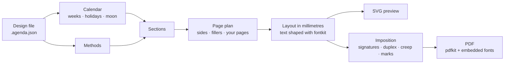

<div align="center">

# Heritage Studio

**Design, preview and print handmade planners: any year, language and country,
folded into signatures and sewn by hand.**

[](README.md)
[](README.es.md)
[](README.pt.md)
[](README.it.md)
[](README.de.md)
[](README.fr.md)


</div>

**Try it online:** [jonidimo.github.io/agenda-heritage-generator](https://jonidimo.github.io/agenda-heritage-generator/) (always the latest version, nothing to install).

Heritage Studio began as one handmade planner for 2026. It is now an app that builds
the whole book for any year: calendar, holidays, habit trackers and planning pages based
on behavioural science. It lays the pages out on sheets ready for a duplex printer, so
you can fold, sew and bind them.

It runs entirely in your browser, also offline, on Linux, Windows, macOS and Android,
and as a desktop app for Windows, macOS and Linux. Nothing is uploaded anywhere.


## Download

**[Download the latest version](https://github.com/jonidimo/agenda-heritage-generator/releases/latest)** and choose the file for your system under
*Assets*:

| System | File |
| --- | --- |
| Windows 10 and 11 | `…-win-x64-setup.exe` (installer) or `…-win-x64-portable.exe` (no installation) |
| macOS 13 or later | `…-mac-arm64.dmg` (Apple silicon) or `…-mac-x64.dmg` (Intel) |
| Linux | `…-linux-x86_64.AppImage` (any distribution) or `…-linux-amd64.deb` (Debian, Ubuntu, Mint) |

The installers are not signed with a paid certificate, so Windows and macOS warn you the
first time you open them. The [desktop app guide](docs/desktop.md) shows how to open them,
where your planners are kept and how to build the app yourself. To use it in the browser
instead, see [Run it](#run-it).

## Features

### See it exactly as it will print

- Four views, updated as you edit: **page**, **spread**, **printed sheet** (as it comes
  out of the printer, front and back) and the **whole book**.
- The preview draws the same glyph outlines that go into the PDF, so it does not depend
  on the fonts installed on your computer.
- **Preflight** finds text that does not fit, texts that overlap, anything outside the
  page or in the printer's unprintable margin, missing characters in a font and images
  with too little resolution.
- **Design and Print modes**: *Design* is for the page, spread and whole book; *Print* adds the printed-sheet view and the print panel, and draws on every page the area the printer does not print and the binding margin.
- **Destination**: a planner made to be **read on screen** drops the binding margin, trims, marks and signature filler pages; its pages keep their size and it exports page by page, with links. You can switch back to *Print and bind* at any time.

### Edit with the mouse

- Drag, nudge, scale, rotate, fade or hide any element. Apply the change to every page of
  that type, mirrored on left-hand pages, or to one page only. Snapping, margin guides,
  undo and redo.
- **Watermarks per person**: the hummingbird, an icon or your own SVG or PNG, anchored to the
  outer or inner edge, with size and opacity; on every page or only on right or left pages,
  blended with the paper (*Multiply* makes a logo's white background disappear), in grey or
  tinted, and with the position and the image mirrored separately on left pages.
- **Your own pages anywhere**: an image, a vector SVG or a page of a PDF (kept as vectors
  in the final PDF), or a page of lines, dots or grid. The rest of the book reflows
  around them.
- Your own text, images, lines and frames on any page type.
- Resize your elements from any edge or corner; hold Shift to keep their proportions.
- **Resize the planner's own elements too** (a month name, a frame, a table, a writing area)
  from any edge or corner: their content is laid out again inside the new box instead of
  being stretched, and the panel has width and height fields.
- **Double-click any text** to edit it where it is: yours, or the planner's own (cover name
  and title, dedication, the phrase of each month, page titles). Enter or Ctrl+Enter confirms,
  Esc discards, and the page redraws as you type. A text element can follow its lines
  (automatic height).
- **Style per element**: dashed, dotted or double lines, colour and weight of each kind of
  line, fill and text colour, for one element on every page of its type or on one page only.
- **Copy, cut, paste and duplicate** your elements (Ctrl+C, X, V and D) within a page or
  between pages.
- Dragging a slider or a colour picker is smooth: the page follows live, thumbnails wait,
  and the whole drag is one undo step.
- An image element takes any picture: choose one from the planner or upload a PNG, JPG or
  SVG.
- Each text element can have its own font and colour, or follow its type of text.
- **Zoom** the page with Ctrl and + / − / 0, or with Ctrl and the mouse wheel (or a pinch on
  the touchpad): the point under the cursor stays where it is. **Settings →
  Interface size** (a slider with its number) scales the whole interface, and the side panels and the page strip
  are resized by dragging their edges; the app remembers both.
- **Right-click** (or long-press on a phone) any element, page or thumbnail for its
  options: change the watermark image, hide something on one page or on all pages of
  that type, select similar elements, add text or images where you clicked.
- **Select several elements** with Ctrl or Shift, or by dragging a box from an empty
  spot. Move them together, align them, distribute them with equal gaps, or tidy them
  into a grid that finds their rows and columns.
- **Lines, dots or grid per page type or per page**: line spacing, horizontal and
  vertical dot spacing, dot size and line weight.
- **Scale and deform**: every element has eight handles that reflow its content in the new box; the scale is a separate slider, and **Allow deforming** stretches the drawing in any direction instead.
- **Copy the planner's own elements** (Ctrl+C on a month name, a frame, a table…) and paste an editable element of your own: text stays editable text; the rest becomes a drawing that keeps its line weights.
- **Ten more kinds of element**: table, checklist, habit tracker, finance lines, mini calendar (its days link to their pages), quadrants, notes, day schedule, rating and **QR code** (any web address, email, phone or text; tappable in the PDF), each with its own fields.
- **Icons and shapes**: a library of 96 icons (Lucide), searchable in every language and tinted any colour, and fifteen shapes: rectangle, ellipse, line with arrows or dots, arrow, triangle, diamond, polygon (3 to 24 sides), star (3 to 24 points), heart, ring, arc or sector, speech bubble, banner, cross and a free SVG path. The stroke stays inside the box and only the settings of each shape are shown.
- **An image on each month cover** instead of the sticker, for one month or for all of them.
- **Layers**: a panel lists the page's elements from top to bottom; raise, lower, send to the back, rename, hide, and blend with what is underneath (multiply, screen, darken, lighten). Ctrl+↑ and Ctrl+↓ move the chosen element.
- **Layer menu and lock**: right-click a row in Layers to duplicate, lock or unlock, rename, bring to the front, send to the back, or delete. A locked element can be selected but not dragged, resized, nudged or deleted (Ctrl+Shift+Alt+L). Under the list, the chosen element's opacity, blend and lock.
- **Shapes**: fill as a colour swatch with a *No fill* button, opacity from 5 to 100 %, and every element of your own rotates from 0 to 360°.
- **Assets / Vectors**: place any image, SVG or icon on the page with one click, or use it as a **stamp and stroke brush**: a click leaves one copy; dragging leaves copies along the stroke (size, spacing, upright / following the stroke / random, variation, colour). Each stroke is one element and one undo step.
- **Full screen (F11)**: just the page, without the side panels, the page strip or the footer; F11 or Esc brings them back as they were.
- **Drag to scroll**: with the middle mouse button, or holding the space bar with the main button, the workspace follows the pointer, without hunting for the scroll bars.
- **Tidy menus**: File (the planner and its files, with *My planners*), Edit, View, Settings (interface language, each in its own language; interface size; preferences; AI assistant) and Help (shortcuts, guide for AI models, report a problem, About). *New planner* fits any window: two columns, and *Create planner* always in view.
- **Hidden elements are never lost**: Edit → *Show hidden elements* lists them and brings each one back. **Zoom to the selection** with Ctrl+Shift+2; the page footer counts the warnings of the current page, and thumbnails show a dot.
- **Keyboard shortcuts** for everything, listed in the app (F1) and beside each menu item.

### Sections and page templates

- **Start from scratch**: the *Blank* template has no pages at all and shows what to do
  first; the *Notebook* template is a title page and as many dotted, lined, squared or plain
  pages as you want, with no calendar. Add any section (and several sections of notes),
  add pages to each month, or remove a section from its menu.

- Click a section in the **Sections** panel to go to its page. Right-click it to move it,
  turn it off or change how often it repeats.
- Any section can appear once or **repeat every month, week or day**.
- **Page templates**: design a page once (a background of lines, dots or grid, texts,
  images, frames) and repeat it wherever you want. Texts such as `{date}`, `{weekday}` or
  `{month}` change on each copy.
- **Right-click a month** in the page strip to go to its cover, log or first week, repeat a page for each month, hide the month, export only that month to PDF, or show only that month in the strip. Hidden months leave the book; the year calendar keeps them, without links. A **Year** marker jumps to the yearly overview, and the strip scrolls with the mouse wheel.

### Find anything

- The **top bar** has three zones (file and history, mode and view, search and zoom) and
  folds what does not fit into a «⋯» menu on narrow windows.
- **Search** (Ctrl+K, `/` or the search field in the top bar) finds settings, sections, pages and elements,
  even with typos, without accents or in any case, and takes you there with a highlight.
- **Back and forward** buttons in the top bar go through the pages you visited, as in a
  browser.

### Any year, language and country

- Printed text in Spanish, English, Portuguese, Italian, German and French; the interface
  speaks the same six languages and follows the language chosen when the planner is created.
- The country sets the regional conventions (date order, currency, first day of the
  week) from the Unicode CLDR data built into the browser, so English in Argentina is
  written day/month. Date order and first day of the week can also be set by hand;
  dates are always stored as ISO 8601.
- Public holidays for **207 countries** and their regions, from 2016 to 2061. Add bridge
  days, remove holidays or give one another name with the pencil in *Calendar → Holidays*
  (for example a shorter one for a name that does not fit its cell).
- Birthdays and important dates, moon phases, and the equinoxes and solstices computed
  for your time zone and hemisphere.
- ISO week numbers, weeks starting on Monday, Sunday or Saturday, 1 to 24 months,
  starting in any month.

### Designed for paper

- 6 themes (Heritage, Clear, Classic, Minimal, Notebook, Filigree) and 4 templates. A
  theme sets everything at once: the font and colour of each type of text and the style of
  writing lines, separators, tables and frames.
- **Lines and flourishes**: solid, dashed, dotted or double lines, ornaments repeated
  along a line or set in its centre, and corners for frames. Ten ornaments are built in,
  and you can import your own SVG or PNG.
- **A palette from one colour**: choose a colour and a harmony (monochrome, analogous,
  complementary, split complementary or triadic). The app derives every colour in the
  OKLCH colour space and keeps text dark enough to read on paper.
- **Your own themes**: save the whole style with a name, use it in other planners and
  share it as a `.tema.json` file with its ornaments inside.
- Change fonts, sizes, line weight and spacing, lines, dots or grid, weekend shading and
  a comfort level for older eyes. Everything updates live.
- 5 bundled open-source font families, embedded in the PDF as subsets. Upload your own
  TTF, OTF, WOFF or WOFF2 fonts; the app checks that they have every character your
  language needs. If one lacks a character (a jersey font with no comma or parentheses),
  that character comes from a fallback font, on screen and in the PDF, as in a browser;
  Style warns when a font lacks punctuation and what it suits best.

### Methods based on evidence

- **30 methods**: Alastair week, if-then plans, WOOP, progress monitoring, a habit
  tracker that counts days done instead of streaks, weekly review, three good things,
  sleep diary, external memory and more.
- Each method changes the pages it affects and is explained in a **printed guide** with
  its level of evidence (strong, moderate, limited, practice without direct studies or
  contested) and its references. See [the evidence report](docs/evidencia-metodos.md)
  (in Spanish).
- Add your own methods from the interface, without code.

### Booklets that come out right

- **Sewn signatures** with the number of sheets per signature you choose (all equal,
  balanced or a custom list), a single signature, cut-and-stack for spiral or disc
  binding, or one page per sheet.
- A4 → A5, Legal / Oficio → 177.8 × 215.9 mm (the largest size the HP LaserJet 4350
  prints), Letter, Folio, Oficio 340, A3, A5 or custom.
- Duplex on the short or long edge, or manual duplex; back-side correction; creep; fold,
  crop and collation marks; signature numbers.
- Calibration sheet, punching template for the sewing stations, and a cover with the
  spine width computed from the number of sheets.

### Read it on a tablet or e-reader

- The **Pages PDF** comes with tappable links, like a digital planner: each day in the
  calendars, the monthly log and the month view takes you to its week (or its day page),
  each month name to its month, titles go one level up (week → month → year calendar →
  contents) and the contents go to their pages. In a reader that follows PDF links, such
  as an Onyx Boox or a tablet, a tap is enough.
- **Reader bookmarks**: the reader's side index lists the sections, each month and its
  weeks.
- **Tabs for every month** on the edge of each page (optional), each one taking you to its
  month.
- Links come from what is printed, so they follow any change of year, paper or sections.
  The links button in the top bar shows them on the page, and a click follows them; each
  element's panel shows where it goes and lets you remove its links or send it to another
  page or a web address. The PDF for printing does not include them.
- Each tappable spot can be changed on its own: click a day number or a month name on the
  page, or right-click it, to send just that one somewhere else or remove it.

### Your files and templates

- **File → Save** (Ctrl+S) writes a `.agenda.json` file with its images and fonts inside.
  In Chrome, Edge and the desktop app, the next saves rewrite the same file.
- **Save as template** keeps a whole design to start new planners from it, for another
  year, person or language. Templates can be exported and shared as files.
- **Back up everything** saves all planners and templates, and the uploaded fonts, in one file;
  opening it restores them. A font in a file you open does not replace the one this device already
  has with the same name: the one here stays, and you are told.
- Planners are also kept in the browser, but only in that browser and at that app
  address, so files are the safe copy.
- The **Images** and **Fonts** panels say where each image is used (watermark, cover, elements, pages, ornaments) and remove it together with everything that used it; fonts show which characters are missing and where each family is used, and your own can be removed.
- **Images next to the file**: a planner can point to its images by path (`"path":
  "images/logo.png"`) instead of carrying them inside; the command line, the MCP server and
  the desktop app (when the system opens the file, or with *File → Open file…*) read them from that
  folder only. In the web app, the warning offers **Find the images folder…**: you choose the folder and
  the images are embedded in the planner (and the path is dropped). As with any file the system opens
  in the desktop app, the first *Save* of a session asks where.
- **Light PDFs**: *Printing → Images in the PDF* (300 ppi for printing, 150 for screens, or originals)
  reduces only the images that have more resolution than their printed size needs, without visible
  quality loss, and an image used on every page (a watermark) is stored once in the PDF. The panel
  *Images* shows each image's weight and its ppi at the size it is really printed; above 600 ppi it
  says so (`overDpi`). Uploads follow the same idea: photos in WebP/HEIC/AVIF become JPEG (not
  PNG), anything over 4000 px on its longest side is reduced, and the same file is never stored twice.
- Desktop app: after exporting a PDF it shows **where it was saved**, with *Open folder*; planners open by double-clicking a `.agenda.json` or by dropping it on the window, and closing never loses the last change.
- **Sheet size from the start**: the new-planner screen shows the paper (or the tablet screen), how it is bound and the resulting page size. *File/Edit → Sheet size…* changes it later and can scale your own elements to the new page in one undo step.

### An AI assistant inside the app

- A round button in the bottom-right corner (**Ctrl+J**): ask for a change in your own words
  («make the notes on this page bigger», «a habit tracker every month»). The assistant reads
  the planner, proposes **one** change, and you see it on the page before you **Apply** or
  **Discard** it; an applied change is a single undo step. Nothing is kept once you close it.
- Works with **Anthropic (Claude), Google Gemini, OpenAI and compatible services**
  (OpenRouter, Groq, Mistral) and **local models** (Ollama, LM Studio), with your own key.
  Optionally it can look at the pages (vision).
- Your key is never stored in clear: in the desktop app the operating system encrypts it
  (Keychain, DPAPI, libsecret) and requests go out through the app; on the website it lives
  in memory, or encrypted in the browser if you choose to remember it. Settings in
  *Settings → AI assistant…* or the gear on the pill.
- **Version 2.4.1**: the assistant sits as a round button in the bottom-right corner. With a local server the model list is fetched by itself (a choice list, not a filtered field), and an address without `/v1` is offered with it. Asking for something else while a proposal is on screen **refines** it (the next proposal adds to it and Apply confirms everything as one step), and the card shows each change with its old and new values.
- **Version 2.5.0**: the model has 10 steps per request and, before the last one, is asked to propose with what it already knows; it knows that changing the planner language translates everything in a single operation. The address `http://0.0.0.0:8080` that llama.cpp prints works as it is. If part of the app fails to load (because it was updated with the window open), the card explains it and offers to reload the window without losing your work.

### Design with an AI model

- An **MCP server** lets Claude, or any model that speaks MCP, create a planner, change
  it, check it, look at its pages and export the PDF or a theme. The desktop app contains
  it: start it with `--mcp` ([how](docs/desktop.md#6-use-it-with-an-ai-model-from-outside-mcp)). Ask it for "a teacher's
  planner from March to December" or "a theme with Art Nouveau flourishes".
- The file format comes with a **JSON Schema** and a catalogue generated from the code,
  and `npm run agenda -- check` says exactly what would be ignored or corrected. Read the
  [guide](docs/llm-templates.md) ([en español](docs/plantillas-llm.md)).
- Every change the model makes comes back with the layout warnings it caused (text that does
  not fit, elements off the page or overlapping), so it can fix them without anyone looking.
- Models can use `icon:<name>` for any icon without declaring it, draw with shapes, and keep
  images next to the file by path. Across the tools, `path` is always the file that is read
  and `out` the one that is written.
- **Own fonts and a guide for models (2.5.0)**: your own fonts travel inside the file (`userFonts`) and the server uses them to draw; `add_font` embeds one and says which punctuation it lacks. `get_guide` gives the guide by section to clients that do not read resources, there are recipes (`nueva-agenda`, `revisar-avisos`, `traducir`), and each `check_design` warning says how to fix it.
- **Images and fonts from the internet (2.5.1)**: the MCP server searches images (`search_images`, with thumbnails to choose from; Openverse and Wikimedia Commons without a key; Pexels, Pixabay, Unsplash and DeviantArt with one) and imports them (`import_image`: cleans them, crops them to a page or to the whole cover with bleed and spine, shrinks them to ~300 dpi, keeps author, license and address, never imports the same one twice, and changes nothing without `confirm: true`); `build_credits_page` builds the credits page; `search_fonts` and `import_font` bring Google Fonts, checking ñ, accents, ¿ and ¡ embedding the font whole so you can edit the text freely. It only visits the APIs' domains (never local or private addresses), with a time and size limit per download; keys go in environment variables (`PIXABAY_API_KEY`, `UNSPLASH_ACCESS_KEY`, `GOOGLE_FONTS_API_KEY`) and are never saved in the planner.
- **Your own images, links and local network (2.5.1)**: `import_image` also takes a file from the working folder (`image`, e.g. AI-generated art) or a direct link (`url`), and `browse_page` lists the images and links of a web page so a model can choose. Pages and links are only opened for domains **you declare** in `AGENDA_TRUSTED_HOSTS` (they can be on your local network, over `http`); everything else stays closed. **Responsibility notice:** declaring a domain is your decision — the program does not check what is there or whose images they are (the copyright of what you import and the use of your network are yours), and it is provided without warranty. Nothing is added without your approval (`confirm`).
- **The assistant (the star) on the internet and in your folders (2.6.0, desktop app)**: the in-app assistant can now search images and fonts on the internet (`search_images`, `browse_page`, `search_fonts`), read images from your folders (`list_local_images`; each planner gets its own folder, made by itself inside `Documents/Heritage Studio` unless you choose another one in **Settings → Internet and folders**) and import them (`import_image`, `import_font`) with author and license; placing them on a page is a proposal you approve, like any other change. **Settings → Internet and folders** holds the API keys (encrypted by the system, never shown again) with a **Test** button for each service, your trusted sites, the base folder and the extra folders the assistant may read. If you move or rename a planner's folder inside the base folder the app finds it again; the **Folders** group in the Images panel previews its images and adds them with one click. For an external client, `list_images` and `AGENDA_MCP_READ_DIRS` give the MCP server read access to the folders you name (images only).
- **Live link (desktop app)**: with the app open, the same server works on **the planner you have open**. The model reads it, changes it as one step you can undo (refused if you edited it meanwhile), shows you a page, or opens another planner. Turn it off in *Settings → Let an AI model edit the open planner*. Nothing listens on the network: it is a local socket protected by a token made at every start.

### Made to last

- *Duplicate for 2028* carries a design to the next year, with its pages and
  adjustments in place.
- Files are validated when they are opened: colours, numbers and theme settings are
  checked, so a damaged or tampered file can neither break the app nor run code in it.
- The same engine runs in the browser, in a background worker and on the command line.

## Screenshots

| | |
| --- | --- |
|  |  |
| The printed sheet, with fold and signature marks, next to the print settings. | Style: fonts, sizes, lines and comfort update the pages live. |
|  |  |
| Methods and the guide that explains them, with evidence and references. | The whole book and the holidays of the chosen country. |

<p align="center"></p>

Real PDF pages: title page (Spanish), guide (English), month cover (Portuguese), habit
tracker (Italian) and passwords (Spanish).


A weekly spread from the 2027 planner: days on the left, the Alastair task grid on the
right.


## How it works



1. **A planner is a design file, not code.** It is JSON, validated on load, with the
   year, language, country, sections and their options, theme, person, watermarks, your
   own pages and images, and your edits. Edits are stored as offsets keyed by stable
   names such as `week:2027-W12:left`, so they survive a change of year or paper.
2. **The calendar** builds months and ISO weeks with holidays, personal dates and moon
   phases.
3. **Sections** (title page, weekly spread, habit tracker, passwords…) plan their pages
   and lay them out in millimetres with layout helpers. Pages are measured, not declared:
   the planner adds filler pages so that spreads face each other, month covers fall on a
   right-hand page and every signature is full.
4. **Text** is shaped once with fontkit. The preview draws those glyphs and the PDF writes
   the same glyphs with the font embedded, so the screen matches the paper.
5. **Imposition** places pages on sheets. In a signature of *n* sheets, sheet *i* carries
   pages 4n−2i and 2i+1 on the front and 2i+2 and 4n−2i−1 on the back.
6. **The PDF** is written by pdfkit in a background worker, so the editor never freezes.
   Imported PDF pages are embedded as vectors with pdf-lib.

## Run it

You need [Node.js](https://nodejs.org/) 22.12 or newer.

```bash
git clone https://github.com/jonidimo/agenda-heritage-generator.git
```

```bash
cd agenda-heritage-generator && npm ci
```

```bash
npm run dev
```

Open <http://localhost:5173>. The first start generates the holiday data, which takes
about a minute.

**Install it as an app.** In Chrome, Edge or Chromium, on a computer or an Android phone,
choose *Install* or *Add to home screen*. It then works offline.

**Desktop app.** See [Download](#download). The [desktop app guide](docs/desktop.md)
explains how to install it and how to build the installers.

**Publish your own copy.** `npm run build` writes a static site to `dist/`. The included
GitHub Pages workflow publishes it: enable it in *Settings → Pages → Source: GitHub
Actions*.

**Command line.** Every export is also available from a terminal:

```bash
npm run agenda -- new --template heritage --year 2028 --locale en-GB --country GB --out designs/my-2028.agenda.json
```

```bash
npm run agenda -- info designs/my-2028.agenda.json
```

```bash
npm run agenda -- check designs/my-2028.agenda.json
```

```bash
npm run pdf -- designs/my-2028.agenda.json --kind imposed --out output/my-2028-print.pdf
```

`check` lists what would be ignored or corrected in a file and the warnings of the built
planner. `npm run -s agenda -- schema` and `npm run -s agenda -- catalog` print the file format and
everything it can name. `npm run -s mcp` starts the MCP server for AI models (see
[the guide](docs/llm-templates.md)).

## Printing and binding

Print the calibration sheet once, then the double-sided PDF; fold, punch, sew and add
the cover. The [printing and binding guide](docs/printing.md) explains each step, with
settings for Linux (CUPS), Windows and Android ([en español](docs/impresion.md)).

## Project layout

| Folder | Contents |
| --- | --- |
| `src/core` | The engine, with no browser dependencies: calendar, holidays, text, layout, sections, imposition, SVG and PDF renderers. |
| `src/app` | The editor (React). |
| `src/workers` | PDF generation in a background worker. |
| `src/cli` | Command line. |
| `src/node` | Shared by the command line, the MCP server and the tests: reads fonts, holidays and images from disk, and checks design files. |
| `src/mcp` | The MCP server for AI models. |
| `electron` | The desktop app (Electron). |
| `designs` | Example planners for 2027 in Spanish, English, Portuguese and Italian. |
| `tests`, `e2e` | Unit tests (Vitest) and browser tests (Playwright). |
| `docs` | Guides and the evidence report. |
| `legacy` | The 2026 Python version and its PDFs, kept as a design reference. |

## Development

```bash
npm test
```

```bash
npm run test:e2e
```

```bash
npm run typecheck && npm run lint
```

The tests lay out every template in several languages, papers and comfort levels and
fail if any text overflows, overlaps or leaves the printable area. To add a method or a
section, read [Adding methods and sections](docs/adding-methods.md).

## Credits

- Made by **Jonatan Damián Dimotta Bré** ([Instagram](https://www.instagram.com/dimottajonatan/),
  [source code](https://github.com/jonidimo/agenda-heritage-generator),
  [online](https://jonidimo.github.io/agenda-heritage-generator/)). Every planner's guide ends
  with these credits and a QR code to the source; they can be turned off in *Methods*.
- Icons from [Lucide](https://lucide.dev) (ISC license).

- Fonts under the SIL Open Font License: Cormorant Garamond, Manrope, Atkinson
  Hyperlegible Next, EB Garamond and Caveat (licenses in `public/fonts`).
- Holiday data from [date-holidays](https://github.com/commenthol/date-holidays) by
  commenthol, based on Wikipedia, under
  [CC BY-SA 3.0](https://creativecommons.org/licenses/by-sa/3.0/). Check your
  government's official calendar for bridge days.
- [Astronomy Engine](https://github.com/cosinekitty/astronomy) (MIT) for moon phases and
  seasons.
- [PDFKit](https://pdfkit.org/) and [fontkit](https://github.com/foliojs/fontkit) (MIT),
  [pdf-lib](https://github.com/cantoo-scribe/pdf-lib) (MIT), [PDF.js](https://mozilla.github.io/pdf.js/)
  (Apache 2.0), React, Vite, Tailwind CSS, Zustand, Immer, Zod and Lucide.
