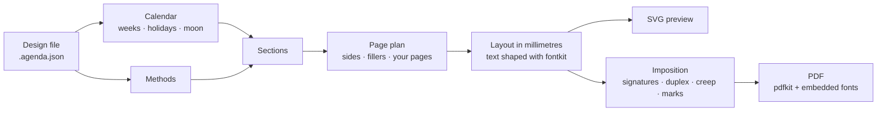

<div align="center">

# Heritage Studio

**Design, preview and print handmade planners: any year, language and country,
folded into signatures and sewn by hand.**

[](README.md)
[](README.es.md)
[](README.pt.md)
[](README.it.md)


</div>

Heritage Studio began as one handmade planner for 2026. It is now an app that builds
the whole book for any year: calendar, holidays, habit trackers and planning pages based
on behavioural science. It lays the pages out on sheets ready for a duplex printer, so
you can fold, sew and bind them.

It runs entirely in your browser, also offline, on Linux, Windows, macOS and Android,
and as a desktop app for Windows, macOS and Linux. Nothing is uploaded anywhere.


## Download

**[Download the latest version](https://github.com/jonidimo/agenda-heritage-generator/releases/latest)** and choose the file for your system under
*Assets*:

| System | File |
| --- | --- |
| Windows 10 and 11 | `…-win-x64-setup.exe` (installer) or `…-win-x64-portable.exe` (no installation) |
| macOS 13 or later | `…-mac-arm64.dmg` (Apple silicon) or `…-mac-x64.dmg` (Intel) |
| Linux | `…-linux-x86_64.AppImage` (any distribution) or `…-linux-amd64.deb` (Debian, Ubuntu, Mint) |

The installers are not signed with a paid certificate, so Windows and macOS warn you the
first time you open them. The [desktop app guide](docs/desktop.md) shows how to open them,
where your planners are kept and how to build the app yourself. To use it in the browser
instead, see [Run it](#run-it).

## Features

### See it exactly as it will print

- Four views, updated as you edit: **page**, **spread**, **printed sheet** (as it comes
  out of the printer, front and back) and the **whole book**.
- The preview draws the same glyph outlines that go into the PDF, so it does not depend
  on the fonts installed on your computer.
- **Preflight** finds text that does not fit, texts that overlap, anything outside the
  page or in the printer's unprintable margin, missing characters in a font and images
  with too little resolution.

### Edit with the mouse

- Drag, nudge, scale, rotate, fade or hide any element. Apply the change to every page of
  that type, mirrored on left-hand pages, or to one page only. Snapping, margin guides,
  undo and redo.
- **Watermarks per person**: the hummingbird or your own SVG or PNG, anchored to the outer
  or inner edge, with size and opacity.
- **Your own pages anywhere**: an image, a vector SVG or a page of a PDF (kept as vectors
  in the final PDF), or a page of lines, dots or grid. The rest of the book reflows
  around them.
- Your own text, images, lines and frames on any page type.
- Resize your elements from any edge or corner; hold Shift to keep their proportions.
- An image element takes any picture: choose one from the planner or upload a PNG, JPG or
  SVG.
- Each text element can have its own font and colour, or follow its type of text.
- **Zoom** the page with Ctrl and + / − / 0 (or the mouse wheel with Ctrl). **File →
  Interface size** scales the whole interface, and the side panels and the page strip
  are resized by dragging their edges; the app remembers both.
- **Right-click** (or long-press on a phone) any element, page or thumbnail for its
  options: change the watermark image, hide something on one page or on all pages of
  that type, select similar elements, add text or images where you clicked.
- **Select several elements** with Ctrl or Shift, or by dragging a box from an empty
  spot. Move them together, align them, distribute them with equal gaps, or tidy them
  into a grid that finds their rows and columns.
- **Lines, dots or grid per page type or per page**: line spacing, horizontal and
  vertical dot spacing, dot size and line weight.

### Sections and page templates

- Click a section in the **Sections** panel to go to its page. Right-click it to move it,
  turn it off or change how often it repeats.
- Any section can appear once or **repeat every month, week or day**.
- **Page templates**: design a page once (a background of lines, dots or grid, texts,
  images, frames) and repeat it wherever you want. Texts such as `{date}`, `{weekday}` or
  `{month}` change on each copy.

### Find anything

- **Search** (Ctrl+K, `/` or the magnifier) finds settings, sections, pages and elements,
  even with typos, without accents or in any case, and takes you there with a highlight.
- **Back and forward** buttons in the top bar go through the pages you visited, as in a
  browser.

### Any year, language and country

- Printed text in Spanish, English, Portuguese and Italian; the interface speaks the same
  four languages and follows the language chosen when the planner is created.
- The country sets the regional conventions (date order, currency, first day of the
  week) from the Unicode CLDR data built into the browser, so English in Argentina is
  written day/month. Date order and first day of the week can also be set by hand;
  dates are always stored as ISO 8601.
- Public holidays for **207 countries** and their regions, from 2016 to 2061. Add bridge
  days, rename or remove holidays.
- Birthdays and important dates, moon phases, and the equinoxes and solstices computed
  for your time zone and hemisphere.
- ISO week numbers, weeks starting on Monday, Sunday or Saturday, 1 to 24 months,
  starting in any month.

### Designed for paper

- 6 themes (Heritage, Clear, Classic, Minimal, Notebook, Filigree) and 4 templates. A
  theme sets everything at once: the font and colour of each type of text and the style of
  writing lines, separators, tables and frames.
- **Lines and flourishes**: solid, dashed, dotted or double lines, ornaments repeated
  along a line or set in its centre, and corners for frames. Ten ornaments are built in,
  and you can import your own SVG or PNG.
- **A palette from one colour**: choose a colour and a harmony (monochrome, analogous,
  complementary, split complementary or triadic). The app derives every colour in the
  OKLCH colour space and keeps text dark enough to read on paper.
- **Your own themes**: save the whole style with a name, use it in other planners and
  share it as a `.tema.json` file with its ornaments inside.
- Change fonts, sizes, line weight and spacing, lines, dots or grid, weekend shading and
  a comfort level for older eyes. Everything updates live.
- 5 bundled open-source font families, embedded in the PDF as subsets. Upload your own
  TTF, OTF, WOFF or WOFF2 fonts; the app checks that they have every character your
  language needs.

### Methods based on evidence

- **30 methods**: Alastair week, if-then plans, WOOP, progress monitoring, a habit
  tracker that counts days done instead of streaks, weekly review, three good things,
  sleep diary, external memory and more.
- Each method changes the pages it affects and is explained in a **printed guide** with
  its level of evidence (strong, moderate, limited, practice without direct studies or
  contested) and its references. See [the evidence report](docs/evidencia-metodos.md)
  (in Spanish).
- Add your own methods from the interface, without code.

### Booklets that come out right

- **Sewn signatures** with the number of sheets per signature you choose (all equal,
  balanced or a custom list), a single signature, cut-and-stack for spiral or disc
  binding, or one page per sheet.
- A4 → A5, Legal / Oficio → 177.8 × 215.9 mm (the largest size the HP LaserJet 4350
  prints), Letter, Folio, Oficio 340, A3, A5 or custom.
- Duplex on the short or long edge, or manual duplex; back-side correction; creep; fold,
  crop and collation marks; signature numbers.
- Calibration sheet, punching template for the sewing stations, and a cover with the
  spine width computed from the number of sheets.

### Read it on a tablet or e-reader

- The **Pages PDF** comes with tappable links, like a digital planner: each day in the
  calendars, the monthly log and the month view takes you to its week (or its day page),
  each month name to its month, titles go one level up (week → month → year calendar →
  contents) and the contents go to their pages. In a reader that follows PDF links, such
  as an Onyx Boox or a tablet, a tap is enough.
- **Reader bookmarks**: the reader's side index lists the sections, each month and its
  weeks.
- **Tabs for every month** on the edge of each page (optional), each one taking you to its
  month.
- Links come from what is printed, so they follow any change of year, paper or sections.
  The links button in the top bar shows them on the page, and a click follows them; each
  element's panel shows where it goes and lets you remove its links or send it to another
  page or a web address. The PDF for printing does not include them.

### Your files and templates

- **File → Save** (Ctrl+S) writes a `.agenda.json` file with its images and fonts inside.
  In Chrome, Edge and the desktop app, the next saves rewrite the same file.
- **Save as template** keeps a whole design to start new planners from it, for another
  year, person or language. Templates can be exported and shared as files.
- **Back up everything** saves all planners and templates in one file; opening it
  restores them.
- Planners are also kept in the browser, but only in that browser and at that app
  address, so files are the safe copy.

### Design with an AI model

- An **MCP server** lets Claude, or any model that speaks MCP, create a planner, change
  it, check it, look at its pages and export the PDF or a theme. The desktop app contains
  it: start it with `--mcp` ([how](docs/desktop.md#5-use-it-with-an-ai-model-mcp)). Ask it for "a teacher's
  planner from March to December" or "a theme with Art Nouveau flourishes".
- The file format comes with a **JSON Schema** and a catalogue generated from the code,
  and `npm run agenda -- check` says exactly what would be ignored or corrected. Read the
  [guide](docs/llm-templates.md) ([en español](docs/plantillas-llm.md)).

### Made to last

- *Duplicate for 2028* carries a design to the next year, with its pages and
  adjustments in place.
- Files are validated when they are opened: colours, numbers and theme settings are
  checked, so a damaged or tampered file can neither break the app nor run code in it.
- The same engine runs in the browser, in a background worker and on the command line.

## Screenshots

| | |
| --- | --- |
|  |  |
| The printed sheet, with fold and signature marks, next to the print settings. | Style: fonts, sizes, lines and comfort update the pages live. |
|  |  |
| Methods and the guide that explains them, with evidence and references. | The whole book and the holidays of the chosen country. |

<p align="center"></p>

Real PDF pages: title page (Spanish), guide (English), month cover (Portuguese), habit
tracker (Italian) and passwords (Spanish).


A weekly spread from the 2027 planner: days on the left, the Alastair task grid on the
right.


## How it works



1. **A planner is a design file, not code.** It is JSON, validated on load, with the
   year, language, country, sections and their options, theme, person, watermarks, your
   own pages and images, and your edits. Edits are stored as offsets keyed by stable
   names such as `week:2027-W12:left`, so they survive a change of year or paper.
2. **The calendar** builds months and ISO weeks with holidays, personal dates and moon
   phases.
3. **Sections** (title page, weekly spread, habit tracker, passwords…) plan their pages
   and lay them out in millimetres with layout helpers. Pages are measured, not declared:
   the planner adds filler pages so that spreads face each other, month covers fall on a
   right-hand page and every signature is full.
4. **Text** is shaped once with fontkit. The preview draws those glyphs and the PDF writes
   the same glyphs with the font embedded, so the screen matches the paper.
5. **Imposition** places pages on sheets. In a signature of *n* sheets, sheet *i* carries
   pages 4n−2i and 2i+1 on the front and 2i+2 and 4n−2i−1 on the back.
6. **The PDF** is written by pdfkit in a background worker, so the editor never freezes.
   Imported PDF pages are embedded as vectors with pdf-lib.

## Run it

You need [Node.js](https://nodejs.org/) 22.12 or newer.

```bash
git clone https://github.com/jonidimo/agenda-heritage-generator.git
```

```bash
cd agenda-heritage-generator && npm ci
```

```bash
npm run dev
```

Open <http://localhost:5173>. The first start generates the holiday data, which takes
about a minute.

**Install it as an app.** In Chrome, Edge or Chromium, on a computer or an Android phone,
choose *Install* or *Add to home screen*. It then works offline.

**Desktop app.** See [Download](#download). The [desktop app guide](docs/desktop.md)
explains how to install it and how to build the installers.

**Publish your own copy.** `npm run build` writes a static site to `dist/`. The included
GitHub Pages workflow publishes it: enable it in *Settings → Pages → Source: GitHub
Actions*.

**Command line.** Every export is also available from a terminal:

```bash
npm run agenda -- new --template heritage --year 2028 --locale en-GB --country GB --out designs/my-2028.agenda.json
```

```bash
npm run agenda -- info designs/my-2028.agenda.json
```

```bash
npm run agenda -- check designs/my-2028.agenda.json
```

```bash
npm run pdf -- designs/my-2028.agenda.json --mode imposed --out output/my-2028-print.pdf
```

`check` lists what would be ignored or corrected in a file and the warnings of the built
planner. `npm run -s agenda -- schema` and `npm run -s agenda -- catalog` print the file format and
everything it can name. `npm run -s mcp` starts the MCP server for AI models (see
[the guide](docs/llm-templates.md)).

## Printing and binding

Print the calibration sheet once, then the double-sided PDF; fold, punch, sew and add
the cover. The [printing and binding guide](docs/printing.md) explains each step, with
settings for Linux (CUPS), Windows and Android ([en español](docs/impresion.md)).

## Project layout

| Folder | Contents |
| --- | --- |
| `src/core` | The engine, with no browser dependencies: calendar, holidays, text, layout, sections, imposition, SVG and PDF renderers. |
| `src/app` | The editor (React). |
| `src/workers` | PDF generation in a background worker. |
| `src/cli` | Command line. |
| `src/node` | Shared by the command line, the MCP server and the tests: reads fonts, holidays and images from disk, and checks design files. |
| `src/mcp` | The MCP server for AI models. |
| `electron` | The desktop app (Electron). |
| `designs` | Example planners for 2027 in Spanish, English, Portuguese and Italian. |
| `tests`, `e2e` | Unit tests (Vitest) and browser tests (Playwright). |
| `docs` | Guides and the evidence report. |
| `legacy` | The 2026 Python version and its PDFs, kept as a design reference. |

## Development

```bash
npm test
```

```bash
npm run test:e2e
```

```bash
npm run typecheck && npm run lint
```

The tests lay out every template in several languages, papers and comfort levels and
fail if any text overflows, overlaps or leaves the printable area. To add a method or a
section, read [Adding methods and sections](docs/adding-methods.md).

## Credits

- Fonts under the SIL Open Font License: Cormorant Garamond, Manrope, Atkinson
  Hyperlegible Next, EB Garamond and Caveat (licenses in `public/fonts`).
- Holiday data from [date-holidays](https://github.com/commenthol/date-holidays) by
  commenthol, based on Wikipedia, under
  [CC BY-SA 3.0](https://creativecommons.org/licenses/by-sa/3.0/). Check your
  government's official calendar for bridge days.
- [Astronomy Engine](https://github.com/cosinekitty/astronomy) (MIT) for moon phases and
  seasons.
- [PDFKit](https://pdfkit.org/) and [fontkit](https://github.com/foliojs/fontkit) (MIT),
  [pdf-lib](https://github.com/cantoo-scribe/pdf-lib) (MIT), [PDF.js](https://mozilla.github.io/pdf.js/)
  (Apache 2.0), React, Vite, Tailwind CSS, Zustand, Immer, Zod and Lucide.
