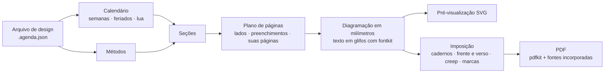

<div align="center">

# Heritage Studio

**Crie, visualize e imprima agendas artesanais: qualquer ano, idioma e país,
em cadernos dobrados e costurados à mão.**

[](README.md)
[](README.es.md)
[](README.pt.md)
[](README.it.md)


</div>

O Heritage Studio começou como uma única agenda artesanal para 2026. Hoje é um aplicativo
que monta o livro inteiro para qualquer ano: calendário, feriados, registros de hábitos e
páginas de planejamento baseadas na ciência do comportamento. Ele distribui as páginas em
folhas prontas para uma impressora frente e verso, para você dobrar, costurar e
encadernar.

Funciona inteiramente no navegador, inclusive sem conexão, no Linux, no Windows, no macOS
e no Android, e também como aplicativo para computador (Windows, macOS e Linux). Nada é
enviado para lugar nenhum.


## O que faz

### Veja tudo exatamente como vai sair impresso

- Quatro modos de visualização, atualizados enquanto você edita: **página**,
  **página dupla**, **folha impressa** (como sai da impressora, frente e verso) e o
  **livro inteiro**.
- A pré-visualização desenha os mesmos contornos de letras que vão para o PDF, por isso
  não depende das fontes instaladas no seu computador.
- A **verificação prévia** encontra textos que não cabem, textos sobrepostos, o que sai da
  página ou cai na margem que a impressora não imprime, caracteres que faltam numa fonte
  e imagens com pouca resolução.

### Edite com o mouse

- Arraste, mova aos poucos, mude a escala, gire, atenue ou oculte qualquer elemento.
  Aplique a mudança a todas as páginas desse tipo, espelhada nas páginas da esquerda, ou
  a uma só página. Ímã, guias de margem, desfazer e refazer.
- **Marcas d’água por pessoa**: o beija-flor ou seu próprio SVG ou PNG, ancorados à borda
  externa ou interna, com tamanho e opacidade.
- **Páginas personalizadas onde você quiser**: uma imagem, um SVG vetorial ou uma página
  de um PDF (que continua vetorial no PDF final), ou uma página de linhas, pontos ou
  quadriculado. O resto do livro se reorganiza sozinho.
- Adicione seus próprios textos, imagens, linhas e molduras a qualquer tipo de página.
- **Clique direito** (ou toque longo no celular) em qualquer elemento, página ou
  miniatura: trocar a imagem da marca d’água, ocultar algo numa página ou em todas as
  desse tipo, selecionar elementos semelhantes, adicionar textos ou imagens onde você
  clicou.
- **Vários elementos de uma vez** com Ctrl ou Shift, ou arrastando um retângulo a partir
  de um lugar vazio: movê-los juntos, alinhá-los, distribuí-los com espaços iguais ou
  organizá-los numa grade que encontra suas linhas e colunas.
- **Linhas, pontos ou quadriculado por tipo de página ou por página**: espaçamento das
  linhas, espaçamento horizontal e vertical dos pontos, tamanho do ponto e espessura.

### Qualquer ano, idioma e país

- Textos impressos em espanhol, inglês, português e italiano; a interface fala os mesmos
  quatro idiomas e segue o que se escolhe ao criar a agenda.
- O país define as convenções regionais (ordem das datas, moeda, dia em que começa a
  semana) com os dados do Unicode CLDR que vêm no navegador: o inglês na Argentina se
  escreve dia/mês. A ordem das datas e o começo da semana também podem ser escolhidos à
  mão; as datas são sempre salvas em ISO 8601.
- Feriados de **207 países** e suas regiões, de 2016 a 2061. Adicione dias de emenda,
  renomeie ou remova feriados.
- Aniversários e datas importantes, fases da lua, e os equinócios e solstícios calculados
  para o seu fuso horário e hemisfério.
- Numeração ISO das semanas, semanas que começam na segunda-feira, no domingo ou no
  sábado, de 1 a 24 meses, começando em qualquer mês.

### Pensada para o papel

- 5 temas (Heritage, Clara, Clássica, Mínima, Caderno) e 4 modelos.
- Mude fontes, tamanhos, espessura e espaçamento das linhas; escolha linhas, pontos ou
  quadriculado; ajuste o sombreado de fim de semana e um nível de conforto para a vista
  cansada. Tudo muda em tempo real.
- 5 famílias tipográficas de código aberto incluídas, incorporadas ao PDF como
  subconjuntos. Envie suas próprias fontes TTF, OTF, WOFF ou WOFF2: o aplicativo verifica
  se elas têm todos os caracteres de que o seu idioma precisa.

### Métodos baseados em evidências

- **30 métodos**: semana Alastair, planos se-então, WOOP, acompanhamento do progresso, um
  registro de hábitos que conta os dias feitos em vez de sequências, revisão semanal,
  três coisas boas, diário do sono, memória externa e mais.
- Cada método modifica as páginas em que atua e é explicado num **guia impresso**, com seu
  nível de evidência (sólida, moderada, limitada, prática sem estudos diretos ou
  controversa) e suas referências. Veja [o relatório de evidências](docs/evidencia-metodos.md)
  (em espanhol).
- Adicione seus próprios métodos pela interface, sem programar.

### Cadernos que saem do jeito certo

- **Cadernos costurados** com o número de folhas por caderno que você escolher (todos
  iguais, equilibrados ou uma lista sob medida), um único caderno, cortar e empilhar para
  espiral ou discos, ou uma página por folha.
- A4 → A5, Legal / Ofício → 177,8 × 215,9 mm (o maior tamanho que a HP LaserJet 4350
  imprime), Carta, Fólio, Ofício 340, A3, A5 ou personalizado.
- Frente e verso virando na borda curta ou longa, ou frente e verso manual; correção do
  verso; compensação de deslocamento (creep); marcas de dobra, de corte e de alceamento;
  número do caderno.
- Folha de calibração, gabarito de furação para as estações de costura e uma capa com a
  largura da lombada calculada pelo número de folhas.

### Para ler no tablet ou no leitor

- O **PDF das páginas** vem com links tocáveis, como uma agenda digital: cada dia dos
  calendários, do registro do mês e da visão mensal leva à sua semana (ou à página do
  dia), cada mês ao seu mês, os títulos sobem um nível (semana → mês → calendário anual →
  índice) e o índice leva às suas páginas. Num leitor que siga os links do PDF, como um
  Onyx Boox ou um tablet, basta tocar.
- **Marcadores do leitor**: o índice lateral do leitor traz as seções, cada mês e suas
  semanas.
- **Abas de todos os meses** na borda de cada página (opcional): cada uma leva ao seu mês.
- Os links saem do que está impresso, então acompanham qualquer mudança de ano, papel ou
  seções. O botão de links da barra de cima os mostra sobre a página e um clique os segue;
  o painel de cada elemento mostra para onde leva e permite tirar os links ou mandá-lo
  para outra página ou um endereço da web. O PDF para imprimir não os leva.

### Seus arquivos e modelos

- **Arquivo → Salvar** (Ctrl+S) grava um arquivo `.agenda.json` com as imagens e fontes
  dentro. No Chrome, no Edge e no aplicativo para computador, as próximas vezes regravam
  o mesmo arquivo.
- **Salvar como modelo** guarda o design completo para começar outras agendas: outro ano,
  outra pessoa ou outro idioma. Os modelos podem ser exportados e compartilhados como
  arquivos.
- **Backup de tudo** salva todas as agendas e modelos num só arquivo; ao abri-lo, eles são
  restaurados.
- As agendas também ficam no navegador, mas só nesse navegador e nesse endereço do
  aplicativo: os arquivos são a cópia segura.

### Feita para durar

- *Duplicar para 2028* leva um design para o ano seguinte, com as páginas e os ajustes no
  lugar.
- Os arquivos são validados ao abrir: cores, números e ajustes do tema são conferidos,
  então um arquivo danificado ou adulterado não quebra o aplicativo nem executa código.
- O mesmo motor roda no navegador, num processo em segundo plano e na linha de comando.

## Capturas de tela

| | |
| --- | --- |
|  |  |
| A folha impressa, com marcas de dobra e de caderno, ao lado dos ajustes de impressão. | Estilo: fontes, tamanhos, linhas e conforto atualizam as páginas em tempo real. |
|  |  |
| Os métodos e o guia que os explica, com evidências e referências. | O livro inteiro e os feriados do país escolhido. |

As capturas mostram a interface em inglês; para mudar o idioma, use o seletor no canto
superior direito.

<p align="center"></p>

Páginas reais do PDF: folha de rosto (espanhol), guia (inglês), capa do mês (português),
registro de hábitos (italiano) e senhas (espanhol).


Uma página dupla semanal da agenda 2027: os dias à esquerda e a grade de tarefas
Alastair à direita.


## Como funciona



1. **Uma agenda é um arquivo de design, não código.** É um JSON, validado ao abrir, com
   o ano, o idioma, o país, as seções e suas opções, o tema, a pessoa, as marcas d’água,
   suas páginas e imagens e seus ajustes. Os ajustes ficam salvos como deslocamentos
   associados a nomes estáveis como `week:2027-W12:left`, por isso sobrevivem a uma troca
   de ano ou de papel.
2. **O calendário** monta os meses e as semanas ISO com feriados, datas pessoais e fases
   da lua.
3. **As seções** (folha de rosto, página dupla semanal, registro de hábitos, senhas…)
   planejam suas páginas e as diagramam em milímetros com funções de diagramação. As
   páginas são medidas, não declaradas: a agenda acrescenta páginas de preenchimento para
   que as páginas duplas fiquem lado a lado, as capas do mês caiam numa página da direita
   e todo caderno fique completo.
4. **O texto** é convertido em glifos uma única vez com o fontkit. A pré-visualização
   desenha esses glifos e o PDF escreve os mesmos glifos com a fonte incorporada: a tela
   coincide com o papel.
5. **A imposição** distribui as páginas nas folhas. Num caderno de *n* folhas, a folha *i*
   recebe as páginas 4n−2i e 2i+1 na frente e 2i+2 e 4n−2i−1 no verso.
6. **O PDF** é escrito pelo pdfkit num processo em segundo plano, por isso o editor nunca
   trava. As páginas de PDF importadas são incorporadas como vetores com o pdf-lib.

## Como usar

Você precisa do [Node.js](https://nodejs.org/) 22.12 ou mais recente.

```bash
git clone https://github.com/jonidimo/agenda-heritage-generator.git
```

```bash
cd agenda-heritage-generator && npm ci
```

```bash
npm run dev
```

Abra <http://localhost:5173>. Na primeira vez são gerados os dados de feriados, o que leva
cerca de um minuto.

**Instalar como aplicativo.** No Chrome, Edge ou Chromium, num computador ou num celular
Android, escolha *Instalar* ou *Adicionar à tela inicial*. A partir daí, funciona sem
conexão.

**Aplicativo para computador.** Os instaladores para Windows, macOS e Linux são gerados no
GitHub. O [guia do aplicativo para computador](docs/desktop.md) (em inglês) explica como
baixá-los, instalá-los e gerá-los.

**Publicar sua própria cópia.** `npm run build` gera um site estático em `dist/`. O
projeto inclui um fluxo de trabalho do GitHub Pages que o publica: ative-o em
*Settings → Pages → Source: GitHub Actions*.

**Linha de comando.** Todas as exportações também podem ser feitas num terminal:

```bash
npm run agenda -- new --template heritage --year 2028 --locale pt-BR --country BR --out designs/minha-2028.agenda.json
```

```bash
npm run agenda -- info designs/minha-2028.agenda.json
```

```bash
npm run pdf -- designs/minha-2028.agenda.json --mode imposed --out output/minha-2028-imprimir.pdf
```

## Impressão e encadernação

Imprima uma vez a folha de calibração e depois o PDF frente e verso; dobre, fure, costure
e coloque a capa. O [guia de impressão e encadernação](docs/printing.md), em inglês,
explica cada passo, com os ajustes para Linux (CUPS), Windows e Android. Há também uma
[versão em espanhol](docs/impresion.md).

## Estrutura do projeto

| Pasta | Conteúdo |
| --- | --- |
| `src/core` | O motor, sem dependências do navegador: calendário, feriados, texto, diagramação, seções, imposição e renderizadores SVG e PDF. |
| `src/app` | O editor (React). |
| `src/workers` | A geração do PDF num processo em segundo plano. |
| `src/cli` | A linha de comando. |
| `electron` | O aplicativo para computador (Electron). |
| `designs` | Agendas de exemplo para 2027 em espanhol, inglês, português e italiano. |
| `tests`, `e2e` | Testes unitários (Vitest) e de navegador (Playwright). |
| `docs` | Guias e o relatório de evidências. |
| `legacy` | A versão 2026 em Python e seus PDFs, mantidos como referência de design. |

## Desenvolvimento

```bash
npm test
```

```bash
npm run test:e2e
```

```bash
npm run typecheck && npm run lint
```

Os testes diagramam cada modelo em vários idiomas, tamanhos de papel e níveis de conforto
e falham se algum texto não couber, se sobrepuser a outro ou sair da área imprimível. Para
adicionar um método ou uma seção, leia [Adding methods and sections](docs/adding-methods.md).

## Créditos

- Fontes sob a licença SIL Open Font License: Cormorant Garamond, Manrope, Atkinson
  Hyperlegible Next, EB Garamond e Caveat (licenças em `public/fonts`).
- Dados de feriados do [date-holidays](https://github.com/commenthol/date-holidays), de
  commenthol, baseados na Wikipédia, sob a licença
  [CC BY-SA 3.0](https://creativecommons.org/licenses/by-sa/3.0/). Confira os dias de
  emenda no calendário oficial do seu país.
- [Astronomy Engine](https://github.com/cosinekitty/astronomy) (MIT) para as fases da lua
  e as estações do ano.
- [PDFKit](https://pdfkit.org/) e [fontkit](https://github.com/foliojs/fontkit) (MIT),
  [pdf-lib](https://github.com/cantoo-scribe/pdf-lib) (MIT), [PDF.js](https://mozilla.github.io/pdf.js/)
  (Apache 2.0), React, Vite, Tailwind CSS, Zustand, Immer, Zod e Lucide.
