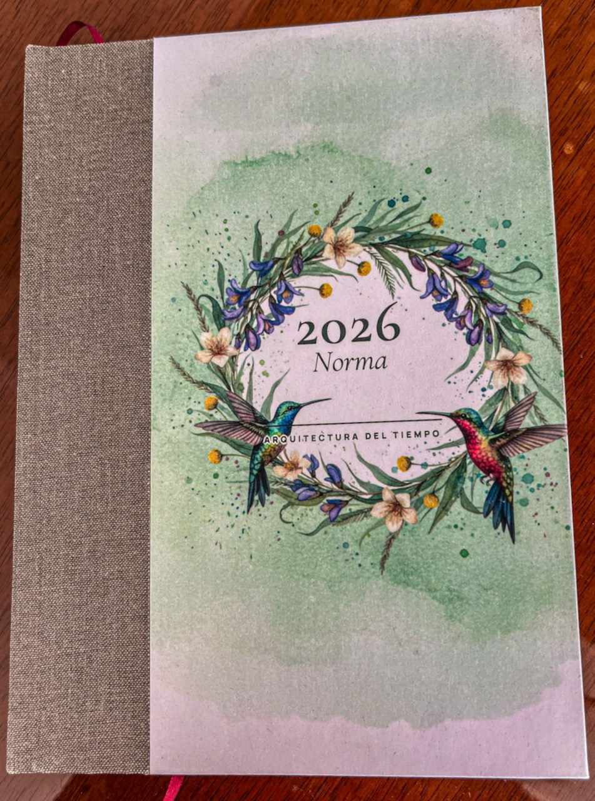
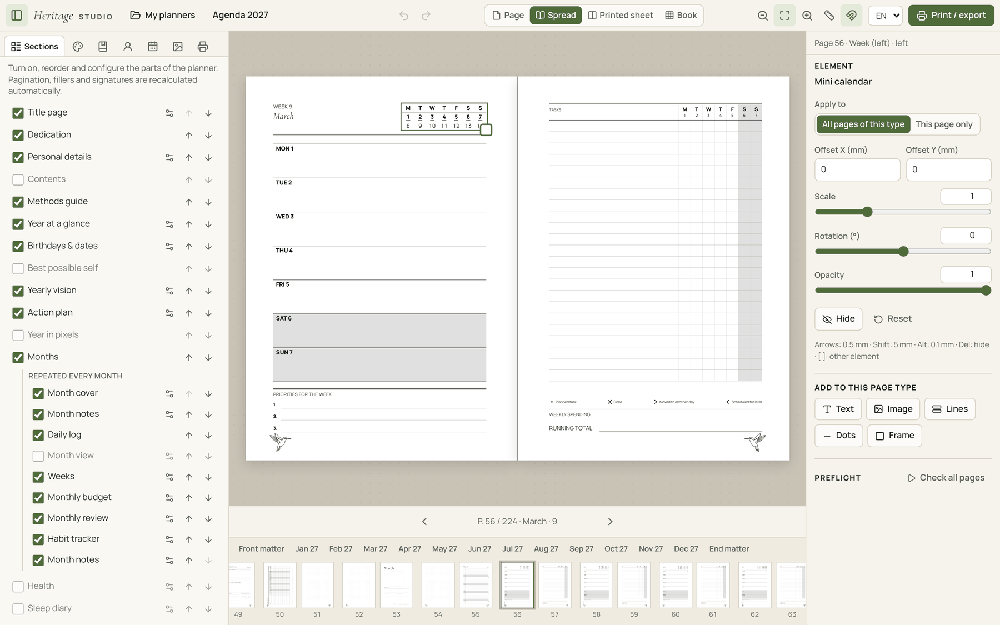
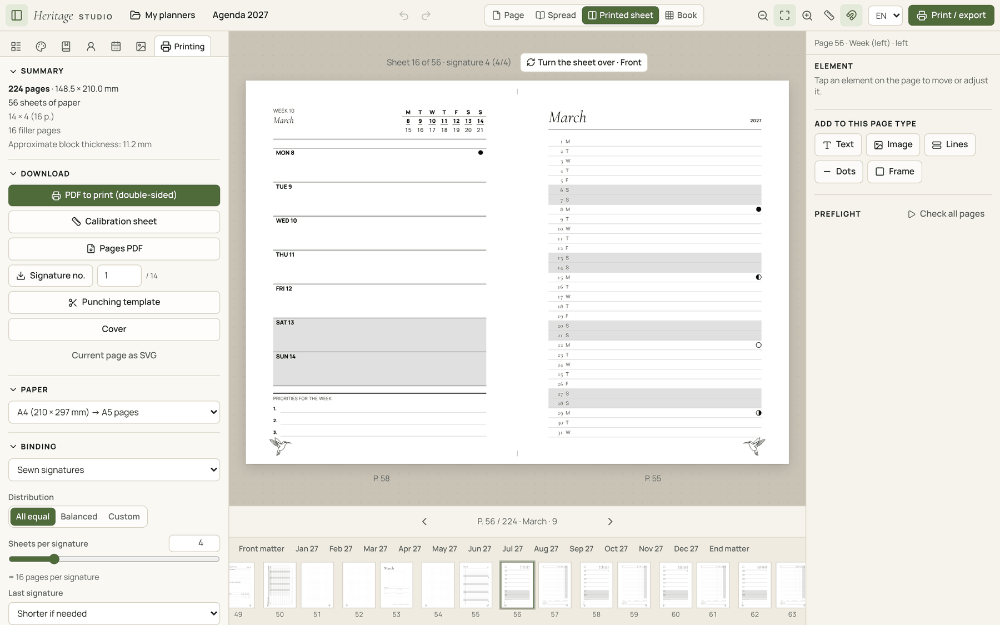
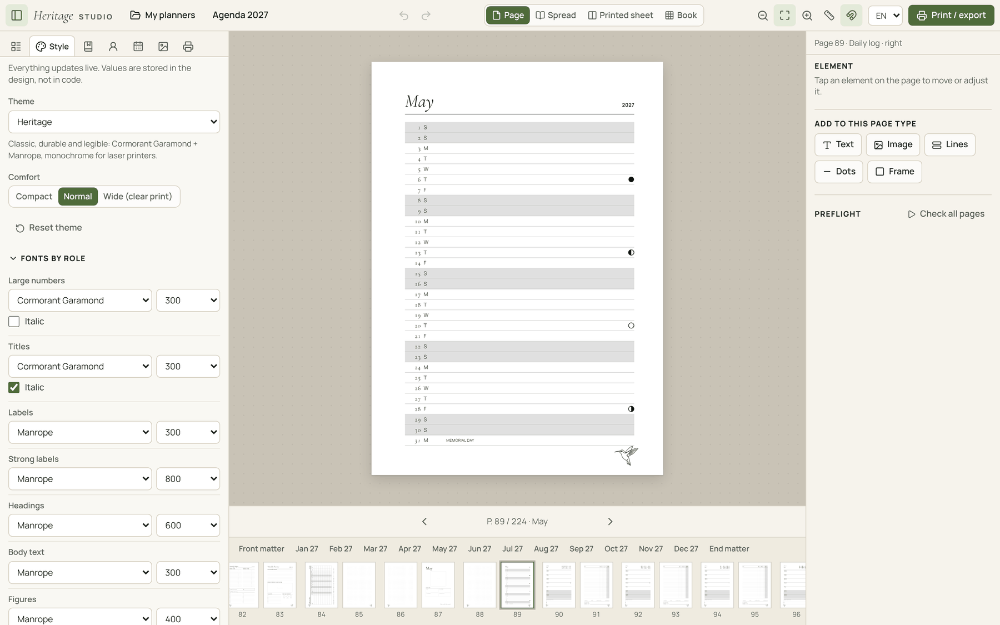
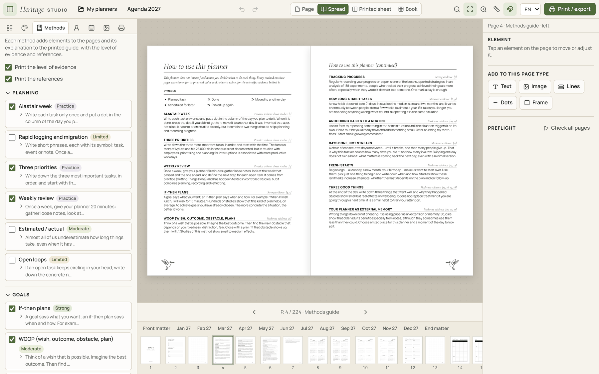
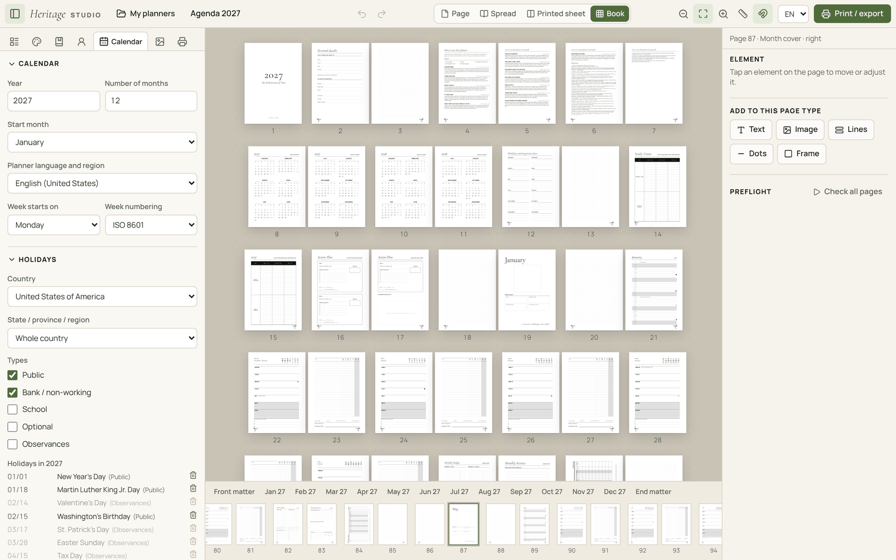
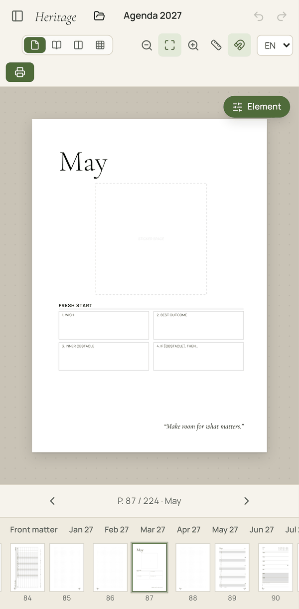
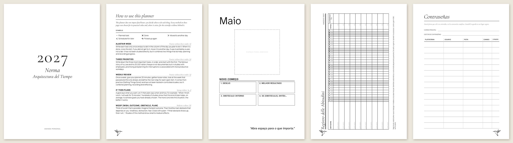
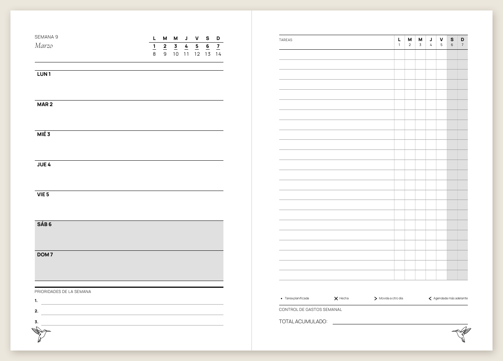
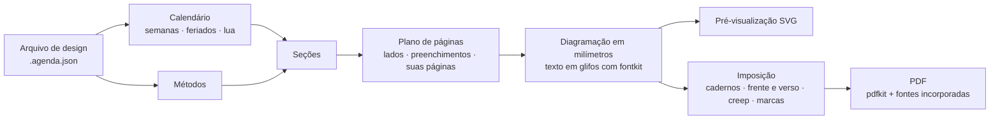

<div align="center">

# Heritage Studio

**Crie, visualize e imprima agendas artesanais: qualquer ano, idioma e país,
em cadernos dobrados e costurados à mão.**

[](README.md)
[](README.es.md)
[](README.pt.md)
[](README.it.md)
[](README.de.md)
[](README.fr.md)



</div>

**Experimente online:** [jonidimo.github.io/agenda-heritage-generator](https://jonidimo.github.io/agenda-heritage-generator/) (sempre a última versão, sem instalar nada).

O Heritage Studio começou como uma única agenda artesanal para 2026. Hoje é um aplicativo
que monta o livro inteiro para qualquer ano: calendário, feriados, registros de hábitos e
páginas de planejamento baseadas na ciência do comportamento. Ele distribui as páginas em
folhas prontas para uma impressora frente e verso, para você dobrar, costurar e
encadernar.

Funciona inteiramente no navegador, inclusive sem conexão, no Linux, no Windows, no macOS
e no Android, e também como aplicativo para computador (Windows, macOS e Linux). Nada é
enviado para lugar nenhum.



## Baixar

**[Baixe a versão mais recente](https://github.com/jonidimo/agenda-heritage-generator/releases/latest)** e escolha o arquivo do seu sistema em *Assets*:

| Sistema | Arquivo |
| --- | --- |
| Windows 10 e 11 | `…-win-x64-setup.exe` (instalador) ou `…-win-x64-portable.exe` (sem instalação) |
| macOS 13 ou posterior | `…-mac-arm64.dmg` (Apple silicon) ou `…-mac-x64.dmg` (Intel) |
| Linux | `…-linux-x86_64.AppImage` (qualquer distribuição) ou `…-linux-amd64.deb` (Debian, Ubuntu, Mint) |

Os instaladores não são assinados com um certificado pago, por isso o Windows e o macOS
mostram um aviso na primeira vez que você os abre. O
[guia do aplicativo para computador](docs/desktop.md) (em inglês) explica como abri-los, onde
ficam as suas agendas e como gerar o aplicativo. Para usar no navegador, veja
[Como usar](#como-usar).

## O que faz

### Veja tudo exatamente como vai sair impresso

- Quatro modos de visualização, atualizados enquanto você edita: **página**,
  **página dupla**, **folha impressa** (como sai da impressora, frente e verso) e o
  **livro inteiro**.
- A pré-visualização desenha os mesmos contornos de letras que vão para o PDF, por isso
  não depende das fontes instaladas no seu computador.
- A **verificação prévia** encontra textos que não cabem, textos sobrepostos, o que sai da
  página ou cai na margem que a impressora não imprime, caracteres que faltam numa fonte
  e imagens com pouca resolução.
- **Modos Design e Impressão**: *Design* é para a página, a dupla e o livro inteiro; *Impressão* soma a folha impressa e o painel de impressão, e desenha em cada página a área que a impressora não imprime e a margem de costura.
- **Destino**: uma agenda feita para **ler na tela** dispensa a margem de costura, os cortes, as marcas e as páginas de preenchimento dos cadernos; as páginas mantêm o tamanho e a exportação é página a página, com links. Você pode voltar a *Imprimir e encadernar* quando quiser.

### Edite com o mouse

- Arraste, mova aos poucos, mude a escala, gire, atenue ou oculte qualquer elemento.
  Aplique a mudança a todas as páginas desse tipo, espelhada nas páginas da esquerda, ou
  a uma só página. Ímã, guias de margem, desfazer e refazer.
- **Marcas d’água por pessoa**: o beija-flor, um ícone ou seu próprio SVG ou PNG, ancorados à
  borda externa ou interna, com tamanho e opacidade; em todas as páginas ou só nas da direita
  ou da esquerda, fundidas com o papel (*Multiplicar* faz sumir o fundo branco de um logo),
  em cinza ou tingidas, e com a posição e a imagem espelhadas separadamente nas páginas da esquerda.
- **Páginas personalizadas onde você quiser**: uma imagem, um SVG vetorial ou uma página
  de um PDF (que continua vetorial no PDF final), ou uma página de linhas, pontos ou
  quadriculado. O resto do livro se reorganiza sozinho.
- Adicione seus próprios textos, imagens, linhas e molduras a qualquer tipo de página.
- Redimensione seus elementos por qualquer borda ou canto; com Shift, as proporções se
  mantêm.
- **Os elementos próprios da agenda também** (o nome de um mês, uma moldura, uma tabela, uma
  área de escrita) mudam de tamanho por qualquer borda ou canto: o conteúdo é reorganizado
  dentro da caixa nova em vez de esticado, e o painel tem campos de largura e altura.
- **Clique duas vezes em qualquer texto** para editá-lo ali mesmo: os seus e os da agenda
  (nome e título da capa, dedicatória, a frase de cada mês, títulos de página). Enter ou
  Ctrl+Enter confirma, Esc descarta, e a página é redesenhada enquanto você escreve. Um
  texto próprio pode acompanhar as suas linhas (altura automática).
- **Estilo por elemento**: linhas tracejadas, pontilhadas ou duplas, cor e espessura de cada
  tipo de linha, preenchimento e cor do texto, para um elemento em todas as páginas do seu
  tipo ou só em uma.
- **Copiar, recortar, colar e duplicar** os seus elementos (Ctrl+C, X, V e D) dentro de uma
  página ou entre páginas.
- Arrastar um controle deslizante ou um seletor de cor é fluido: a página acompanha ao vivo,
  as miniaturas esperam e todo o arrasto é um único passo de desfazer.
- Um elemento de imagem aceita qualquer imagem: escolha uma da agenda ou envie um PNG, JPG
  ou SVG.
- Cada texto pode ter a sua própria fonte e a sua própria cor, ou seguir as do seu tipo de
  texto.
- **Zoom** da página com Ctrl e + / − / 0, ou com Ctrl e a roda do mouse (ou uma pinça no
  touchpad): o ponto sob o cursor fica parado. **Ajustes →
  Tamanho da interface** (um controle deslizante com o seu número) aumenta ou diminui toda a interface, e os painéis laterais e a faixa
  de miniaturas se redimensionam arrastando as bordas; o aplicativo lembra as duas coisas.
- **Clique direito** (ou toque longo no celular) em qualquer elemento, página ou
  miniatura: trocar a imagem da marca d’água, ocultar algo numa página ou em todas as
  desse tipo, selecionar elementos semelhantes, adicionar textos ou imagens onde você
  clicou.
- **Vários elementos de uma vez** com Ctrl ou Shift, ou arrastando um retângulo a partir
  de um lugar vazio: movê-los juntos, alinhá-los, distribuí-los com espaços iguais ou
  organizá-los numa grade que encontra suas linhas e colunas.
- **Linhas, pontos ou quadriculado por tipo de página ou por página**: espaçamento das
  linhas, espaçamento horizontal e vertical dos pontos, tamanho do ponto e espessura.
- **Escalar e deformar**: cada elemento tem oito alças que reorganizam o conteúdo na caixa nova; a escala é um controle à parte, e **Permitir deformar** estica o desenho em qualquer direção.
- **Copie os elementos do programa** (Ctrl+C sobre o nome de um mês, uma moldura, uma tabela…) e cole um elemento próprio editável: o texto continua sendo texto editável; o resto vira um desenho que mantém a espessura das linhas.
- **Mais dez tipos de elemento**: tabela, lista de tarefas, acompanhamento de hábitos, linhas de finanças, minicalendário (seus dias levam à página), quadrantes, notas, horário do dia, avaliação e **código QR** (qualquer endereço web, e-mail, telefone ou texto; tocável no PDF), cada um com seus campos.
- **Ícones e formas**: uma biblioteca de 96 ícones (Lucide), que se buscam em qualquer idioma e se tingem de qualquer cor, e quinze formas: retângulo, elipse, linha com setas ou pontos, seta, triângulo, losango, polígono (de 3 a 24 lados), estrela (de 3 a 24 pontas), coração, anel, arco ou setor, balão de fala, faixa, cruz e traçado livre SVG. O traço fica dentro da caixa e cada forma mostra só seus ajustes.
- **Uma imagem em cada capa de mês** no lugar do adesivo, para um mês ou para todos.
- **Camadas**: um painel lista os elementos da página de cima para baixo; subir, descer, enviar para o fundo, renomear, ocultar e mesclar com o que está embaixo (multiplicar, tela, escurecer, clarear). Ctrl+↑ e Ctrl+↓ movem o elemento escolhido.
- **Menu de camadas e bloqueio**: clique direito numa linha de Camadas para duplicar, bloquear ou desbloquear, renomear, trazer para a frente, enviar para o fundo ou apagar. Um elemento bloqueado é selecionado, mas não é arrastado, redimensionado, movido com as setas nem apagado (Ctrl+Shift+Alt+L). Abaixo da lista, a opacidade, a mesclagem e o bloqueio do escolhido.
- **Formas**: preenchimento como amostra de cor com um botão *Sem preenchimento*, opacidade de 5 a 100 %, e todo elemento próprio gira de 0 a 360°.
- **Recursos / Vetores**: qualquer imagem, SVG ou ícone se coloca na página com um clique, ou vira um **pincel de carimbo e traço**: um clique deixa uma cópia; arrastar deixa cópias ao longo do traço (tamanho, espaçamento, reto / segue o traço / aleatório, variação, cor). Cada traço é um elemento e um passo de Desfazer.
- **Tela cheia (F11)**: só a página, sem os painéis laterais, a faixa de miniaturas nem o rodapé; F11 ou Esc os devolvem como estavam.
- **Arrastar para rolar**: com o botão do meio do mouse, ou com a barra de espaço pressionada e o botão principal, a área de trabalho acompanha o ponteiro, sem procurar as barras de rolagem.
- **Menus organizados**: Arquivo (a agenda e seus arquivos, com *Minhas agendas*), Editar, Ver, Ajustes (idioma da interface, cada um no seu idioma; tamanho da interface; preferências; assistente de IA) e Ajuda (atalhos, guia para modelos de IA, avisar de um problema, Sobre). *Nova agenda* cabe em qualquer janela: duas colunas, e *Criar agenda* sempre à vista.
- **O que se oculta não se perde**: Editar → *Mostrar elementos ocultos* lista cada um e o traz de volta. **Aproximar da seleção** com Ctrl+Shift+2; o rodapé da página conta os avisos da página atual e as miniaturas mostram um ponto.
- **Atalhos de teclado** para tudo, listados no aplicativo (F1) e ao lado de cada item de menu.

### Seções e modelos de página

- **Começar do zero**: o modelo *Em branco* não tem nenhuma página e mostra o que fazer
  primeiro; o modelo *Caderno* é uma folha de rosto e todas as páginas pontilhadas, pautadas,
  quadriculadas ou lisas que você quiser, sem calendário. Adicione qualquer seção (e várias de
  notas), adicione páginas a cada mês ou remova uma seção pelo seu menu.

- Clique numa seção do painel **Seções** para ir até a página dela. Com o clique direito
  você a move, desativa ou muda a frequência com que se repete.
- Qualquer seção pode aparecer uma vez ou **se repetir todo mês, toda semana ou todo dia**.
- **Modelos de página**: você desenha uma página uma vez (fundo de linhas, pontos ou
  quadriculado, textos, imagens, molduras) e a repete onde quiser. Textos como `{date}`,
  `{weekday}` ou `{month}` mudam em cada cópia.
- **Clique direito num mês** da tira de páginas para ir à capa, ao registro ou à primeira semana, repetir uma página em cada mês, ocultar o mês, exportar só esse mês em PDF ou ver só esse mês na tira. Os meses ocultos saem do livro; o calendário anual os mantém, sem links. Um marcador **Ano** salta para a visão anual e a tira rola com a roda do mouse.

### Encontre qualquer coisa

- A **barra superior** tem três zonas (arquivo e histórico, modo e vista, busca e zoom) e,
  em janelas estreitas, guarda o que não cabe num menu «⋯».
- **Busca** (Ctrl+K, `/` ou o campo de busca da barra): encontra ajustes, seções, páginas e elementos mesmo
  com erros de digitação, sem acentos ou com outras maiúsculas, e leva você até lá com um
  destaque.
- Botões **Voltar e Avançar** na barra superior percorrem as páginas que você visitou,
  como no navegador.

### Qualquer ano, idioma e país

- Textos impressos em espanhol, inglês, português, italiano, alemão e francês; a interface
  fala os mesmos seis idiomas e segue o que se escolhe ao criar a agenda.
- O país define as convenções regionais (ordem das datas, moeda, dia em que começa a
  semana) com os dados do Unicode CLDR que vêm no navegador: o inglês na Argentina se
  escreve dia/mês. A ordem das datas e o começo da semana também podem ser escolhidos à
  mão; as datas são sempre salvas em ISO 8601.
- Feriados de **207 países** e suas regiões, de 2016 a 2061. Adicione dias de emenda,
  remova feriados ou dê a um deles outro nome com o lápis de *Calendário → Feriados* (por
  exemplo, um mais curto para um nome que não cabe na sua casa).
- Aniversários e datas importantes, fases da lua, e os equinócios e solstícios calculados
  para o seu fuso horário e hemisfério.
- Numeração ISO das semanas, semanas que começam na segunda-feira, no domingo ou no
  sábado, de 1 a 24 meses, começando em qualquer mês.

### Pensada para o papel

- 6 temas (Heritage, Clara, Clássica, Mínima, Caderno, Filigrana) e 4 modelos. Um tema
  define tudo de uma vez: a fonte e a cor de cada tipo de texto e o estilo das linhas de
  escrita, dos separadores, das tabelas e das molduras.
- **Linhas e arabescos**: linhas lisas, tracejadas, pontilhadas ou duplas, ornamentos
  repetidos ao longo de uma linha ou no seu centro, e cantos para as molduras. Há dez
  ornamentos incluídos, e você pode importar os seus em SVG ou PNG.
- **Uma paleta a partir de uma cor**: escolha uma cor e uma harmonia (monocromática,
  análoga, complementar, complementar dividida ou triádica). O aplicativo deriva todas as
  cores no espaço de cor OKLCH e mantém o texto escuro o bastante para ler no papel.
- **Temas próprios**: salve o estilo inteiro com um nome, use-o em outras agendas e
  compartilhe-o como arquivo `.tema.json`, com os ornamentos dentro.
- Mude fontes, tamanhos, espessura e espaçamento das linhas; escolha linhas, pontos ou
  quadriculado; ajuste o sombreado de fim de semana e um nível de conforto para a vista
  cansada. Tudo muda em tempo real.
- 5 famílias tipográficas de código aberto incluídas, incorporadas ao PDF como
  subconjuntos. Envie suas próprias fontes TTF, OTF, WOFF ou WOFF2: o aplicativo verifica
  se elas têm todos os caracteres de que o seu idioma precisa. Se faltar um caractere a uma
  delas (uma fonte de camisa sem vírgula nem parênteses), esse caractere sai de uma fonte de
  reserva, na tela e no PDF, como num navegador; Estilo avisa se faltar a pontuação e para
  que ela serve melhor.

### Métodos baseados em evidências

- **30 métodos**: semana Alastair, planos se-então, WOOP, acompanhamento do progresso, um
  registro de hábitos que conta os dias feitos em vez de sequências, revisão semanal,
  três coisas boas, diário do sono, memória externa e mais.
- Cada método modifica as páginas em que atua e é explicado num **guia impresso**, com seu
  nível de evidência (sólida, moderada, limitada, prática sem estudos diretos ou
  controversa) e suas referências. Veja [o relatório de evidências](docs/evidencia-metodos.md)
  (em espanhol).
- Adicione seus próprios métodos pela interface, sem programar.

### Cadernos que saem do jeito certo

- **Cadernos costurados** com o número de folhas por caderno que você escolher (todos
  iguais, equilibrados ou uma lista sob medida), um único caderno, cortar e empilhar para
  espiral ou discos, ou uma página por folha.
- A4 → A5, Legal / Ofício → 177,8 × 215,9 mm (o maior tamanho que a HP LaserJet 4350
  imprime), Carta, Fólio, Ofício 340, A3, A5 ou personalizado.
- Frente e verso virando na borda curta ou longa, ou frente e verso manual; correção do
  verso; compensação de deslocamento (creep); marcas de dobra, de corte e de alceamento;
  número do caderno.
- Folha de calibração, gabarito de furação para as estações de costura e uma capa com a
  largura da lombada calculada pelo número de folhas.

### Para ler no tablet ou no leitor

- O **PDF das páginas** vem com links tocáveis, como uma agenda digital: cada dia dos
  calendários, do registro do mês e da visão mensal leva à sua semana (ou à página do
  dia), cada mês ao seu mês, os títulos sobem um nível (semana → mês → calendário anual →
  índice) e o índice leva às suas páginas. Num leitor que siga os links do PDF, como um
  Onyx Boox ou um tablet, basta tocar.
- **Marcadores do leitor**: o índice lateral do leitor traz as seções, cada mês e suas
  semanas.
- **Abas de todos os meses** na borda de cada página (opcional): cada uma leva ao seu mês.
- Os links saem do que está impresso, então acompanham qualquer mudança de ano, papel ou
  seções. O botão de links da barra de cima os mostra sobre a página e um clique os segue;
  o painel de cada elemento mostra para onde leva e permite tirar os links ou mandá-lo
  para outra página ou um endereço da web. O PDF para imprimir não os leva.
- Cada zona tocável pode ser mudada separadamente: clique num número de dia ou no nome de um
  mês na página, ou use o botão direito, para mandar só esse para outro lugar ou removê-lo.

### Seus arquivos e modelos

- **Arquivo → Salvar** (Ctrl+S) grava um arquivo `.agenda.json` com as imagens e fontes
  dentro. No Chrome, no Edge e no aplicativo para computador, as próximas vezes regravam
  o mesmo arquivo.
- **Salvar como modelo** guarda o design completo para começar outras agendas: outro ano,
  outra pessoa ou outro idioma. Os modelos podem ser exportados e compartilhados como
  arquivos.
- **Backup de tudo** salva todas as agendas e modelos, e as fontes enviadas, num só arquivo; ao
  abri-lo, eles são restaurados. Uma fonte de um arquivo aberto não substitui a que este
  dispositivo já tem com o mesmo nome: fica a daqui, com um aviso.
- As agendas também ficam no navegador, mas só nesse navegador e nesse endereço do
  aplicativo: os arquivos são a cópia segura.
- Os painéis **Imagens** e **Fontes** dizem onde cada imagem é usada (marca d’água, capa, elementos, páginas, ornamentos) e a removem junto com tudo o que a usava; as fontes mostram que caracteres faltam e onde cada família é usada, e as suas podem ser removidas.
- **Imagens ao lado do arquivo**: uma agenda pode apontar para suas imagens por caminho
  (`"path": "imagens/logo.png"`) em vez de levá-las dentro; a linha de comando, o servidor MCP
  e o aplicativo de desktop (quando o sistema abre o arquivo, ou com *Arquivo → Abrir arquivo…*) as
  leem só dessa pasta. No aplicativo web, o aviso oferece **Procurar a pasta das imagens…**: você
  escolhe a pasta e as imagens ficam incorporadas à agenda (e o caminho é descartado). Como com qualquer
  arquivo que o sistema abre no aplicativo de desktop, o primeiro *Salvar* de uma sessão pergunta onde.
- **PDFs leves**: *Impressão → Imagens no PDF* (300 ppp para imprimir, 150 para tela, ou originais)
  reduz apenas as imagens que têm mais resolução do que o tamanho impresso precisa, sem perda de
  qualidade visível, e uma imagem usada em todas as páginas (uma marca d’água) é guardada uma só vez no
  PDF. O painel *Imagens* mostra o peso de cada uma e seus ppp no tamanho em que é realmente impressa;
  acima de 600 ppp avisa (`overDpi`). Ao enviar imagens vale o mesmo: fotos WebP/HEIC/AVIF viram JPEG
  (não PNG), o que passa de 4000 px de lado é reduzido e o mesmo arquivo nunca é guardado duas vezes.
- Aplicativo de desktop: ao exportar um PDF mostra **onde foi salvo**, com *Abrir pasta*; as agendas abrem com duplo clique num `.agenda.json` ou soltando-as na janela, e fechar nunca perde a última alteração.
- **O tamanho da folha desde o início**: a tela de agenda nova mostra o papel (ou a tela do tablet), a encadernação e o tamanho que fica cada página. *Arquivo/Edição → Tamanho da folha…* muda depois e pode levar seus elementos à página nova num só passo de Desfazer.

### Um assistente de IA dentro do aplicativo

- Um botão redondo no canto inferior direito (**Ctrl+J**): peça uma mudança com suas palavras
  («aumente as notas desta página», «um registro de hábitos todo mês»). O assistente lê a
  agenda, propõe **uma** mudança e você a vê na página antes de **Aplicar** ou **Descartar**;
  uma mudança aplicada é um único passo de desfazer. Nada fica guardado ao fechar.
- Funciona com **Anthropic (Claude), Google Gemini, OpenAI e serviços compatíveis**
  (OpenRouter, Groq, Mistral) e **modelos locais** (Ollama, LM Studio), com sua própria chave.
  Se quiser, também pode olhar as páginas (visão).
- Sua chave nunca é guardada em texto puro: no aplicativo de desktop o sistema operacional a
  criptografa (Chaves, DPAPI, libsecret) e os pedidos saem pelo aplicativo; na web ela fica em
  memória, ou criptografada no navegador se você escolher lembrá-la. Os ajustes estão em
  *Ajustes → Assistente de IA…* ou na engrenagem da pílula.
- **Versão 2.4.1**: o assistente fica como um botão redondo no canto inferior direito. Com um servidor local a lista de modelos é buscada sozinha (uma lista para escolher, não um campo que filtra), e um endereço sem `/v1` é oferecido corrigido. Pedir outra coisa com uma proposta à vista a **ajusta** (a próxima proposta se soma e Aplicar confirma tudo num passo), e o cartão mostra cada mudança com o valor anterior e o novo.
- **Versão 2.5.0**: o modelo tem 10 passos por pedido e, antes do último, pede-se que proponha com o que já sabe; sabe que mudar o idioma da agenda traduz tudo numa só operação. O endereço `http://0.0.0.0:8080` que o llama.cpp mostra funciona como está. Se uma parte do programa não carregar (porque foi atualizado com a janela aberta), o cartão explica e oferece recarregar a janela sem perder o que você fez.

### Crie com um modelo de inteligência artificial

- Um **servidor MCP** permite que o Claude, ou qualquer modelo compatível com MCP, crie
  uma agenda, a altere, a revise, veja as páginas e exporte o PDF ou um tema. O aplicativo de
  desktop o inclui: inicie-o com `--mcp` ([como](docs/desktop.md#6-use-it-with-an-ai-model-from-outside-mcp), em inglês). Peça "uma
  agenda de professor de março a dezembro" ou "um tema com arabescos art nouveau".
- O formato do arquivo tem um **esquema JSON** e um catálogo gerados a partir do código,
  e `npm run agenda -- check` diz exatamente o que seria ignorado ou corrigido. Leia o
  [guia](docs/llm-templates.md) (em inglês; [en español](docs/plantillas-llm.md)).
- Cada mudança do modelo volta com os avisos de layout que ela produziu (textos que não
  cabem, elementos fora da página ou sobrepostos), e ele pode corrigi-los sem ninguém olhar.
- Os modelos podem usar `icon:<nome>` para qualquer ícone sem declará-lo, desenhar com formas
  e deixar as imagens ao lado do arquivo por caminho. Em todas as ferramentas, `path` é sempre
  o arquivo que se lê e `out` o que se escreve.
- **Fontes próprias e guia para modelos (2.5.0)**: as fontes próprias viajam dentro do arquivo (`userFonts`) e o servidor as usa para desenhar; `add_font` incorpora uma e diz que pontuação lhe falta. `get_guide` dá o guia por seções aos clientes que não leem recursos, há receitas (`nueva-agenda`, `revisar-avisos`, `traducir`), e cada aviso de `check_design` diz como corrigi-lo.
- **Imagens e fontes da internet (2.5.1)**: o servidor MCP procura imagens (`search_images`, com miniaturas para escolher; Openverse e Wikimedia Commons sem chave; Pexels, Pixabay, Unsplash e DeviantArt com uma) e importa-as (`import_image`: limpa-as, recorta-as para uma página ou para a capa inteira com sangria e lombada, reduz-as a ~300 dpi, guarda autor, licença e endereço, não importa a mesma duas vezes e não altera nada sem `confirm: true`); `build_credits_page` monta a página de créditos; `search_fonts` e `import_font` trazem fontes do Google Fonts, verificando ñ, acentos, ¿ e ¡ e incorporando a fonte inteira para poder editar o texto à vontade. Só visita os domínios dessas APIs (nunca endereços locais ou privados), com tempo e tamanho máximos por descarga; as chaves vão em variáveis de ambiente (`PIXABAY_API_KEY`, `UNSPLASH_ACCESS_KEY`, `GOOGLE_FONTS_API_KEY`) e nunca são guardadas na agenda.
- **Imagens próprias, links e rede local (2.5.1)**: `import_image` também aceita um arquivo da pasta de trabalho (`image`, p. ex. arte feita com IA) ou um link direto (`url`), e `browse_page` lista as imagens e os links de uma página web para que um modelo escolha. Só se abrem páginas e links de domínios que **você declara** em `AGENDA_TRUSTED_HOSTS` (podem ser da sua rede local, por `http`); o resto continua fechado. **Aviso de responsabilidade:** declarar um domínio é decisão sua: o programa não verifica o que há ali nem de quem são as imagens (os direitos autorais do que importar e o uso da sua rede são seus) e é oferecido sem garantias. Nada é adicionado sem a sua aprovação (`confirm`).
- **O assistente (a estrela) na internet e nas suas pastas (2.6.0, app de desktop)**: o assistente do app agora busca imagens e fontes na internet (`search_images`, `browse_page`, `search_fonts`), lê imagens das suas pastas (`list_local_images`; cada agenda tem sua própria pasta, criada sozinha dentro de `Documentos/Heritage Studio`, a menos que você escolha outra em **Ajustes → Internet e pastas**) e as importa (`import_image`, `import_font`) com autor e licença; colocá-las numa página é uma proposta que você aprova, como qualquer outra mudança. **Ajustes → Internet e pastas** reúne as chaves das APIs (cifradas pelo sistema, nunca mostradas de novo) com um botão **Testar** por serviço, seus sites de confiança, a pasta base e as pastas extras que o assistente pode ler. Se você mover ou renomear a pasta de uma agenda dentro da pasta base, o app a encontra de novo; o grupo **Pastas** do painel de imagens mostra uma prévia e adiciona com um clique. Para um cliente externo, `list_images` e `AGENDA_MCP_READ_DIRS` dão ao servidor MCP leitura das pastas que você indicar (só imagens).
- **Link ao vivo (aplicativo de desktop)**: com o aplicativo aberto, o mesmo servidor trabalha na **agenda que você tem aberta**. O modelo a lê, a altera num único passo que você pode desfazer (recusado se você a editou nesse meio-tempo), mostra uma página ou abre outra agenda. Desative em *Ajustes → Permitir que um modelo de IA edite a agenda aberta*. Nada escuta na rede: é um socket local protegido por um token gerado a cada início.

### Feita para durar

- *Duplicar para 2028* leva um design para o ano seguinte, com as páginas e os ajustes no
  lugar.
- Os arquivos são validados ao abrir: cores, números e ajustes do tema são conferidos,
  então um arquivo danificado ou adulterado não quebra o aplicativo nem executa código.
- O mesmo motor roda no navegador, num processo em segundo plano e na linha de comando.

## Capturas de tela

| | |
| --- | --- |
|  |  |
| A folha impressa, com marcas de dobra e de caderno, ao lado dos ajustes de impressão. | Estilo: fontes, tamanhos, linhas e conforto atualizam as páginas em tempo real. |
|  |  |
| Os métodos e o guia que os explica, com evidências e referências. | O livro inteiro e os feriados do país escolhido. |

As capturas mostram a interface em inglês; para mudar o idioma, use o menu
**Arquivo**.

<p align="center"></p>

Páginas reais do PDF: folha de rosto (espanhol), guia (inglês), capa do mês (português),
registro de hábitos (italiano) e senhas (espanhol).



Uma página dupla semanal da agenda 2027: os dias à esquerda e a grade de tarefas
Alastair à direita.



## Como funciona



1. **Uma agenda é um arquivo de design, não código.** É um JSON, validado ao abrir, com
   o ano, o idioma, o país, as seções e suas opções, o tema, a pessoa, as marcas d’água,
   suas páginas e imagens e seus ajustes. Os ajustes ficam salvos como deslocamentos
   associados a nomes estáveis como `week:2027-W12:left`, por isso sobrevivem a uma troca
   de ano ou de papel.
2. **O calendário** monta os meses e as semanas ISO com feriados, datas pessoais e fases
   da lua.
3. **As seções** (folha de rosto, página dupla semanal, registro de hábitos, senhas…)
   planejam suas páginas e as diagramam em milímetros com funções de diagramação. As
   páginas são medidas, não declaradas: a agenda acrescenta páginas de preenchimento para
   que as páginas duplas fiquem lado a lado, as capas do mês caiam numa página da direita
   e todo caderno fique completo.
4. **O texto** é convertido em glifos uma única vez com o fontkit. A pré-visualização
   desenha esses glifos e o PDF escreve os mesmos glifos com a fonte incorporada: a tela
   coincide com o papel.
5. **A imposição** distribui as páginas nas folhas. Num caderno de *n* folhas, a folha *i*
   recebe as páginas 4n−2i e 2i+1 na frente e 2i+2 e 4n−2i−1 no verso.
6. **O PDF** é escrito pelo pdfkit num processo em segundo plano, por isso o editor nunca
   trava. As páginas de PDF importadas são incorporadas como vetores com o pdf-lib.

## Como usar

Você precisa do [Node.js](https://nodejs.org/) 22.12 ou mais recente.

```bash
git clone https://github.com/jonidimo/agenda-heritage-generator.git
```

```bash
cd agenda-heritage-generator && npm ci
```

```bash
npm run dev
```

Abra <http://localhost:5173>. Na primeira vez são gerados os dados de feriados, o que leva
cerca de um minuto.

**Instalar como aplicativo.** No Chrome, Edge ou Chromium, num computador ou num celular
Android, escolha *Instalar* ou *Adicionar à tela inicial*. A partir daí, funciona sem
conexão.

**Aplicativo para computador.** Veja [Baixar](#baixar). O
[guia do aplicativo para computador](docs/desktop.md) (em inglês) explica como instalá-lo e
como gerar os instaladores.

**Publicar sua própria cópia.** `npm run build` gera um site estático em `dist/`. O
projeto inclui um fluxo de trabalho do GitHub Pages que o publica: ative-o em
*Settings → Pages → Source: GitHub Actions*.

**Linha de comando.** Todas as exportações também podem ser feitas num terminal:

```bash
npm run agenda -- new --template heritage --year 2028 --locale pt-BR --country BR --out designs/minha-2028.agenda.json
```

```bash
npm run agenda -- info designs/minha-2028.agenda.json
```

```bash
npm run agenda -- check designs/minha-2028.agenda.json
```

```bash
npm run pdf -- designs/minha-2028.agenda.json --kind imposed --out output/minha-2028-imprimir.pdf
```

`check` lista o que seria ignorado ou corrigido num arquivo e os avisos da agenda montada.
`npm run -s agenda -- schema` e `npm run -s agenda -- catalog` mostram o formato do arquivo e tudo
o que ele pode nomear. `npm run -s mcp` inicia o servidor MCP para modelos de inteligência
artificial (veja [o guia](docs/llm-templates.md)).

## Impressão e encadernação

Imprima uma vez a folha de calibração e depois o PDF frente e verso; dobre, fure, costure
e coloque a capa. O [guia de impressão e encadernação](docs/printing.md), em inglês,
explica cada passo, com os ajustes para Linux (CUPS), Windows e Android. Há também uma
[versão em espanhol](docs/impresion.md).

## Estrutura do projeto

| Pasta | Conteúdo |
| --- | --- |
| `src/core` | O motor, sem dependências do navegador: calendário, feriados, texto, diagramação, seções, imposição e renderizadores SVG e PDF. |
| `src/app` | O editor (React). |
| `src/workers` | A geração do PDF num processo em segundo plano. |
| `src/cli` | A linha de comando. |
| `src/node` | Compartilhado pela linha de comando, pelo servidor MCP e pelos testes: lê fontes, feriados e imagens do disco e revisa arquivos de agenda. |
| `src/mcp` | O servidor MCP para modelos de inteligência artificial. |
| `electron` | O aplicativo para computador (Electron). |
| `designs` | Agendas de exemplo para 2027 em espanhol, inglês, português e italiano. |
| `tests`, `e2e` | Testes unitários (Vitest) e de navegador (Playwright). |
| `docs` | Guias e o relatório de evidências. |
| `legacy` | A versão 2026 em Python e seus PDFs, mantidos como referência de design. |

## Desenvolvimento

```bash
npm test
```

```bash
npm run test:e2e
```

```bash
npm run typecheck && npm run lint
```

Os testes diagramam cada modelo em vários idiomas, tamanhos de papel e níveis de conforto
e falham se algum texto não couber, se sobrepuser a outro ou sair da área imprimível. Para
adicionar um método ou uma seção, leia [Adding methods and sections](docs/adding-methods.md).

## Créditos

- Feito por **Jonatan Damián Dimotta Bré** ([Instagram](https://www.instagram.com/dimottajonatan/),
  [código-fonte](https://github.com/jonidimo/agenda-heritage-generator),
  [online](https://jonidimo.github.io/agenda-heritage-generator/)). O guia de cada agenda
  termina com estes créditos e um código QR para o código-fonte; podem ser desligados em *Métodos*.
- Ícones do [Lucide](https://lucide.dev) (licença ISC).

- Fontes sob a licença SIL Open Font License: Cormorant Garamond, Manrope, Atkinson
  Hyperlegible Next, EB Garamond e Caveat (licenças em `public/fonts`).
- Dados de feriados do [date-holidays](https://github.com/commenthol/date-holidays), de
  commenthol, baseados na Wikipédia, sob a licença
  [CC BY-SA 3.0](https://creativecommons.org/licenses/by-sa/3.0/). Confira os dias de
  emenda no calendário oficial do seu país.
- [Astronomy Engine](https://github.com/cosinekitty/astronomy) (MIT) para as fases da lua
  e as estações do ano.
- [PDFKit](https://pdfkit.org/) e [fontkit](https://github.com/foliojs/fontkit) (MIT),
  [pdf-lib](https://github.com/cantoo-scribe/pdf-lib) (MIT), [PDF.js](https://mozilla.github.io/pdf.js/)
  (Apache 2.0), React, Vite, Tailwind CSS, Zustand, Immer, Zod e Lucide.
